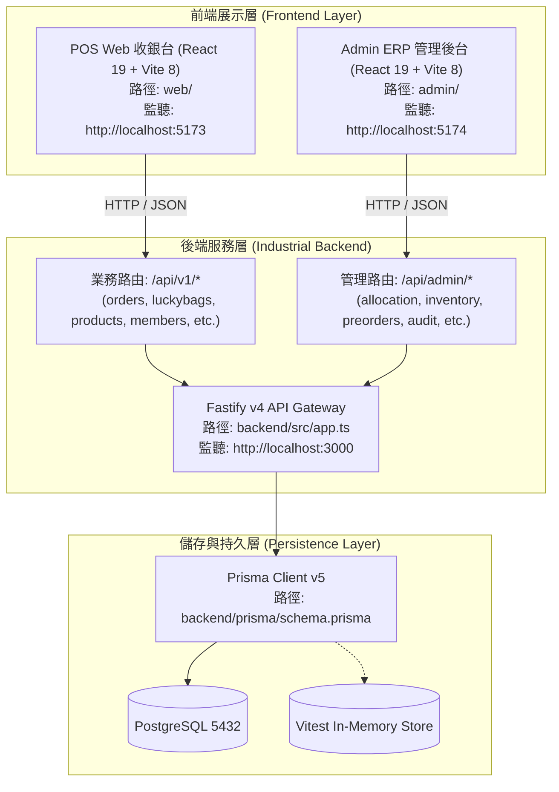
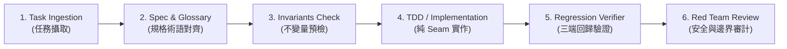

# OneSoul Developer Agent Operations & Engineering Playbook (AGENTS.md)

> **版本**：v1.0.0-argon  
> **標準依循**：Matt Cook (AI Hero) Engineering Methodology (`writing-for-agents`, `deep-modules`, `clean-seams`)  
> **單一真實來源指針 (SSOT)**：
> - 系統規格書：[`docs/SYSTEM_SPECIFICATION.md`](./docs/SYSTEM_SPECIFICATION.md)
> - 領域名詞術語庫：[`GLOSSARY.md`](./GLOSSARY.md)
> - 資料庫實體模型：[`backend/prisma/schema.prisma`](./backend/prisma/schema.prisma)
> - 收銀核心純函數 Seam：[`web/src/logic/checkout.ts`](./web/src/logic/checkout.ts)
> - 後端結帳核心交易 Seam：[`backend/src/modules/orders/routes.ts`](./backend/src/modules/orders/routes.ts)
> - 配賞看板計算 Seam：[`backend/src/modules/admin/allocation.routes.ts`](./backend/src/modules/admin/allocation.routes.ts)

---

## 0. Quick Command Cheatsheet (Agent 高頻命令速查)

任何 Agent 接手本專案，**嚴禁盲目嘗試指令**，一律使用下列標準指令：

### 0.1 驗證與測試 (Regression & Verifier)
```bash
# 後端全單元與整合測試 (12 test suites, 125 tests)
npm --prefix backend run test

# POS 前端收銀單元測試 (13 test suites, 249 tests)
npm --prefix web run test

# 雙前端 TypeScript 編譯與生產建置 (必須 0 錯誤通過)
npm --prefix admin run build && npm --prefix web run build
```

### 0.2 本地服務啟動 (Local Development)
```bash
# 後端 Fastify 伺服器 (Port 3000 / tsx watch)
npm --prefix backend run dev

# POS Web 收銀台 (Port 5173 / Vite)
npm --prefix web run dev

# Admin ERP 旗艦管理後台 (Port 5174 / Vite)
npm --prefix admin run dev
```

### 0.3 資料庫與遷移 (Prisma & Migration)
```bash
# 生成 Prisma Client
npm --prefix backend run prisma:generate

# 執行資料庫遷移
npm --prefix backend run prisma:migrate

# 歷史試算表全量清洗與遷移 (預演 dryRun 模式)
npm --prefix backend run migrate:sheets
```

---

## 1. System Architecture & Topology (系統架構拓撲)

本專案為實體玩具模型專賣店之一番賞開套配賞、收銀結帳、庫存調撥、會員點數錢包與門市即時營運系統，架構劃分為三大獨立模組：



---

## 2. Standard 6-Phase Agent Workflow (標準 Agent Flow 六部曲)

所有自主開發 Agent 必須遵循以下六個標準階段，嚴禁跳步：



### Phase 1: Task Ingestion (任務攝取與影響範圍圈定)
- **Goal**: 確定變更涉及之端點與模組（`web`、`admin` 或 `backend`）。
- **Action**: 查詢本文第 3 節的「Agent 任務決策矩陣」，圈定受影響之檔案清單。
- **Rule**: 若需新增功能，優先思考是否能在既有 Clean Seams 內擴充，避免過早新增獨立檔案。

### Phase 2: Spec & Glossary Mapping (規格與術語對齊)
- **Goal**: 確保所有變更符合統一詞彙庫與規格定義。
- **Action**:
  1. 查閱 [`GLOSSARY.md`](./GLOSSARY.md)，杜絕禁用名詞（如禁止將 `LuckyBag` 寫成「抽獎盒」、禁止將 `Prize` 寫成「獎品條目」、禁止將 `StoreInventory` 寫成「庫存量」）。
  2. 查閱 [`docs/SYSTEM_SPECIFICATION.md`](./docs/SYSTEM_SPECIFICATION.md)，確認對應的 User Story ID 與驗收指標。

### Phase 3: Invariants Check (業務關鍵不變量預檢)
- **Goal**: 評估本次改動是否可能衝擊三大業務不變量。
- **Action**: 對照本文第 4 節「三大不可破壞之業務不變量」，若涉及扣點、開套、庫存扣減，必須設計防呆與鎖定機制。

### Phase 4: TDD / Implementation (測試先行與純 Seam 實作)
- **Goal**: 實作高內聚、低耦合的 Deep Module。
- **Action**:
  1. 涉及結帳/算費邏輯：先在 [`web/src/__tests__/checkout-logic.test.ts`](./web/src/__tests__/checkout-logic.test.ts) 補寫失敗測試，再修改 [`web/src/logic/checkout.ts`](./web/src/logic/checkout.ts)。
  2. 涉及後端 API：先在 [`backend/tests/`](./backend/tests/) 增加 Fastify `inject()` 測試，再修改對應模組 `routes.ts`。
  3. 保持純函數無副作用（Pure Functions），嚴禁在算費核心混入 React Hooks 或 DOM 呼叫。

### Phase 5: Regression & Verifier (三端回歸驗收)
- **Goal**: 確保所有既有功能不受破壞。
- **Action**: 依序執行 Checkable Completion Criteria：
  ```bash
  npm --prefix backend run test
  npm --prefix web run test
  npm --prefix admin run build
  npm --prefix web run build
  ```
- **Criteria**: 測試必須 100% 通過（後端 125 tests、前端 249 tests），TS build 必須 0 errors。

### Phase 6: Red Team Review (白盒安全審計與邊界防禦)
- **Goal**: 防範惡意滲透與並發漏洞。
- **Action**:
  1. **散客零元購檢查**：散客代碼（`111111`、`WALKIN`）能否透過 API 偽造 `pointsUsed` 或抽限定點數套？
  2. **並發死鎖檢查**：多品項扣庫存是否使用 `localeCompare` 字典序鎖定？
  3. **日誌脫敏檢查**：是否符合 MASVS-STORAGE，禁止在 log 輸出電話、密碼、Token？

---

## 3. Agent Task Decision Matrix (Agent 任務決策矩陣)

| 任務場景 | 必讀規格章節 | 核心檔案指針 (SSOT) | 必過測試套件 | 核心不變量 |
| :--- | :--- | :--- | :--- | :--- |
| **新增/修改業務 API** | 附錄 B.1 ~ B.17 | [`backend/src/app.ts`](./backend/src/app.ts#L75-L88)<br>掛載於 `/api/v1/*` 或 `/api/admin/*` | `backend/tests/functional.test.ts` | 嚴格使用 Zod Schema 驗證 Payload |
| **修改收銀台結帳/算費** | 規格書 4.1 Seam 1<br>規格書 4.2 狀態機 1, 2 | [`web/src/logic/checkout.ts`](./web/src/logic/checkout.ts)<br>純函數 `calcSummary` / `validateCheckout` | `web/src/__tests__/checkout-logic.test.ts` | Invariant #1 (散客穿透阻斷)<br>限定點數套金額歸零 |
| **修改門市庫存/調撥/盤點** | 規格書 3.4<br>附錄 A.1 Models 8, 9, 10 | [`backend/src/modules/orders/routes.ts`](./backend/src/modules/orders/routes.ts#L200-L240)<br>[`backend/src/modules/stocktakes/routes.ts`](./backend/src/modules/stocktakes/routes.ts) | `backend/tests/data-integrity-workbench.test.ts` | Invariant #2 (發布開套不預扣)<br>Invariant #3 (字典序防死鎖) |
| **修改一番賞開套/配賞看板** | 規格書 3.1<br>規格書 4.1 Seam 3 | [`backend/src/modules/admin/allocation.routes.ts`](./backend/src/modules/admin/allocation.routes.ts)<br>[`admin/src/views/PrizeAllocationWorkbenchView.tsx`](./admin/src/views/PrizeAllocationWorkbenchView.tsx) | `backend/tests/allocation.test.ts` | Invariant #2 (發布開套不預扣)<br>X/Z 雙小賞等價點數注入 |
| **修改會員點數/錢包** | 規格書 3.6<br>附錄 A.1 Models 5, 6 | [`backend/src/modules/members/routes.ts`](./backend/src/modules/members/routes.ts)<br>[`backend/src/modules/orders/routes.ts`](./backend/src/modules/orders/routes.ts) | `backend/tests/security.test.ts` | Invariant #1 (散客阻斷)<br>行級悲觀鎖保護點數扣減 |
| **修改資料庫模型 (Prisma)** | 附錄 A 全章 (29 Models, 19 Enums) | [`backend/prisma/schema.prisma`](./backend/prisma/schema.prisma) | `backend/tests/data-cleaning-user-stories.test.ts` | 維持 `@@map` 蛇形命名規範<br>外鍵關聯具備級聯保護 |
| **修改廠商預購單 (PreOrders)** | 規格書 3.5<br>規格書 4.2 狀態機 3 | [`backend/src/modules/admin/preorders.routes.ts`](./backend/src/modules/admin/preorders.routes.ts) | `backend/tests/preorders.test.ts` | 入庫自動防禦貨號碰撞<br>原子建立 Product + StoreInventory |

---

## 4. Critical Invariants & Anti-Trap Guide (三大不可破壞之不變量與防呆)

### 🚨 Invariant 1: 散客（Walk-In）點數穿透阻斷不變量
- **原則**：未綁定有效會員手機號碼之散客（包含電話為 `111111`、`222222`、`333333`、`88888`、`99999` 或名稱包含 `散客`、`WALKIN`、`現場` 者），**嚴禁使用任何點數折抵、點數兌換商品，或參與限定點數套**。
- **後端防禦實作**：[`backend/src/modules/orders/routes.ts`](./backend/src/modules/orders/routes.ts#L114-L140)
  ```typescript
  if (isWalkIn) {
    const hasPointsUsage = payload.payment?.pointsUsed && payload.payment.pointsUsed > 0;
    const hasMerchPoints = payload.merchandises?.some((m) => m.paymentType === '點數' || m.paymentType === 'POINTS');
    const hasLotteryPoints = payload.lotteries?.some((l) => l.type === '點數' || l.paymentType === '點數');
    if (hasPointsUsage || hasMerchPoints || hasLotteryPoints) {
      return reply.status(400).send({
        success: false,
        message: '散客無會員帳號，嚴禁使用點數扣抵或抽取點數套，請先為顧客建檔綁定會員手機號碼。',
      });
    }
  }
  ```
- **前端防呆實作**：[`web/src/logic/checkout.ts`](./web/src/logic/checkout.ts) 之 `validateCheckout` 針對散客扣點直接標紅阻擋。

---

### 🚨 Invariant 2: 一番賞開套不預扣庫存，提貨核銷不變量
- **原則**：管理員在後台發布一番賞套組（`POST /api/admin/allocation/plans/publish`）時，**嚴禁預先扣除門市實體商品庫存 (`StoreInventory`)**。
- **核心原由**：
  1. 門市現貨在架公仔是實體資產，發布開套僅代表賞品清單確立。
  2. 若開套即預扣門市庫存，收銀台結帳顧客抽出大賞選擇「帶走（`TAKE_AWAY`）」時若再度扣庫存，將造成**雙重扣減**與負庫存災難；若收銀台不扣庫存，則可能發生零售與一番賞搶同一隻公仔之**超賣災難**。
- **權威架構**：
  - 開套時：只建立 `LuckyBag` 與 `LuckyBagPrize` 記錄，不異動 `StoreInventory`。
  - 配賞看板：`GET /api/admin/allocation/live-stock` 動態計算 `allocatedCount`（即活躍套組中包含該商品貨號的獎項抽數），可配現貨量為 `currentQty - allocatedCount`。
  - 收銀結帳時：僅當顧客抽中獎品且 `pickType === 'TAKE_AWAY'` 時，才執行 Prisma 事務原子扣除 `StoreInventory` 1 件，並寫入 `InventoryLog`。

---

### 🚨 Invariant 3: 多商品併發鎖序字典序防死鎖不變量
- **原則**：當一筆結帳訂單包含多筆實體商品出庫時，若兩位收銀員同時結帳相同商品組合，資料庫行級鎖若獲取順序相反，必引發 PostgreSQL 交叉死鎖（`ERROR 40P01: deadlock detected`）。
- **後端防禦實作**：[`backend/src/modules/orders/routes.ts`](./backend/src/modules/orders/routes.ts) 在進入資料庫交易扣庫存前，強制將所有涉及之 `productId` 進行標準字典序排序（`localeCompare`），依序循序獲取鎖：
  ```typescript
  // 防死鎖排序：確保所有交易依固定字典序競爭鎖
  const sortedProductIds = [...new Set(involvedProductIds)].sort((a, b) => a.localeCompare(b));
  for (const pid of sortedProductIds) {
    await tx.$executeRaw`SELECT id FROM store_inventories WHERE store_id = ${storeId} AND product_id = ${pid} FOR UPDATE`;
  }
  ```

---

### ⚠️ Common Traps & Pitfalls (常見陷阱防呆清單)

1. **限定點數套預設提貨模式**：
   - 限定點數套（`isPointsSet = true`）結帳時，應付金額必為 $0。
   - 預設提貨模式必須為 `type = '帶走'`，折算點數為 0 點。客人抽中大賞是拿走實體公仔，**絕不可誤算為加發點數**。
   - 每抽扣點計算公式：$\text{pointsCost} = \lfloor \text{unitPrice} / 20 \rfloor \times \text{draws}$。

2. **X 賞盲盒與 Z 賞保底小賞**：
   - 顧客抽中 X 賞或 Z 賞選擇「帶走」時，不扣減特定單品實體庫存（屬於全域小禮品）。
   - 顧客選擇「點數（不帶走）」時，X 賞自動換發該套設定之等價點數（預設 10 點），Z 賞換發保底 1 點。

3. **密碼學審計鏈不可篡改鏈條**：
   - 任何涉及 `AuditLog` 的操作，必須查詢上一筆日誌之 `currentHash` 作為當前之 `prevHash`，並透過 SHA-256 重新計算 `currentHash`。不可傳入空字串或任意虛擬雜湊，否則會被審計檢查判為斷鏈。

4. **API 路由 Prefix 精確對齊**：
   - POS 前端與外部呼叫標準業務端點，一律使用 `/api/v1/*` 前綴（如 `/api/v1/orders/checkout`、`/api/v1/luckybags/prizes`）。
   - Admin 管理端點一律使用 `/api/admin/*` 前綴（如 `/api/admin/allocation/plans`、`/api/admin/inventory/products`）。

---

## 5. Checkable Completion Criteria (可機器檢驗的驗收標準)

Agent 完成任何任務後，必須透過下列具體標準自我檢驗，**全部通過方可交付**：

```bash
# 1. 後端單元與整合測試驗證 (預期輸出: 12 test files passed, 125 passed)
npm --prefix backend run test
# Check: exit code 0

# 2. 前端收銀台邏輯與組件測試驗證 (預期輸出: 13 test files passed, 249 passed)
npm --prefix web run test
# Check: exit code 0

# 3. 前端後台 TypeScript 編譯驗證 (預期輸出: 0 errors)
npm --prefix admin run build
# Check: exit code 0, 產出 dist/assets/*.js

# 4. 前端收銀台 TypeScript 編譯驗證 (預期輸出: 0 errors)
npm --prefix web run build
# Check: exit code 0, 產出 dist/assets/*.js
```

---

## 6. Glossary Alignment Quick Reference (名詞術語速查)

| 官方標準術語 | 避免使用的模糊詞彙 | 業務定義與規範 |
| :--- | :--- | :--- |
| **`LuckyBag`** (一番賞套組 / 福袋) | 抽獎盒, 獎品包, 套裝 | 門市開抽主體，具備單抽價格、總抽數與賞位明細。 |
| **`Prize`** (獎項) | 獎品, 獎項條目 | 一番賞內配置之特定賞位等級（A賞、B賞、X賞、Z賞、LAST賞）。 |
| **`GrandPrize`** (大賞 / 大獎) | 特獎, 頭獎 | 前排吸引核心，通常為店內實體現貨 GK 雕像。 |
| **`X-Prize`** (X賞 / 盲盒賞) | 盲盒獎, 抽盲盒 | 門市盲盒任選帶走；若不帶走則等價折換點數（預設 10 點）。 |
| **`Z-Prize`** (Z賞 / 保底小賞) | 保底賞, 銘謝惠顧 | 門市小周邊；若不帶走折換 1 點。 |
| **`PointsSet`** (限定點數套) | 免費套, 點數獎, 純點套 | 僅能使用點數抽獎之一番賞套組，結帳金額 $0，每抽扣除 `floor(單抽價/20)` 點。 |
| **`WalkIn`** (散客) | 訪客, 臨時客, 非會員 | 未綁定手機號碼之散客（如 `111111`），嚴禁扣點或抽點數套。 |
| **`Z-Report`** (日結關帳報表) | 關帳單, 每日結算 | 班次結束時凍結之財務報表快照，記錄實盤現金、溢短帳與營收。 |
| **`TransferOrder`** (跨店調撥單) | 調貨單, 運送單 | 竹北、金山與總倉間之在途物流調撥管理單據。 |
| **`Stocktake`** (門市實盤) | 盤點單, 盤庫 | 門市架上現貨清點與審核過帳修正庫存程序。 |
