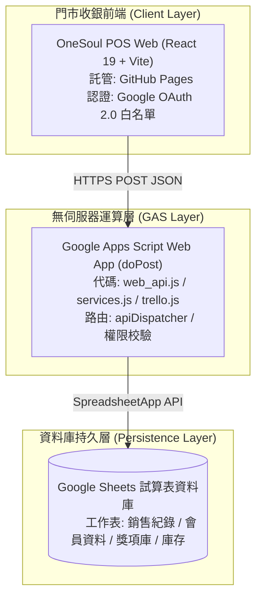

# OneSoul POS v1.0.0 (初代 Google Apps Script & Google Sheets 雲端收銀系統)

> **版本**：v1.0.0-legacy  
> **技術架構**：React 19 + Vite 6 + Tailwind CSS (前端) / Google Apps Script (GAS) + Google Sheets (後端與試算表資料庫)  
> **部署目標**：GitHub Pages (POS 前端) / Google Apps Script Web App (無伺服器 API)

---

## 1. 系統定位與架構概述

OneSoul POS v1.0 是專為實體玩具模型、一番賞抽獎專賣店（竹北門市、金山門市）設計的無伺服器雲端收銀系統。透過將 Google Sheets 作為試算表資料庫，結合 Google Apps Script (GAS) Web App 充當無伺服器 API Gateway，實現免維護主機、$0 伺服器成本的門市即時營運收銀方案。



---

## 2. 核心業務功能與安全不變量

### 2.1 散客零元購阻斷不變量 (Walk-In Invariant)
未綁定有效手機號碼之散客（黑名單包含 `111111`、`222222`、`333333`、`88888`、`99999` 或名稱包含 `散客`、`WALKIN`、`現場` 者）：
- **嚴禁使用任何點數折抵現金**。
- **嚴禁抽取或參與限定點數套（Points-only Sets）**。
- 前端收銀核心 pure seam（`web/src/logic/checkout.ts`）在結帳計算與按鈕送出前強制校驗，凡偵測散客嘗試使用點數即時標紅阻斷，杜絕門市錯帳。

### 2.2 交易群組化顯示 (Transaction Grouping)
收銀台支援「一筆訂單多項商品/一番賞混合結帳」。系統在送出交易時產生全域唯一識別碼 `checkoutUID`（格式：`UID-時間戳-隨機碼`）。
- **當日銷售** 與 **歷史銷售明細** 會依據 `checkoutUID` 自動聚合為單一張獨立訂單卡片。
- 清楚呈現實收現金、總折抵點數、贈送點數與各細項提貨模式（帶走實體 / 換取點數 / 贈送）。

### 2.3 作廢訂單精確退點機制 (Void & Points Rollback)
當店員在「當日銷售」頁面對特定訂單執行作廢時：
- 系統自動解析該筆交易原始扣點與發點記錄。
- 若當時使用了點數折抵，作廢時自動為該會員回補（退還）點數。
- 若當時因抽獎或消費獲得了點數，作廢時自動扣回該筆獲得之點數。
- 透過 `SpreadsheetApp.openById` 搭配原子行更新與快照比對，防止誤退或雙重退點。

### 2.4 一番賞開套、廢套與配賞防呆
- **抽數校驗**：結帳抽數嚴格限制不可超過該賞位在套組中之剩餘數量。
- **跨店安全鎖定**：竹北門市與金山門市獎項庫分流隔離，跨店作廢套組會被系統強制攔截。
- **高風險結帳二度確認 Modal**：將購物車梳理為「外帶實體」、「換點」、「贈送」三大區塊，大賞（A~D 賞、最後賞）若選換點必須二次核對，防止高單價商品人為疏失。

---

## 3. Google Apps Script (GAS) 部署與 Clasp 操作

後端代碼集中於專案根目錄，透過 Google 官方 `@google/clasp` 工具進行版控與發布：

### 3.1 環境設置與認證
```bash
# 全域安裝 clasp (若尚未安裝)
npm install -g @google/clasp

# 登入 Google 帳號
clasp login
```

### 3.2 開發版與正式版切換部署
專案預先配置 npm 腳本，透過 `.clasp.json` 自動對應開發環境與正式環境：
```bash
# 部署至開發測試環境 (Dev GAS Script)
npm run push:dev

# 部署至正式營運環境 (Prod GAS Script)
npm run push:prod
```

### 3.3 機敏金鑰配置 (Script Properties)
系統嚴禁在代碼中寫死 API Key 或 Webhook Token。請在 GAS 控制台 **專案設定 -> 指令碼屬性 (Script Properties)** 中設定下列變數：
- `APP_BACKGROUND_ID`: 營運 Google Sheets 試算表 ID。
- `TRELLO_API_KEY`: Trello 開發者 API Key。
- `TRELLO_API_TOKEN`: Trello 授權 Token。
- `TRELLO_LIST_ID`: 每日關帳帶走清單之 Trello List ID。
- `LINE_CHANNEL_ACCESS_TOKEN`: LINE 門市廣播 Channel Token。

---

## 4. 前端開發與 GitHub Pages CI/CD

### 4.1 本地開發
```bash
# 進入 web 目錄並安裝依賴
cd web
npm install

# 啟動 Vite 本地開發伺服器 (預設 Port 5173)
npm run dev
```

### 4.2 GitHub Pages 自動化發布
專案具備 GitHub Actions 自動建置發布工作流程（`.github/workflows/deploy.yml`）：
1. 任何推送到 `main` 分支之 Commit 會觸發 CI。
2. 自動執行 TypeScript 類型檢查與 Vite Production Build。
3. 自動發布產物至 `gh-pages` 分支，由 GitHub Pages 提供靜態 HTTPS 託管服務。

---

## 5. 測試套件與驗證指南

專案前端採用 **Vitest** 作為單元測試框架，並配置 **Playwright** 進行 E2E 核心結帳流全場景驗收：

### 5.1 執行全單元測試
```bash
# 執行收銀核心純函數、狀態機與防呆邏輯測試 (13 test suites, 249 tests)
npm --prefix web run test
```

### 5.2 執行 E2E 整合測試 (Playwright)
```bash
# 執行結帳全矩陣端到端模擬測試
npm --prefix web run test:e2e
```

---

## 6. 專案目錄結構

```text
onesoul_dev/ (main)
├── .github/workflows/       # GitHub Pages 自動建置 CI/CD 工作流
├── docs/                    # 系統手冊、SOP 與部署文件
├── web/                     # React 19 + Vite 收銀前端應用程式
│   ├── e2e/                 # Playwright 端到端驗收測試
│   ├── src/
│   │   ├── components/      # 收銀台、獎項庫、當日銷售 UI 元件
│   │   ├── logic/           # checkout.ts 等核心純函數 Seams
│   │   ├── config.ts        # 維護人員與門市營運設定
│   │   └── App.tsx          # 應用程式入口與路由
│   └── package.json         # 前端依賴與測試腳本
├── main.js                  # GAS 入口與環境切換
├── prog_index.js            # GAS 核心分派器
├── services.js              # GAS 結帳、點數扣抵、關帳與庫存服務
├── trello.js                # Trello 關帳自動建卡串接 (動態讀取 Properties)
├── web_api.js               # Web POS POST API 閘門與安全過濾
└── package.json             # 根目錄 Clasp 部署指令集
```

---

## 7. 資安與個資脫敏規範 (MASVS Compliance)

1. **零真實 PII 寫入代碼庫**：所有測試案例、Mock 數據一律使用假名與虛擬號碼（如 `0911000001`）。
2. **防範試算表公式注入 (OWASP A03)**：`web_api.js` 中所有寫入試算表之字串值一律經過 `sanitizeForSheet()` 處理，阻斷以 `=+ -@` 開頭之惡意注入公式。
3. **無金鑰外洩原則**：Trello、LINE、Google OAuth 相關 Token 絕不提交至版本庫，一律由 GCP / GAS Secret Manager 託管。
