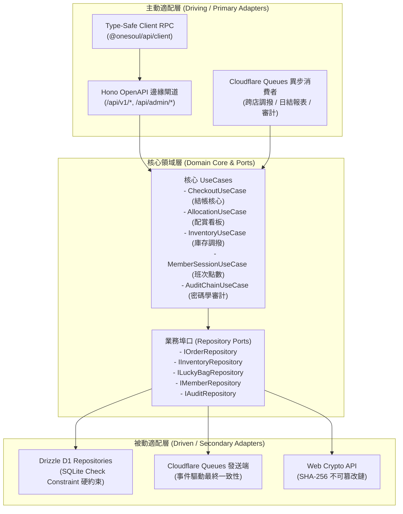

# OneSoul Edge v2.0.0 (純 Cloudflare 邊緣多租戶六角架構 - D1-per-Tenant)

> **版本**：v2.0.0-edge  
> **技術架構**：Cloudflare Workers + Hono OpenAPI + Drizzle ORM + Cloudflare D1 (SQLite) + Cloudflare Queues  
> **多租戶拓撲**：D1-per-Tenant（一店一庫實體物理隔離 + 全域中央協調庫）  
> **架構風格**：純六角架構 (Hexagonal / Ports and Adapters) + 代碼即合約 (Code-as-Contract)

---

## 1. 系統定位與架構演化

OneSoul Edge v2.0 是專為多實體連鎖玩具模型、一番賞抽獎專賣店打造的次世代純邊緣雲端 ERP/POS 後端。徹底告別傳統單體 VPS 與容器冷啟動延遲，全面遷移至 Cloudflare 全球 330+ 邊緣節點（V8 Isolates）。透過台北 PoP 節點就近提供 < 2ms 極致冷啟動與 < 10ms 網路往返延遲。

### 1.1 六角架構拓撲 (Hexagonal Architecture)

系統嚴格遵循六角架構規範，業務核心領域純邏輯與外部基礎設施徹底解耦：



---

## 2. D1-per-Tenant 實體物理隔離多租戶體系

為杜絕連鎖玩具加盟體系中「門市毛利、營業額與進貨成本跨店外洩」之致命痛點，本系統揚棄傳統單一資料庫 `WHERE store_id = ?` 邏輯共享方案，全面採用 **D1-per-Tenant 物理隔離**：

```
                              [ Cloudflare Edge Gateway ]
                                           │
                           [ Hono Dynamic Tenant Resolver ]
                                           │
              ┌────────────────────────────┼────────────────────────────┐
              │ (X-Store-Id: chupei)       │ (X-Store-Id: jinshan)      │ (X-Store-Id: warehouse)
              ▼                            ▼                            ▼
    [ onesoul-d1-chupei ]        [ onesoul-d1-jinshan ]       [ onesoul-d1-warehouse ]
      竹北門市獨立 D1              金山門市獨立 D1              中央總倉獨立 D1
      - orders                     - orders                     - orders
      - store_inventories          - store_inventories          - store_inventories
      - cash_sessions              - cash_sessions              - cash_sessions
      - lucky_bags                 - lucky_bags                 - lucky_bags
              │                            │                            │
              └────────────────────────────┼────────────────────────────┘
                                           ▼
                              [ onesoul-d1-coordinator ]
                                  全域協調中央庫
                                  - members & point_logs
                                  - products & categories
                                  - 跨店 transfer_orders
```

1. **實體層物理隔離**：竹北門市 (`DB_CHUPEI`)、金山門市 (`DB_JINSHAN`) 與中央總倉 (`DB_WAREHOUSE`) 各自為獨立 Cloudflare D1 實體 SQLite 資料庫，各門市資料在作業系統與資料庫核心層面不可跨越。
2. **動態租戶解析中介軟體**：`resolveTenant()` 依據 Request Header `X-Store-Id` 動態注入對應門市 D1 資料庫綁定至 Request Context (`c.get('storeDb')`)。
3. **中央協調庫與異步調撥最終一致性**：全域會員資料與跨店物流調撥單（`TransferOrder`）由中央協調庫管理，透過 Cloudflare Queues 實現竹北扣庫存、金山入庫驗收的兩階段事件驅動傳遞。

---

## 3. 代碼即合約 (Code-as-Contract) 與 OpenAPI 3.1

系統採用 `@hono/zod-openapi` 作為單一真實來源 (Single Source of Truth, SSOT)：
1. **執行期輸入校驗**：每個 API 端點以 Zod Schema 定義 Params、Query 與 Body，自動攔截無效 Payload。
2. **動態產生 OpenAPI 3.1 規格**：訪問 `/api/docs` 可即時查看 Swagger UI 互動式文檔。
3. **零手動維護的型別安全 RPC**：
   前端無需手寫 fetch 請求，直接引入 `@onesoul/api/client`：
   ```typescript
   import { createOneSoulClient } from '@onesoul/api/client';

   const client = createOneSoulClient('https://api.onesoul.com.tw');
   // 自動具備完整的路徑、參數、Body 與回傳型別推導：
   const res = await client.api.v1.luckybags.$get({
     header: { 'x-store-id': 'chupei' }
   });
   ```

---

## 4. 核心業務不變量與密碼學審計鏈 (Invariants)

1. **🚨 Invariant 1: 散客（Walk-In）點數穿透阻斷**
   - 散客手機代碼（`111111`、`WALKIN`、`現場`、`000000`）嚴禁使用點數折抵現金、嚴禁抽取限定點數套。
   - 違者於 Hono 路由層即刻回傳 HTTP 400 阻斷，並在 SQLite 引擎層設置 CHECK 約束雙重防禦。
2. **🚨 Invariant 2: 一番賞開套不預扣庫存，提貨核銷不變量**
   - 發布開套（`POST /api/admin/allocation/plans/publish`）僅建立套組與籤位，嚴禁扣減 `StoreInventory`。
   - 配賞看板（`GET /api/admin/allocation/live-stock`）動態計算活躍套組佔用量，實物唯有在結帳抽中且模式為「帶走（`TAKE_AWAY`）」時方原子核銷。
3. **🚨 Invariant 3: D1 Batch 原子交易防死鎖**
   - 結帳與庫存變更全面使用 Cloudflare D1 `db.batch([...])` 原生交易語法，消除鎖競爭與分散式死鎖風險。
4. **🔒 密碼學審計日誌鏈 (Cryptographic Audit Trail)**
   - 每一筆關鍵營運異動（結帳、調撥、作廢、盤點）寫入 `AuditLog`。
   - 每筆日誌記錄包含前一筆日誌的 `currentHash` 作為 `prevHash`，透過 Web Crypto API 計算當前記錄之 SHA-256 雜湊，建構防竄改審計鏈。

---

## 5. 架構決策記錄 (Architecture Decision Records)

本專案重大技術架構決策均以 ADR 標準文件記錄於 [`docs/adr/`](./docs/adr/)：

| ADR 編號 | 決策主題 | 狀態 | 核心摘要 |
| :--- | :--- | :--- | :--- |
| **[ADR-0001](./docs/adr/0001-why-edge-hono.md)** | 全面遷移至 Cloudflare Workers 與 Hono | `Accepted` | 告別 Node.js 容器冷啟動，台北 PoP 節點提供 < 2ms 響應與 99.78% 毛利率。 |
| **[ADR-0002](./docs/adr/0002-why-drizzle-and-d1.md)** | 採用 Drizzle ORM 與 Cloudflare D1 | `Accepted` | 輕量極致 SQLite 驅動，取代 Prisma 沉重引擎，支援資料庫 CHECK Constraint。 |
| **[ADR-0003](./docs/adr/0003-d1-per-tenant-multi-tenancy-architecture.md)** | D1-per-Tenant 門市實體物理隔離多租戶 | `Accepted` | 竹北、金山、總倉一店一 D1 實體資料庫，底層杜絕營業額跨店穿透。 |
| **[ADR-0004](./docs/adr/0004-core-invariants-and-cryptographic-audit-chain.md)** | 核心業務不變量與密碼學審計鏈設計 | `Accepted` | SHA-256 Merkle-like 稽核鏈條與三大不可逾越之業務防呆。 |

---

## 6. Monorepo 結構與測試執行指令

本分支採用 npm Workspaces 單一版本庫管理：

```text
onesoul_dev/ (feat/cloudflare-pure-stack-rewrite)
├── apps/
│   └── api/                 # Cloudflare Workers Hono 邊緣後端服務 (Port 8787)
│       ├── src/
│       │   ├── core/        # 六角架構核心 (entities, usecases, ports)
│       │   ├── adapters/    # 次級適配層 (d1-repositories, crypto)
│       │   ├── routes/      # 初級適配層 (Hono OpenAPI 路由定義)
│       │   └── client.ts    # 前端專用 Type-Safe RPC Client
│       └── tests/           # 24 個整合測試套件 (419 tests)
├── packages/
│   ├── db/                  # Drizzle ORM D1 SQLite Schema & Migrations
│   │   ├── src/schema/      # 多門市資料表定義與 CHECK 約束
│   │   └── scripts/         # 多門市資料庫自動化遷移腳本 (migrate-tenants.ts)
│   └── shared/              # 前後端共用領域驗證規則、Result 型別與 Zod Schema
├── web/                     # React 19 POS 收銀前端
├── admin/                   # React 19 ERP 旗艦後台
└── docs/adr/                # 系統架構決策紀錄庫
```

### 6.1 自動化測試矩陣驗證

```bash
# 1. 執行 Cloudflare Edge API 全量測試 (24 test suites, 419 passed)
npm --prefix apps/api run test

# 2. 執行 D1 資料庫約束與 Schema 測試 (2 test suites, 16 passed)
npm --prefix packages/db run test

# 3. 執行跨端共用領域與 Result 型別測試 (3 test suites, 40 passed)
npm --prefix packages/shared run test

# 4. 執行 POS 前端收銀純函數測試 (16 test suites, 328 passed)
npm --prefix web run test
```
