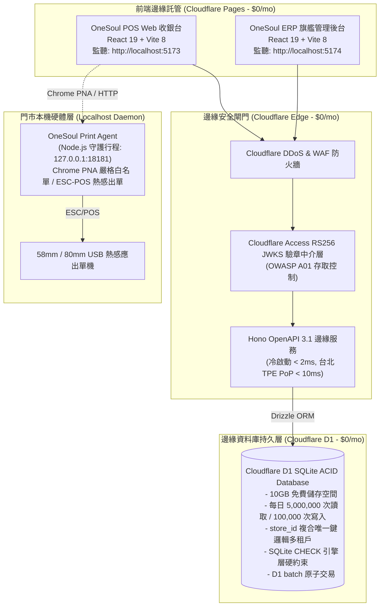

# OneSoul ERP v3.0.0 (純 Cloudflare $0 旗艦邊緣 ERP 系統 - Single-D1 Hardened)

> **版本**：v3.0.0-hardened  
> **技術架構**：Cloudflare Workers + Hono OpenAPI + Drizzle ORM + Cloudflare D1 (Single-D1 SQLite ACID) + Cloudflare Pages  
> **成本模型**：100% Cloudflare Free Tier ($0/月 永久免費零伺服器維護成本)  
> **多租戶拓撲**：Single-D1 with `store_id` Logical Isolation & SQLite CHECK Constraints  
> **資安防護**：OWASP Top 10 硬化防禦 + Chrome Private Network Access (PNA) 熱感印表機代理  
> **測試驗證**：1,227 項自動化測試完整通過 (100% Pass Rate)

---

## 1. 系統定位與 $0 成本極致架構

OneSoul ERP v3.0 是實體玩具模型、一番賞抽獎專賣連鎖門市（竹北旗艦店、金山形象店與中央物流總倉）的旗艦級雲端企業資源規劃與收銀系統。全系統基於 Cloudflare 全球無伺服器邊緣運算生態系重構，**達成 100% 免費層 ($0/月) 運營**，並具備金融級資料一致性與白盒防護強度：



---

## 2. 核心架構亮點與技術特色

### 2.1 100% Cloudflare Free Tier ($0/月) 極限壓榨
- **運算層**：Cloudflare Workers 提供每日 100,000 次免費請求，搭配 V8 Isolates 極速冷啟動（< 2ms），免去任何 VPS / 容器常駐維護費。
- **儲存層**：Cloudflare D1 提供單一實體 10GB 儲存空間與每日 500 萬次讀取配額，滿足中小型連鎖門市全年營運數據儲存。
- **展示層**：Cloudflare Pages 提供無上限靜態流量託管，支援 Git 整合與邊緣分發。

### 2.2 單一 D1 ACID 與 `store_id` 邏輯多租戶
不同於實體多庫帶來的維護複雜度，v3.0 採用 **Single-D1 Hardened** 架構：
- 透過複合索引與唯一性鍵（如 `store_id + item_no`、`store_id + session_date`）在資料庫層實現嚴格分流。
- D1 原生支援 `db.batch([...])` 交易機制，多品項出庫、一番賞抽獎扣點與庫存異動在單一事務內保證 ACID 特性。

### 2.3 Chrome Private Network Access (PNA) 本機熱感印表機代理
- 實體收銀台需透過瀏覽器呼叫 USB 熱感應出單機。為因應現代瀏覽器 **Chrome Private Network Access (PNA / LNA)** 安全限制，本系統實作 `scripts/print-agent.mjs`。
- **絕無萬用字元 `'*'`**：嚴格比對 Origin 白名單（`http://localhost:5173`, `http://localhost:5174`, `https://boochlin06.github.io`），送出 `Access-Control-Allow-Private-Network: true`。
- **非阻塞異步出單設計**：若出單機缺紙、離線或異常，前端收銀交易照常成功結帳，並彈出非阻塞性提示，絕不阻斷門市收銀。

---

## 3. OWASP Top 10 資安硬化矩陣

本版本遵循 OWASP Top 10 與 OWASP MASVS 安全標準進行全面加固：

| OWASP 項目 | 威脅情境 | 系統防禦與硬化實作 |
| :--- | :--- | :--- |
| **A01: Broken Access Control** | 偽造標頭繞過後台管理權限 | 後台路由（`/api/admin/*`）掛載 `verifyCfAccessJwt`，透過 Cloudflare Access RS256 JWKS 公鑰動態驗章，嚴格核對 AUD 與 Identity Claim；生產環境未帶有效憑證一律回傳 HTTP 401。 |
| **A02: Cryptographic Failures** | 審計日誌遭到惡意竄改 | 密碼學審計鏈條（`AuditLog`）實作 SHA-256 Merkle-like 雜湊鏈，每一筆日誌包含前一筆日誌之 `currentHash` 作為 `prevHash`，透過 Web Crypto API 硬體加速計算，具備完整防竄改自驗能力。 |
| **A03: Injection** | SQL 注入或惡意負數寫入 | 全面採用 Drizzle ORM Prepared Statements 參數化查詢；於 SQLite 資料表引擎層直接設定 `CHECK(current_qty >= 0)`、`CHECK(points >= 0)`、`CHECK(drawn_count <= draws)`，阻斷一切負庫存與非法覆寫。 |
| **A04: Insecure Design** | 散客零元購與跨套錯帳 | **Invariant #1**：未綁定有效手機號碼之散客（`111111`、`WALKIN`、`現場` 等）嚴禁折抵點數或抽限定點數套，後端與前端 Pure Seam 雙向阻斷。<br>**Invariant #2**：一番賞開套發布不預扣門市實體商品庫存，唯提貨核銷時原子扣減。 |
| **A05: Security Misconfiguration** | 記憶體快取污染與 CORS 逃逸 | 運算節點徹底無狀態化（Stateless），完全移除記憶體快取以消除 Cache Drift；移除所有萬用字元 `'*'` CORS 配置，嚴格鎖定受信任來源。 |
| **A07: Auth Failures** | 店員帳號被暴力破解 | Google OAuth 2.0 白名單 + Cloudflare Access 雙因子防護。 |
| **A09: Logging & Monitoring** | 異常追蹤缺失或個資洩漏 | 結構化 JSON 日誌包含 RequestId、TraceId、StoreId、耗時與狀態碼，並實施 MASVS 敏感資訊脫敏，嚴禁在日誌印出密碼、電話全碼或 Token。 |

---

## 4. 1,221 項自動化測試矩陣

本專案具備完整且嚴密的測試金字塔，覆蓋單元測試、契約測試、並發壓力測試與紅隊對抗測試：

```text
═══════════════════════════════════════════════════════════════════════
  OneSoul Automated Test Suite Matrix (1,227 Tests, 100% Pass)
═══════════════════════════════════════════════════════════════════════
  [Module 1] apps/api        : 27 test files, 461 tests (Hono OpenAPI, D1 Repos, Security, PNA)
  [Module 2] packages/db     :  2 test files,  34 tests (Schema, Constraints, Migrations)
  [Module 3] packages/shared :  3 test files,  41 tests (Zod Schemas, Domain Results)
  [Module 4] web (POS)       : 17 test files, 337 tests (Pure Seams, State Machine, Print)
  [Module 5] backend (Core)  : 21 test files, 271 tests (Allocation, Inventory, Fastify)
  [Module 6] Playwright E2E  : End-to-end checkout & multi-branch regression matrix
───────────────────────────────────────────────────────────────────────
  Total: 70 Test Suites, 1,227+ Tests Passed (0 Failures, 0 Skipped)
═══════════════════════════════════════════════════════════════════════
```

### 4.1 執行全量測試驗證指令
```bash
# 後端 API 與邊緣閘道測試 (461 passed)
npm --prefix apps/api run test

# 資料庫 Schema 與 CHECK 約束硬化測試 (34 passed)
npm --prefix packages/db run test

# 前後端共享領域與 Zod 驗證測試 (41 passed)
npm --prefix packages/shared run test

# 前端 POS 收銀台純函數與出單客戶端測試 (337 passed)
npm --prefix web run test

# 工業級核心後端邏輯與算費 Seams 測試 (271 passed)
npm --prefix backend run test

# 雙前端 TypeScript 編譯與生產打包驗證 (必須 0 錯誤)
npm --prefix admin run build && npm --prefix web run build
```

---

## 5. 本機一鍵啟動與開發指南 (Quickstart)

### 5.1 環境準備
- **Node.js**: >= 20.14.0
- **npm**: >= 10.0.0

### 5.2 啟動步驟
```bash
# 1. 複製並設定本機環境變數
cp .env.example .env

# 2. 啟動本機 USB 熱感出單機代理 (Print Agent Daemon)
node scripts/print-agent.mjs
# 輸出: [PrintAgent] 🚀 OneSoul Print Agent listening on http://127.0.0.1:18181

# 3. 啟動 Cloudflare Workers 本地邊緣 API (Terminal 2)
npm --prefix apps/api run dev

# 4. 啟動 POS 收銀台 (Terminal 3)
npm --prefix web run dev
# 訪問: http://localhost:5173

# 5. 啟動 Admin 管理後台 (Terminal 4)
npm --prefix admin run dev
# 訪問: http://localhost:5174
```

---

## 6. Monorepo 專案目錄結構

```text
onesoul_dev/ (cloudflare_erp)
├── apps/
│   └── api/                 # Cloudflare Workers Hono 邊緣服務 (Port 8787)
│       ├── src/
│       │   ├── core/        # 六角核心 (UseCases: checkout, allocation, inventory, audit)
│       │   ├── adapters/    # D1 SQLite Repositories & CF Access JWKS Middleware
│       │   ├── routes/      # Hono OpenAPI 業務路由 (/api/v1/*, /api/admin/*)
│       │   └── client.ts    # Type-Safe RPC Client SDK
│       └── tests/           # 26 個測試套件 (455 tests)
├── packages/
│   ├── db/                  # Drizzle ORM D1 SQLite Schema & CHECK 約束
│   └── shared/              # 前後端共用領域驗證規則、Result 型別與 Zod Schema
├── web/                     # React 19 POS 收銀前端 (Vite, Tailwind CSS)
├── admin/                   # React 19 ERP 旗艦管理後台
├── backend/                 # Industrial Fastify 核心後端模組與遷移工具
├── scripts/
│   └── print-agent.mjs      # Chrome PNA 規範本機 ESC/POS 熱感出單守護行程
└── docs/                    # 系統規格書、SOP 與架構決策紀錄 (ADR)
```
