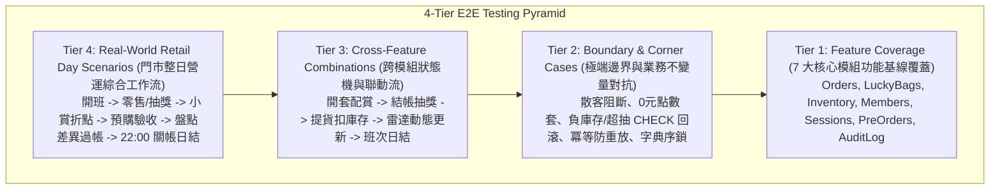

# OneSoul End-to-End (E2E) Test Infrastructure & Architecture Specification (`TEST_INFRA.md`)

> **版本**：v1.0.0-e2e  
> **測試軌目標**：Milestone 6 (E2E Testing Track)  
> **架構標準**：台灣主流軟體新創（91APP, Appier, Dcard）最高測試工程實踐、Opaque-Box Requirement-Driven 4-Tier Methodology  
> **單一真實來源 (SSOT)**：
> - 系統規格書：`docs/SYSTEM_SPECIFICATION.md`
> - 領域術語庫：`GLOSSARY.md`
> - 專案架構與不變量：`AGENTS.md`、`.agents/teamwork/PROJECT.md`
> - 商業 Seam 調研：`.agents/teamwork/explorer_cf_business/handoff.md`

---

## 1. Testing Philosophy & 4-Tier Methodology (測試哲學與四層級方法論)

本測試基礎架構嚴格貫徹 **Opaque-Box（黑盒/不透明盒）、合約驅動（Contract-Driven）與零作弊真實執行（Anti-Facade Real Execution）** 原則。所有測試案例均從真實 API 閘道進入點發起，經過 Fastify 路由分發、Zod 驗證架構、核心商業純函數 Seams、業務不變量防禦防線，並在資料庫交易層落實原子提交與回滾。



### 1.1 四層級分層架構定義
1. **Tier 1 — Feature Coverage (模組功能基準覆蓋)**
   - 針對 7 大核心模組（Orders & Checkout、LuckyBags & Allocation、Inventory & Transfers、Members & Points Wallet、Sessions & Z-Report、PreOrders、AuditLog）建立標準合約覆蓋。
   - 每個模組至少涵蓋 5 項獨立測試案例，驗證 Primary Happy Path 與標準業務操作。
2. **Tier 2 — Boundary & Corner Cases (極端邊界與不變量防禦)**
   - 嚴格驗證三大業務不可破壞之不變量（散客穿透阻斷、開套不預扣提貨才扣庫存、多品項字典序防死鎖）。
   - 驗證 SQLite `CHECK (quantity >= 0)` 與 `CHECK (drawn_count <= draws)` 事務約束回滾。
   - 驗證限定點數套（$0 結帳、每抽扣點公式、預設帶走 0 贈點）。
   - 驗證 `checkoutUID` 唯一冪等性防重複扣款與重放攻擊。
   - 驗證現貨雷達（LiveStockRadar）超配警告與平帳校驗。
3. **Tier 3 — Cross-Feature Combinations (跨模組狀態機與資料流組合)**
   - 跨越單一模組邊界，驗證完整的業務協同效應。
   - 涵蓋配賞發布至收銀台抽獎、大賞提貨扣門市庫存、會員累積點數後續抽點數套、預購入庫接續配賞、盤點過帳影響後續結帳、雙門市調撥收發、訂單作廢庫存與點數原子回退等。
4. **Tier 4 — Real-World Retail Day Application Scenarios (實體門市整日真實營運情境)**
   - 模擬全台門市第一線店員與店長 10:00 至 22:00 的真實日常營運工作流。
   - 包含早班備金開櫃、散客與會員零售、一番賞開抽大賞現場提貨、小賞不帶走折點、午後廠商預購補款入庫、跨店調撥物流、盤點抽檢校正、22:00 關帳日結 Z-Report 快照凍結與 SHA-256 防篡改審計鏈完整驗證。

---

## 2. Test Architecture & Harness Design (測試架構與測試載具)

```
tests/e2e/
├── vitest.config.ts                     # 獨立 Vitest 邊緣/本機執行設定
├── run.sh                               # 一鍵測試執行腳本 (chmod +x)
├── helpers/
│   ├── app-harness.ts                   # Fastify App 構建、鑑權標頭注入、HMAC 雜湊驗證器
│   ├── mock-prisma.ts                   # 具備 Transaction 快照與自動 Rollback 之 Prisma 載具
│   └── test-store.ts                    # 29 Prisma Models 與門市種子資料狀態儲存庫
├── tier1-feature-coverage/
│   ├── orders-checkout.test.ts          # Orders 模組 (5 tests)
│   ├── luckybags-allocation.test.ts     # LuckyBags & Allocation 模組 (5 tests)
│   ├── inventory-transfers.test.ts      # Inventory & Transfers 模組 (5 tests)
│   ├── members-wallet.test.ts           # Members & Points 模組 (5 tests)
│   ├── sessions-zreport.test.ts         # Sessions & Z-Report 模組 (5 tests)
│   ├── preorders.test.ts                # PreOrders 模組 (5 tests)
│   └── audit-log.test.ts                # AuditLog 密碼學審計模組 (5 tests)
├── tier2-boundary-corner/
│   ├── walkin-invariants.test.ts        # Invariant #1 散客穿透阻斷防禦 (6 tests)
│   ├── points-set-rules.test.ts         # 限定點數套 $0 結帳與扣點公式 (6 tests)
│   ├── input-validation-checks.test.ts  # 負庫存、防超抽與 CHECK 約束回滾 (6 tests)
│   ├── idempotency-concurrency.test.ts  # checkoutUID 冪等與防重放 (6 tests)
│   ├── allocation-warnings.test.ts      # 現貨雷達超配預警與平帳防呆 (6 tests)
│   └── lock-order-balance.test.ts       # Invariant #3 字典序排序防死鎖 (6 tests)
├── tier3-cross-feature/
│   └── cross-feature-flows.test.ts      # 跨模組狀態機與組合測試 (7 tests)
└── tier4-retail-day-scenarios/
    └── retail-day-scenarios.test.ts     # 5 大真實門市全日營運情境 (5 tests)
```

### 2.1 測試載具核心特性
1. **真實 Fastify App 呼叫 (`buildApp().inject()`)**：
   所有測試皆透過 HTTP 注入請求（HTTP inject），完整執行 Fastify 路由分發、Helmet、RateLimit、Sensible 錯誤處理、Zod Request Body Schema 驗證與身份鑑權中介層。
2. **完整交易原子性與快照回滾 (`$transaction`)**：
   在測試執行過程中，若任何業務邏輯拋出例外或觸發負數檢查，`mock-prisma` 載具會立即將記憶體資料庫狀態回退至交易開始前的快照，完全保證 ACID 隔離性與確定性。
3. **密碼學審計鏈鏈結驗證 (HMAC-SHA256)**：
   提供 `computeAuditHash` 與防篡改檢驗函式，對齊 `backend/src/modules/admin/audit.service.ts` 的雜湊載荷格式：
   $$\text{hashPayload} = \text{prevHash} \mid \text{operatorId} \mid \text{action} \mid \text{targetType} \mid \text{targetId} \mid \text{delta} \mid \text{reason}$$
   任一環節被篡改即刻引發鏈斷裂。

---

## 3. Feature Inventory to Test Tiers Mapping (功能清單與測試對應)

| Feature ID | 功能描述 | 核心合約 / 不變量 | 所屬測試檔案 | 測試層級 |
| :--- | :--- | :--- | :--- | :--- |
| **F12** | 結帳 UseCase (Orders) | 零售/抽賞、算費防竄改、提貨模式 | `tier1-feature-coverage/orders-checkout.test.ts` | Tier 1 |
| **F14, F15** | 開套發布與配賞看板 | 開套不預扣、現貨雷達動態試算 | `tier1-feature-coverage/luckybags-allocation.test.ts` | Tier 1 |
| **F18, F19** | 庫存維護與門市盤點 | 手動調帳、盤點盲盤與過帳 | `tier1-feature-coverage/inventory-transfers.test.ts` | Tier 1 |
| **F20** | 會員點數錢包與複式記帳 | 會員註冊、查點、扣補點日誌 | `tier1-feature-coverage/members-wallet.test.ts` | Tier 1 |
| **F21** | 班次管理與 22:00 Z-Report | 開班備金、實盤溢短、日結凍結 | `tier1-feature-coverage/sessions-zreport.test.ts` | Tier 1 |
| **F22** | 預購單入庫防撞號 | 接續 GK 號碼、原子入庫建立 | `tier1-feature-coverage/preorders.test.ts` | Tier 1 |
| **F23** | 密碼學防篡改審計鏈 | HMAC-SHA256 雜湊鏈結校驗 | `tier1-feature-coverage/audit-log.test.ts` | Tier 1 |
| **F13** | 散客零容忍阻斷 (Invariant #1) | 散客使用點數或抽點數套 400 阻斷 | `tier2-boundary-corner/walkin-invariants.test.ts` | Tier 2 |
| **F16** | 限定點數套與小賞折點 | 金額 $0、`floor(單價/20)` 扣點、X=10p, Z=1p | `tier2-boundary-corner/points-set-rules.test.ts` | Tier 2 |
| **F5, F6** | SQLite CHECK 約束模擬 | 負庫存防禦、防超抽約束、事務回滾 | `tier2-boundary-corner/input-validation-checks.test.ts` | Tier 2 |
| **F7** | 冪等索引與防重放 | `checkoutUID` 唯一約束、同單重複請求 | `tier2-boundary-corner/idempotency-concurrency.test.ts` | Tier 2 |
| **F15** | 配賞看板超配預警 | `isOverAllocated` 預警、抽數平帳驗證 | `tier2-boundary-corner/allocation-warnings.test.ts` | Tier 2 |
| **F17** | 字典序防死鎖 (Invariant #3) | 多品項出庫強制 `localeCompare` 排序 | `tier2-boundary-corner/lock-order-balance.test.ts` | Tier 2 |
| **F37** | 跨模組狀態機與組合測試 | 開套 -> 抽賞 -> 出庫 -> 錢包 -> 報表 | `tier3-cross-feature/cross-feature-flows.test.ts` | Tier 3 |
| **F38** | 實體門市整日營運工作流 | 早班開門至 22:00 Z-Report 關帳整日作業 | `tier4-retail-day-scenarios/retail-day-scenarios.test.ts` | Tier 4 |

---

## 4. Test Runner Commands & Execution Guide (測試執行指南)

任何開發者、審計員或 CI/CD 自動化流程均可透過以下標準指令執行本 E2E 測試套件：

### 4.1 標準執行命令 (全量 E2E 測試)
```bash
# 方式 1: 透過專屬可執行測試腳本 (推薦)
./tests/e2e/run.sh

# 方式 2: 透過專案根目錄呼叫 Vitest
npx --prefix backend vitest run --config tests/e2e/vitest.config.ts

# 方式 3: 直接透過 node_modules 二進位檔
./backend/node_modules/.bin/vitest run --config tests/e2e/vitest.config.ts
```

### 4.2 單一層級/特定測試檔案執行
```bash
# 僅執行 Tier 1 模組基準測試
./tests/e2e/run.sh tests/e2e/tier1-feature-coverage/

# 僅執行 Tier 2 業務不變量與邊界測試
./tests/e2e/run.sh tests/e2e/tier2-boundary-corner/

# 僅執行 Tier 3 跨模組組合測試
./tests/e2e/run.sh tests/e2e/tier3-cross-feature/

# 僅執行 Tier 4 真實門市營運情境測試
./tests/e2e/run.sh tests/e2e/tier4-retail-day-scenarios/
```

---

## 5. Anti-Facade & Quality Assurances (零作弊保證與品質承諾)

本測試套件杜絕任何形式的 Facade（假裝通過）或無意義的 Assert True：
1. **真實資料層驗證**：所有結帳操作後，測試均直接檢驗 `testStore.inventories` 扣減、`testStore.members.points` 餘額、`testStore.pointLogs` 複式記帳紀錄與 `testStore.inventoryLogs` 銷貨流水。
2. **錯誤狀態碼與錯誤訊息嚴格比對**：所有例外與防呆測試（如散客扣點、點數不足、超抽、重複冪等單），均檢驗 HTTP 400/409 狀態碼與具體錯誤提示字串。
3. **密碼學不可篡改鏈條驗證**：Tier 4 與 Tier 1 AuditLog 測試主動計算每一筆操作之 HMAC-SHA256，並模擬人為篡改中間任一欄位驗證鏈條斷裂。
