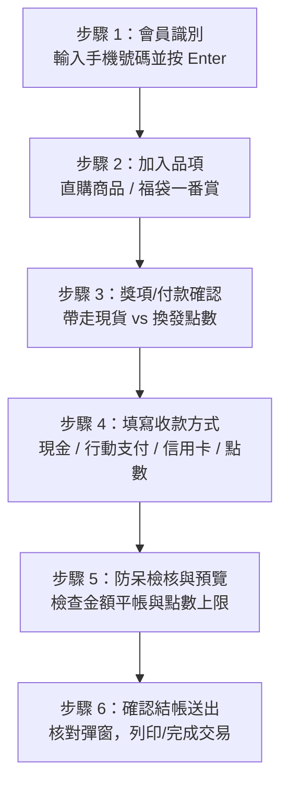
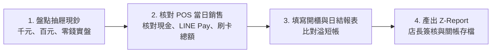

# OneSoul POS 門市收銀人員操作指引與異常防呆手冊 (CHECKOUT_SOP.md)

> **文件版本**：v1.0.0-retail  
> **適用對象**：門市店長、門市正職夥伴、兼職夥伴、收銀值班同仁  
> **技術規格參照**：[`docs/CHECKOUT_SPECIFICATION.md`](./CHECKOUT_SPECIFICATION.md)  
> **系統架構基準**：OneSoul Industrial POS & ERP Architecture  

---

## 1. 門市收銀結帳六部曲 (Standard Operating Procedure)

收銀同仁進行現場交易時，請嚴格依循標準六部曲進行操作：

---

### 步驟 1：會員識別與建檔

1. **會員顧客**：
   - 請顧客出示或報出手機號碼（10 碼，如 `0912345678`）。
   - 於「會員查詢」輸入框填入號碼後，**必須按下鍵盤 `Enter` 鍵**或點擊查詢圖示。
   - 系統將從後端抓取會員姓名、累積點數及消費等級。
2. **現場散客（未註冊會員）**：
   - 若顧客暫時不註冊會員，可輸入通用散客代號 `111111`、`222222` 或輸入「散客」。
   - ⚠️ **重要提醒**：散客**無法累積點數**，且系統**嚴格禁止散客使用任何點數折抵或抽取限定點數套**。若散客欲折抵點數，收銀員應主動引導掃描門市 QR Code 加入官方 LINE 成為會員。

---

### 步驟 2：商品加入單據（直購商品）

1. **貨號輸入**：
   - 於商品清單點擊「+ 新增商品」，輸入實體標籤上的商品貨號（如 `1001`）。
   - 系統自動聯動後端與本地庫存，帶出商品名稱、分類、門市售價與折算點數。
2. **GK 雕像高資產保護機制**：
   - 若輸入之商品分類為 `GK` 雕像或高價限量模型，系統將**自動強制將付款方式切換為「點數」**。
   - 此設計旨在防止收銀員誤以低額現金直購售出高價值實體 GK 模型。
3. **跨店在庫提示**：
   - 若輸入貨號在本門市無庫存，但另一門市（如金山店或竹北店）有現貨，系統會於備註欄自動提示「在金山店現貨 X 件」，協助店員即時向顧客說明調撥需求。

---

### 步驟 3：一番賞 / 福袋開抽流程

1. **選擇一番賞套組**：
   - 於「一番賞 / 福袋」區塊點擊「+ 新增抽獎」，輸入或選擇套組 ID。
   - 系統即時連動套組單抽金額與目前活躍賞位。
2. **核對抽中賞位與領取方式**：
   - **大賞（A / B / C / D / LAST 賞）**：
     - 若顧客現場帶走公仔：領取方式選擇 **「帶走」**。系統結帳時將**自動原子扣減門市在庫公仔 1 件**。
     - 若顧客不帶走欲折換點數：領取方式選擇 **「點數」**。系統自動帶入該賞位設定之點數，**不扣減實體門市商品庫存**。
   - **X 賞（盲盒賞）**：
     - 顧客現場任選盲盒帶走：選擇 **「帶走」**，門市現場交付盲盒。
     - 顧客不帶走：選擇 **「點數」**，系統自動換發 **10 點**入會員帳戶。
   - **Z 賞（保底小賞）**：
     - 顧客帶走門市小周邊：選擇 **「帶走」**。
     - 顧客不帶走：選擇 **「點數」**，系統自動換發 **1 點**保底點數入會員帳戶。

---

### 步驟 4：限定點數套抽獎流程

1. **識別限定點數套**：
   - 一番賞套組若標記為「點數限定套」（`isPointsSet`），代表僅限以會員點數開抽。
2. **金額與點數規則**：
   - **應收現金金額自動為 $0**。
   - 扣除點數公式：$$\text{每抽扣點} = \left\lfloor \frac{\text{單抽牌價}}{20} \right\rfloor \times \text{抽數}$$
   - 範例：單抽牌價 $350 之限定點數套，抽 2 抽，系統自動扣除 $\lfloor 350 / 20 \rfloor \times 2 = 17 \times 2 = 34$ 點。
3. **賞品領取**：
   - 預設領取方式為「帶走」，顧客帶走實體大賞，點數套折算現金與額外點數均為 0，店員切勿手動誤改為點數。

---

### 步驟 5：收款與多重混合支付拆帳

結帳區提供四大收款管道，收銀員可依顧客需求彈性拆帳：

1. **現金 (Cash)**：現場收取之實體新台幣鈔券與硬幣。
2. **行動支付 / 匯款 (LinePay / Bank)**：LINE Pay 條碼掃描、街口支付或銀行轉帳。
3. **信用卡 (Credit Card)**：實體刷卡機感應或插卡交易。
4. **會員點數折抵 (Points)**：
   - 會員以點數折抵現金（1 點 = NT$ 1）。
   - 點數折抵不得超過顧客當前現有點數，亦不得超過應付總額。
5. **平帳檢核**：
   - 實體收款金額（現金 + 行動支付 + 信用卡）加上點數折抵，必須**分毫不差等於應付總額**：
     $$\text{現金} + \text{行動支付} + \text{信用卡} = \text{應收金額}$$
   - 若有任何差額，系統將以紅字標示溢收或短收金額，結帳按鈕鎖定無法點擊。

---

### 步驟 6：確認彈窗與完成交易

1. 點擊「前往結帳」按鈕。
2. 畫面彈出「結帳內容最終確認」視窗，收銀員應再次與顧客朗讀確認：
   - 會員姓名與電話
   - 購買品項與抽獎賞位
   - 實收金額與各支付管道明細
   - 點數扣抵與本次獲贈點數
3. 點擊「確認結帳送出」，後端完成原子交易，交易成功並扣庫存後畫面自動清空重置。

---

## 2. 核心防呆規則與異常排除手冊 (Troubleshooting & Invariants)

| 錯誤提示訊息 | 觸發原因 (Root Cause) | 標準排除步驟 (Resolution) |
| :--- | :--- | :--- |
| **「散客無會員帳號，嚴禁使用點數扣抵或抽取點數套，請先為顧客建檔綁定會員手機號碼。」** | 顧客電話輸入為 `111111` 或姓名為散客，卻在支付明細使用了「點數折抵」、點數兌換直購品，或抽限定點數套。 | 1. 散客依法不能扣點（Invariant #1 防零元購漏洞）。 2. 向顧客說明：「點數為會員專屬權益，請提供手機號碼免費加入會員。」 3. 若顧客堅持不建檔，請將點數折抵歸零，改以全額現金或 LINE Pay 支付。 |
| **「收款金額與應收不符：溢收 NT$ X / 短收 NT$ X」** | 現金、匯款、信用卡輸入總和不等於商品與抽獎的應收金額。 | 1. 查看收款明細卡下方的紅色提示金額。 2. 若多收了錢，將多餘的金額退還給顧客，並修正對應欄位。 3. 若少收了錢，請顧客補足差額或調整點數折抵。 |
| **「會員點數不足！所需點數: X 點，會員現有點數: Y 點」** | 會員使用點數折抵或抽限定點數套時，所需點數超過帳戶目前現有額度。 | 1. 請顧客確認是否記錯手機號碼。 2. 減少點數折抵金額，不足部分改以現金或信用卡支付。 |
| **「請輸入顧客電話並點擊查詢」** | 收銀員在顧客姓名欄位手動打字，但未於電話欄輸入手機號碼並按 Enter 進行系統查詢。 | 1. 點擊「顧客電話」輸入框。 2. 輸入顧客 10 碼手機號碼，並**按下鍵盤 Enter 鍵**完成系統載入。 |
| **「商品貨號 [xxxx] 不存在」** | 輸入的直購商品貨號在門市庫存資料庫中找不到。 | 1. 重新確認實體商品標籤上的條碼編號。 2. 切換至「在庫現貨」Tab，以關鍵字搜尋品名，確認正確貨號。 3. 若為新到貨品項，通知店長至後台 ERP 執行建檔入庫。 |
| **「GK 類別商品付款方式自動變更為點數」** | 這是系統故意設計的保護機制，並非系統故障。 | 向顧客說明 GK 雕像為高階預購與點數兌換專屬品項，收銀系統預設以點數結算；如店長核准以特案現金販售，需由店長授權並調整單價。 |

---

## 3. 日結與營運交接程序 (Closing & Handover)

每日晚班打烊或交接班時，收銀人員須依下列流程完成關帳結算：

1. **實體零錢盤點**：
   - 結算時清點收銀抽屜內所有現金（千元鈔、五百元鈔、百元鈔及各類硬幣）。
   - 扣除每日固定開櫃備用金（如 NT$ 3,000），即為本日實收現金現鈔。
2. **核對 POS 當日銷售總覽 (`DailySalesView`)**：
   - 切換至「當日銷售」分頁。
   - 檢查系統記載之各管道營收：
     - **現金總額 (Cash Total)**：必須與「實盤現金 - 開櫃備用金」相符。
     - **LINE Pay / 匯款總額**：打開 LINE Pay 商家管理 App，核對本日請款交易總額。
     - **信用卡總額**：列印實體刷卡機「總計單 (Batch Report)」，核對刷卡簽帳金額。
3. **溢短帳處理原則**：
   - 若發生溢帳（實盤多於系統）或短帳（實盤少於系統），請於交接備忘錄註明差額與可能原因（如顧客找零誤給、誤 key 支付管道）。
   - 嚴禁私下以私人現金墊補或挪移溢額。
4. **產出 Z-Report**：
   - 確認三方金額無誤後，於系統執行結算關帳，產出本日 Z-Report 財務快照，並拍照上傳門市營運通訊群組備查。

---

## 4. 緊急應變指引 (Emergency Protocol)

### 4.1 網路暫時中斷或離線處理
- POS 前端採用 LocalStorage 即時草稿保存機制。若結帳中途瀏覽器不慎關閉或重新整理，頁面重新開啟後會自動還原剛才輸入的購物車品項與顧客資料。
- 若門市 Wi-Fi 斷線，請切換至備用手機熱點。在未恢復連線前，暫勿點擊「確認結帳送出」，避免交易請求逾時。

### 4.2 交易作廢 (Void) 與退換貨處理
- 若顧客結帳後立即要求取消或更換賞位：
  1. 請店長切換至後台 ERP 或當日銷售紀錄，找到該筆交易單號。
  2. 點擊「作廢單據 (Void Order)」。
  3. 系統將啟動反向補償事務：
     - 將該筆交易所扣減之門市庫存原物加回。
     - 將顧客折抵之點數全數歸還，同時扣回該筆訂單所獲贈之點數。
  4. 現場將收取之現金或電子支付刷退退還顧客。
