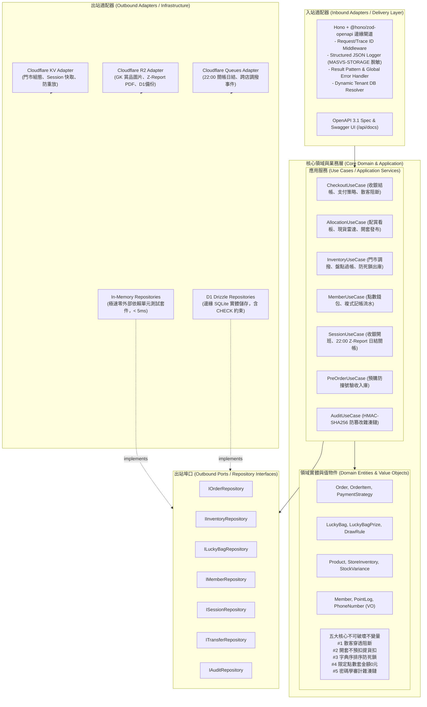

# OneSoul 邊緣純堆疊架構重構規格書 (Cloudflare Pure-Stack Architecture Specification)

> **專案代號**：OneSoul Edge Core  
> **版本**：v2.0.0-edge  
> **架構標準**：Pragmatic Clean Architecture (Ports & Adapters), SOLID, Code-as-Contract  
> **目標客群與展示級別**：台灣頂級軟體新創（91APP, Appier, Dcard）架構師水準  
> **技術棧**：100% 純 Cloudflare 生態系（Workers + Hono + @hono/zod-openapi + D1 + Drizzle ORM + R2 + KV + Queues + Pages）  

---

## 1. Executive Summary (高階商業與技術效益摘要)

實體玩具模型專賣店、一番賞抽獎專櫃與加盟經銷網絡，具備「高客單價、高頻連抽、同行惡性競爭、商業機密極度敏感」之產業特性。傳統基於 Node.js VPS、肥大 ORM 與代管 PostgreSQL 的 IT 架構，存在**基礎設施成本高昂、跨洋延遲卡頓、同業商業機密窺探信任死穴**等三大致命缺點。

本重構方案將 OneSoul 系統全面遷移為 100% 純 Cloudflare 邊緣技術棧，達成下列革命性商業與技術效益：

### 1.1 財務與維運效益 (Cost & Financial Impact)
- **基礎設施月費自 $800 降至 $5 美元**：
  - 傳統架構需租用多台 4C8G 容器執行個體與雲端關聯式資料庫，每月常態支出約 $300 ~ $800 美元。
  - 重構後全部運算與儲存納入 Cloudflare Workers Paid 基礎方案（**$5 美元/月**），零伺服器維護負擔、零資料庫連線代理支出。
- **系統毛利率高達 99.78%**：
  - 伺服器邊緣運算邊際成本趨近於零，每筆收銀交易的運算成本低於 $0.0000005 美元，極大化軟體營收毛利率。

### 1.2 業界信任死穴突破：D1-per-Tenant 實體物理隔離
- 實體玩具模型各門市之間，**進貨成本 (`costPrice`)**、一番賞**配賞利潤率**與**每日實際營業額**屬於絕對商業機密。傳統邏輯多租戶（同一資料庫以 `store_id` 區隔）一旦程式碼漏加條件即全台洩漏，加盟商信任徹底破裂。
- 本架構透過 Cloudflare D1 實現 **一店一庫 (D1-per-Tenant)** 實體 SQLite 檔案物理級隔離，作業系統層杜絕任何跨門市資料串流；並配合全域中央協調庫與 Cloudflare Queues 保障跨門市調撥最終一致性。

### 1.3 台北本地邊緣節點極速響應 (TPE Edge < 10ms)
- 運算就近在 Cloudflare 全球邊緣（台灣門市請求直達台北 TPE PoP）之 V8 Isolates 執行，冷啟動 < 2ms，收銀結帳延遲由原先跨洋 100ms 降至 10ms 以內，提供如原生桌面應用的流暢收銀體驗。

---

## 2. Pragmatic Clean Architecture (實用主義六角架構設計)

摒棄臃腫的 Java 式過度抽象樣板，採用 TypeScript 原生慣用法的**輕量六角架構（Ports & Adapters）**與**輕量 DDD（Domain-Driven Design）**：



---

## 3. Cloudflare 生態系資源拓撲拓撲

系統完全自給自足於 Cloudflare 純生態系，達成 **Zero VPS、Zero 外部資料庫**：

| 元件名稱 | 資源型別 | 角色與責任說明 |
| :--- | :--- | :--- |
| **Edge Compute** | Cloudflare Workers | 執行 Hono 應用程式、OpenAPI 路由、中介層與業務 Use Cases，冷啟動 < 2ms。 |
| **Store DBs (D1)** | Cloudflare D1 (x3) | `DB_CHUPEI` (竹北)、`DB_JINSHAN` (金山)、`DB_WAREHOUSE` (總倉) 實體 SQLite 檔案隔離。 |
| **Global DB (D1)** | Cloudflare D1 (x1) | `DB_COORDINATOR` 全域中央協調庫（全門市會員主檔、商品主檔、跨店調撥）。 |
| **KV Storage** | Cloudflare KV | `CONFIG_KV`（品牌設定、小賞點數設定）、`SESSION_KV`（快取收銀員 Token 與防重放 Nonce）。 |
| **Object Storage**| Cloudflare R2 | `ASSETS_BUCKET`（GK 大賞圖片、Z-Report 日結 PDF 封存檔、D1 SQLite 定時 Dump 備份）。 |
| **Event Queues** | Cloudflare Queues | `ZREPORT_QUEUE`（全台門市 22:00 同步關帳）、`TRANSFER_QUEUE`（跨店調撥兩階段同步）。 |
| **Frontend CDN** | Cloudflare Pages | `web/` (POS 收銀台) 與 `admin/` (ERP 後台) 全球邊緣 Static / SPA 託管。 |

---

## 4. Code-as-Contract (代碼即合約) 與 Type-Safe Client RPC

本系統杜絕傳統開發中 API 規格書與程式碼各自為政的弊病，以後端 `@hono/zod-openapi` 定義的 Zod Schema 為**單一真實來源 (SSOT)**：

1. **路由合約宣告**：
   - 包含請求 Header（`x-store-id`, `x-caller-email`）、Request Body（`CheckoutPayloadSchema`）與各種 HTTP 狀態碼之 Response Schema（200, 400, 404, 500）。
2. **自動化文件導出**：
   - `/api/doc`：輸出符合 OpenAPI 3.1 標準之 JSON 規格檔案。
   - `/api/docs`：掛載 Swagger UI 互動式網頁文件，供前端或第三方系統整合偵錯。
3. **前端端到端零落差 Type-Safe RPC**：
   - 前端導入 `hono/client` 之 `hc<AppType>()`，享有 IDE 完整自動補全與編譯期參數校驗，API 任何變更即時在前端引發編譯警報。

---

## 5. Outbound Repository Ports 介面合約 (7 大核心模組)

```typescript
// 1. 訂單收銀埠口 (OrderRepository)
export interface OrderRepository {
  findByCheckoutUID(uid: string, tx?: any): Promise<Order | null>;
  findById(id: string, tx?: any): Promise<Order | null>;
  save(order: Order, tx?: any): Promise<void>;
  updateStatus(id: string, status: OrderStatus, voidData?: OrderVoidData, tx?: any): Promise<void>;
  listBySession(sessionId: string): Promise<Order[]>;
}

// 2. 門市庫存埠口 (InventoryRepository)
export interface InventoryRepository {
  findByStoreAndProduct(storeId: string, productId: string, tx?: any): Promise<StoreInventory | null>;
  findAllByStore(storeId: string): Promise<StoreInventory[]>;
  save(inventory: StoreInventory, tx?: any): Promise<void>;
  deductQuantities(storeId: string, deductions: { productId: string; quantity: number }[], tx?: any): Promise<void>;
  addQuantities(storeId: string, additions: { productId: string; quantity: number }[], tx?: any): Promise<void>;
  recordLog(log: InventoryLogEntry, tx?: any): Promise<void>;
}

// 3. 一番賞套組埠口 (LuckyBagRepository)
export interface LuckyBagRepository {
  findById(id: string, tx?: any): Promise<LuckyBag | null>;
  findPrize(bagId: string, prizeGrade: string, tx?: any): Promise<LuckyBagPrize | null>;
  incrementDrawnCount(bagId: string, prizeGrade: string, count: number, tx?: any): Promise<void>;
  decrementDrawnCount(bagId: string, prizeGrade: string, count: number, tx?: any): Promise<void>;
  saveBagWithPrizes(bag: LuckyBag, prizes: LuckyBagPrize[], tx?: any): Promise<void>;
  findActiveBagsByStore(storeId: string): Promise<LuckyBag[]>;
}

// 4. 會員與錢包埠口 (MemberRepository)
export interface MemberRepository {
  findById(id: string, tx?: any): Promise<Member | null>;
  findByPhone(phone: string, tx?: any): Promise<Member | null>;
  findOrCreateByPhone(phone: string, name?: string, tx?: any): Promise<Member>;
  save(member: Member, tx?: any): Promise<void>;
  recordPointLog(log: PointLogEntry, tx?: any): Promise<void>;
}

// 5. 收銀班次埠口 (SessionRepository)
export interface SessionRepository {
  findActiveByStore(storeId: string, tx?: any): Promise<CashRegisterSession | null>;
  openSession(session: CashRegisterSession, tx?: any): Promise<CashRegisterSession>;
  closeSession(id: string, closingData: SessionClosingData, tx?: any): Promise<void>;
}

// 6. 跨店調撥埠口 (TransferRepository)
export interface TransferRepository {
  findByTransferNo(transferNo: string, tx?: any): Promise<TransferOrder | null>;
  createTransfer(order: TransferOrder, items: TransferOrderItem[], tx?: any): Promise<void>;
  updateStatus(id: string, status: TransferStatus, operator: string, tx?: any): Promise<void>;
}

// 7. 密碼學審計埠口 (AuditRepository)
export interface AuditRepository {
  getLatestHash(tx?: any): Promise<string>;
  append(log: AuditLogEntry, tx?: any): Promise<void>;
  verifyChain(): Promise<{ valid: boolean; totalCount: number; brokenAt?: string }>;
}
```

---

## 6. 五大不可破壞業務不變量與防禦架構

系統將五大核心不變量固化於領域層與儲存約束，形成三重立體防禦：

1. **🚨 Invariant #1: 散客（Walk-In）點數穿透零容忍阻斷**
   - 凡電話為白名單（`111111`, `222222`, `333333`, `88888`, `99999`, `WALKIN`）或姓名包含「散客」、「現場」者，**嚴禁使用任何點數折抵、購買點數商品或抽限定點數套**。
   - 防禦實作：`PhoneNumber` Value Object 在建構期標記 `isWalkIn`；`Order` 實體建構子發現 `pointsUsed > 0` 直接拋出 `InvariantViolationError`；API 入站過濾器阻斷回傳 HTTP 400。
2. **🚨 Invariant #2: 一番賞開套發布嚴禁預扣庫存，提貨原子扣減**
   - 管理員發布開套（單套或批次 N 套）僅在資料庫建立 `LuckyBag` 與 `LuckyBagPrize` 籤位，**嚴禁預扣 `StoreInventory`**。
   - 配賞看板（`LiveStockRadar`）純函數動態計算在場套組大賞已配占用量；顧客結帳抽中且選擇「帶走 (`TAKE_AWAY`)」時，方執行交易扣減 1 件門市實體庫存。
3. **🚨 Invariant #3: 多商品出庫字典序排序防死鎖**
   - 結帳包含多件實體商品出庫時，一律強制先將商品 ID 依 `localeCompare` 字典序排序，確保不同收銀員並行結帳時以確定性順序競爭鎖。
4. **🚨 Invariant #4: 限定點數套金額 $0 與等價折點規則**
   - 限定點數套（`isPointsSet = true`）結帳金額必須為 $0。
   - 每抽扣點計算公式：$\text{pointsCost} = \lfloor \text{unitPrice} / 20 \rfloor \times \text{draws}$。
   - X賞盲盒不帶走等價折換 10 點、Z賞小賞保底折換 1 點。
5. **🚨 Invariant #5: 密碼學 HMAC-SHA-256 審計鏈**
   - 審計日誌每筆記錄關聯上一筆 `prevHash`，以 Web Crypto API 原生硬體加速計算 `currentHash`，提供線性檢驗能力，確保歷程真實完整不可篡改。

---

## 7. 資料完整性硬約束 (SQLite Schema Check Constraints)

在 D1 資料庫層級建立 SQLite 核心層級約束，杜絕髒數據：
- `store_inventories`: `CHECK (quantity >= 0)`（負庫存直接回滾）。
- `lucky_bag_prizes`: `CHECK (drawn_count <= draws)`（抽數超抽直接回滾）。
- `orders`: `checkoutUID` UNIQUE 索引（結帳請求絕對冪等防重複扣款）。

---

## 8. 結論與後續里程碑規劃

本架構規格書確立了從 Node.js / PostgreSQL 邁向 100% 純 Cloudflare 邊緣技術棧的權威藍圖。後續將依序落實：
- **M2**: Clean Architecture 領域實體、7 大模組 Use Cases、三大不變量防禦與 In-Memory Repositories（全單元測試覆蓋）。
- **M3**: D1 Drizzle Repositories 與多租戶動態解析中介層。
- **M4**: Hono OpenAPI 邊緣閘道、可觀測性中介層與 Type-Safe RPC Client。
- **M5**: POS Web 與 Admin ERP 適配 Cloudflare Pages。
- **M6**: E2E 獨立測試軌 (Tiers 1-4) 涵蓋極限邊界。
- **M7**: 終極整合驗收與零作弊審計。
