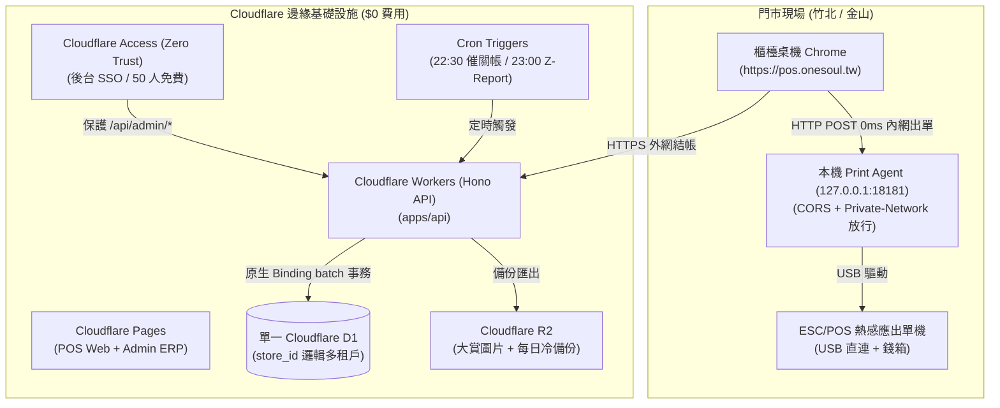
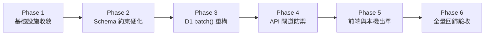

# OneSoul 純 Cloudflare 邊緣 ERP 系統完整落地實作計畫書 (Implementation & Execution Plan)

> **目標**：以 **$0 月費** 實現高效能、強一致性之純 Cloudflare 邊緣架構（Workers + Hono + 單一 D1 + Pages + KV + R2），徹底解決歷史架構漏洞，並落地門市桌機 Chrome + USB 出單機硬體橋接。  
> **版本**：v3.0.0-pure-cloudflare-edge  
> **生效日期**：2026-11-19  

---

## 1. 架構定案與邊界 (Architecture Baseline)



### 核心原則與決策清單
1. **費用極致 $0/月**：依賴 Workers Free（10 萬 req/日）、D1 Free（500 萬讀 / 10 萬寫/日）、Pages Free、R2 Free（10GB 儲存）、Access Free（50 席位）。三門市日均 60 筆交易僅佔額度 < 0.1%。
2. **單一 D1 實例收斂**：廢棄一店一庫物理分庫，改為 `store_id` 邏輯多租戶，跨店調撥與會員點數扣減在單一資料庫內原生保證 ACID。
3. **門市極簡出單**：廢棄公網 Tunnel 現場出單，改由門市桌機跑極輕量本機 Agent（`127.0.0.1:18181`），外網斷線不影響收據出單。
4. **信用卡綁定用途**：純用於解鎖 Zero Trust Access（保護後台）與 R2 物件儲存，不產生固定月費。

---

## 2. 六大階段執行藍圖 (Six-Phase Implementation Roadmap)



---

### Phase 1：基礎設施配置收斂 (Infra & Config Cleanup)

- [ ] **1.1 收斂 `apps/api/wrangler.toml`**
  - 將 4 顆 D1 (`DB_CHUPEI`, `DB_JINSHAN`, `DB_WAREHOUSE`, `DB_COORDINATOR`) 收斂為單一 `DB`。
  - 移除強制付費的 `queues.producers` (`ZREPORT_QUEUE`, `TRANSFER_QUEUE`)。
  - 新增排程設定：
    ```toml
    [triggers]
    crons = ["30 14 * * *", "0 15 * * *"] # 台北 22:30 催辦, 23:00 總部 Z-Report
    ```
- [ ] **1.2 補齊環境變數型別與 DI 注入**
  - `apps/api/src/types/env.ts`：加入 `AUDIT_SECRET: string`、`CF_ACCESS_TEAM_NAME: string`、`CF_ACCESS_AUD: string`。
  - `apps/api/src/di/container.ts`：將 `AUDIT_SECRET` 注入審計倉儲，移除 `'onesoul-audit-key-2026'` 硬編碼。

---

### Phase 2：資料庫 Schema 與 SQLite 引擎約束硬化 (Schema & Constraints)

- [ ] **2.1 補齊實體表 `CHECK` 約束與複合外鍵**
  - 修改 `packages/db/src/schema/tables.ts`：
    - `store_inventories`：加入 `CHECK (quantity >= 0)`
    - `members`：加入 `CHECK (points >= 0)`
    - `lucky_bag_prizes`：加入 `CHECK (drawn_count <= draws)`
    - `orders`：加入 `CHECK (is_walkin = 0 OR points_used = 0)`
    - `cash_register_sessions`：加入部分唯一索引 `UNIQUE (store_id) WHERE status = 'OPEN'`
- [ ] **2.2 審計日誌表升級為分區獨立鏈**
  - `audit_logs` 增加 `store_id TEXT NOT NULL`、`sequence_num INTEGER NOT NULL`。
  - 建立複合約束：`UNIQUE (store_id, sequence_num)` 與 `UNIQUE (store_id, prev_hash)`。
  - 確保首筆寫入時 `sequence_num = 1, prev_hash = '0000...0000' (64-zeros)`。
- [ ] **2.3 產出全新 Drizzle Migration 腳本**
  - 執行 `npm --prefix packages/db run db:generate` 產出乾淨之單一 D1 遷移 SQL。

---

### Phase 3：D1 核心交易層重構 (D1 Transaction & Batching)

- [ ] **3.1 淘汰 `D1TransactionManager` 的 `db.transaction()`**
  - 修改 `apps/api/src/adapters/d1/D1TransactionManager.ts`：
    - 移除底層發送原生 `BEGIN/COMMIT` 之 `this.db.transaction()`。
    - 改為蒐集 SQL 語句清單並透過 `env.DB.batch([...])` 提交。
- [ ] **3.2 落實 D1 `db.batch()` 6 條 SQLite 硬護欄**
  1. **相對增減**：庫存與點數扣減採 `UPDATE ... SET points = points - ? WHERE id = ?`，不把餘額寫入 `WHERE`，超扣直接觸發 `CHECK` 拋錯回滾。
  2. **哨兵唯一表防重入**：關帳與作廢插入 `session_closures(session_id PK)` 與 `order_voids(order_id PK)`，防止並發重複執行。
  3. **防 0-row 靜默提交**：日誌流水帳 `INSERT (..., balance)` 的 `balance` 欄位以子查詢 `(SELECT points FROM members WHERE id = ?)` 填入，目標列不存在時觸發 `NOT NULL` 回滾。
  4. **審計鏈單表尾端 CAS**：交易前讀取最後一筆 `sequence_num` 與 `current_hash`，批次內寫入時若併發衝突，由 `UNIQUE` 約束強制整批回滾並觸發外層重試。
  5. **同品項重複 SKU 聚合**：結帳前將相同 `productId` 預先合併排序，避免批次語句膨脹。
  6. **消除 AllocationUseCase N+1**：改寫 `AllocationUseCase.ts` 為單一 `IN (...)` 批次查詢，防爆 D1 50 queries 上限。
- [ ] **3.3 改寫 6 個 UseCase（11 處交易點）**
  - 改寫 `CheckoutUseCase`、`InventoryUseCase`、`PreOrderUseCase`、`MemberUseCase`、`AllocationUseCase`、`SessionUseCase` 之批次構建邏輯。

---

### Phase 4：API 閘道防禦與安全性加固 (Gateway & Security Hardening)

- [ ] **4.1 補齊 Cloudflare Access JWT 驗證中介層**
  - 新增 `apps/api/src/middleware/accessAuth.ts`：
    - 抓取 `Cf-Access-Jwt-Assertion` Header。
    - 使用 `@cloudflare/workers-types` 或 `jose` 抓取 Cloudflare Access JWKS 驗證簽章、`aud` 與 `exp`。
    - 提取登入信箱寫入 `c.set('callerEmail', email)`，全面封殺 Header 偽造。
- [ ] **4.2 收緊 CORS 跨域設定**
  - 修改 `apps/api/src/middleware/security.ts`：
    - 移除萬用正則 `/^https:\/\/[a-zA-Z0-9_\-]+\.pages\.dev$/`。
    - 嚴格鎖定指定生產網域（如 `https://pos.onesoul.tw`, `https://admin.onesoul.tw`）。
- [ ] **4.3 廢除記憶體暫存與加固輸入驗證**
  - 移除 `orders.routes.ts` 的 `orderDraftsMap = new Map()`，改由前端離線暫存。
  - 所有結帳 Zod Schema 數值欄位（`amount`, `pointsUsed`, `cash` 等）全面追加 `.min(0)`，杜絕負數鑄點漏洞。
  - 清理過時的 LINE Notify 依賴，統一對接 Telegram Bot 警報。

---

### Phase 5：門市硬體與收銀端點對齊 (POS Frontend & Printing)

- [ ] **5.1 規範門市桌機 Localhost Print Agent**
  - 建立極簡本機列印守護行程（監聽 `http://127.0.0.1:18181`）。
  - 設定 HTTP 回應標頭（符合 Chrome LNA 規範）：
    ```http
    Access-Control-Allow-Origin: https://pos.onesoul.tw
    Access-Control-Allow-Methods: POST, OPTIONS
    Access-Control-Allow-Headers: Content-Type, X-Print-Token
    Access-Control-Allow-Private-Network: true
    ```
- [ ] **5.2 前端 POS 收銀台（`web/`）正式切換**
  - 將 `web/src/services/api.ts`（舊 GAS）呼叫全面切換至 `edgeClient.ts`。
  - 於 `useCheckout` 完成結帳後，非同步發送出單請求至 `http://127.0.0.1:18181/print`。

---

### Phase 6：全量回歸與驗收標準 (Verification & Acceptance)

- [ ] **6.1 後端測試回歸**：
  ```bash
  npm --prefix apps/api run test # 目標：24 test files, 419+ passed, 0 failures
  ```
- [ ] **6.2 前端 POS 測試回歸**：
  ```bash
  npm --prefix web run test # 目標：16 test files, 328 passed, 0 failures
  ```
- [ ] **6.3 雙前端生產建置檢查**：
  ```bash
  npm --prefix admin run build && npm --prefix web run build # 0 TypeScript errors
  ```
- [ ] **6.4 紅隊對抗情境驗收**：
  - [ ] 模擬兩機同時以同一會員扣減點數，驗證是否精確拋出 CAS 衝突拒絕雙花。
  - [ ] 模擬跨門市同時調撥相同品項，驗證字典序防死鎖與單一事務原子性。
  - [ ] 模擬散客傳入 `pointsUsed > 0`，驗證 SQLite 引擎層 `CHECK` 約束是否百分之百硬阻斷。
