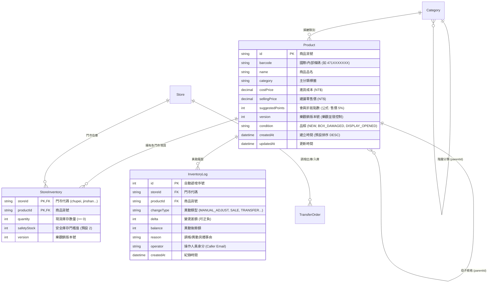
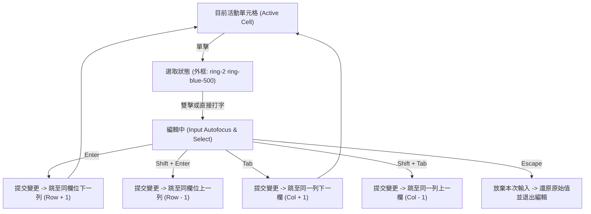

# OneSoul POS 庫存主檔工作台規格書 (Inventory Workbench Specification)

**版本**: v1.3.0  
**日期**: 2026-10-13  
**系統目標**: 為 OneSoul 實體玩具公仔連鎖門市提供旗艦級 Google Sheets 體驗之庫存主檔工作台，支援多門市動態水平對照、原地單元格鍵盤流編輯、雙軌即時/批次儲存，以及高並發原子級交易防護。

---

## 1. 系統架構與資料模型規格 (Data Architecture Spec)

### 1.1 核心實體關聯 (ERD)



### 1.2 Google Sheet 試算表歷史資料清洗與品名 100% 精確對齊 (Data Cleansing)
- **試算表空白公式佔位行 (Ghost Rows Filtering)**：
  - 歷史 Google Sheet 的 `items` 試算表底部存在 888 筆由公式 `=IF(...)` 預填貨號流水號（`3262` ~ `4107`）之空白預留列（品名為空、成本=0、售價=0、庫存=0）。
  - ETL 清洗引擎與查詢 API 嚴格執行幽靈行防護過濾：凡無品名且成本=0、售價=0、庫存=0 者一律拋棄，禁止污染商品主檔。
- **品名 100% 精確對齊**：
  - 全量 3,148 筆真實公仔商品品名（如海賊王、寶可夢、火影、GK雕像等）100% 與 Google Sheet 歷史庫存品名精確對應。
  - 絕不以貨號/純數字代號作為品名之 fallback 遮蔽。
- **最新到舊動態排序與次級排序 (Secondary Sort)**：
  - 預設按 `createdAt DESC` 排序。
  - 當時間戳相同時，依貨號遞減次級排序（大編號新品在前），確保使用者打開第 1 頁看到的永遠是最新進貨與最新手動建立之公仔品名。

### 1.3 多門市動態擴展與 O(1) 雜湊聚合架構
- **門市動態擴展**：拒絕固定寫死竹北/金山欄位。後端動態查詢所有 `isActive = true` 門市，回傳門市陣列與字典。
- **O(1) 雜湊映射算法**：
  - 記憶體中建立 `Map<productId, { storeStocks: Record<string, number>, safetyStocks: Record<string, number>, totalStock: number, maxSafetyStock: number }>`。
  - 單次走訪 8,000+ 筆庫存紀錄完成聚合，避免 $O(N \times M)$ 迴圈查詢。
- **全庫搜尋與分頁引擎**：
  - 支援品名、貨號、條碼三重模糊搜尋，250ms 前端防抖。
  - 支援動態排序：建立時間 (`createdAt DESC`)、更新時間、建議售價、全店合計庫存、品名字典序。
  - 分頁規格：支援 20 / 50 / 100 筆分頁，回傳 `total`、`totalPages` 與統計資訊。

---

## 2. API 合約規格 (API Contract Specifications)

### 2.1 `GET /api/admin/inventory/summary`
- **目的**：獲取跨門市庫存對照總覽清單與動態門市配置。
- **Query 參數**：
  - `q` (string, optional): 關鍵字搜尋 (品名/貨號/條碼)。
  - `category` (string, optional): 分類篩選 ('ALL' 或指定分類)。
  - `lowStockOnly` (boolean, optional): 僅看低於安全庫存商品。
  - `page` (number, default: 1): 頁碼。
  - `pageSize` (number, default: 20): 每頁筆數。
  - `sortBy` (string, default: 'createdAt'): 排序欄位。
  - `sortOrder` ('asc' | 'desc', default: 'desc'): 排序方向。
- **Response (200 OK)**：
  ```json
  {
    "success": true,
    "stores": [
      { "id": "chupei", "name": "竹北店", "code": "CP" },
      { "id": "jinshan", "name": "金山店", "code": "JS" }
    ],
    "data": [
      {
        "id": "PROD-001",
        "barcode": "471999001",
        "name": "海賊王 魯夫 五檔 景品公仔",
        "category": "FIGURE",
        "costPrice": 320,
        "sellingPrice": 580,
        "suggestedPoints": 29,
        "version": 1,
        "storeStocks": { "chupei": 8, "jinshan": 4 },
        "safetyStocks": { "chupei": 2, "jinshan": 2 },
        "totalStock": 12,
        "safetyStock": 2,
        "isLowStock": false,
        "createdAt": "2026-10-12T12:00:00.000Z"
      }
    ],
    "pagination": {
      "page": 1,
      "pageSize": 20,
      "total": 4041,
      "totalPages": 203
    },
    "meta": {
      "totalProducts": 4041,
      "filteredCount": 4041,
      "lowStockCount": 15
    }
  }
  ```

### 2.2 `PUT /api/admin/inventory/products/:id`
- **目的**：修改單一商品主檔（價格、品名、條碼）並進行樂觀鎖版本驗證。
- **Payload**：
  ```json
  {
    "name": "海賊王 魯夫 五檔 景品公仔 (再版)",
    "sellingPrice": 620,
    "costPrice": 340,
    "suggestedPoints": 31,
    "barcode": "471999002",
    "version": 1
  }
  ```
- **衝突處理**：若傳入 `version` 與資料庫現存版本不一致，回傳 `409 Conflict`。

### 2.3 `POST /api/admin/inventory/adjust-stock`
- **目的**：單一門市庫存快速調帳。
- **Payload**：
  ```json
  {
    "storeId": "chupei",
    "productId": "PROD-001",
    "delta": 2,
    "newQuantity": 10,
    "reason": "門市盤點回補 (或預設快速調帳)"
  }
  ```
- **約束**：調帳後餘額禁止小於 0（否則回傳 `400 Bad Request`）。

### 2.4 `POST /api/admin/inventory/batch-update`
- **目的**：試算表批次模式一次性原子提交多筆主檔與門市庫存。
- **Payload**：
  ```json
  {
    "productUpdates": [
      { "id": "PROD-001", "sellingPrice": 650, "costPrice": 350, "suggestedPoints": 33 }
    ],
    "stockAdjustments": [
      { "storeId": "chupei", "productId": "PROD-001", "newQuantity": 12, "reason": "試算表批次原地更新" },
      { "storeId": "jinshan", "productId": "PROD-001", "newQuantity": 6, "reason": "試算表批次原地更新" }
    ]
  }
  ```
- **原子性保障**：全數包覆於 Prisma `$transaction`，若有任何失敗則全數回滾（All-or-Nothing）。

---

## 3. Google Sheets 試算表 UX 互動規範 (UI/UX Spec)

### 3.1 雙向凍結窗格規範 (Freeze Panes Spec)
| 欄位名稱 | CSS 定位屬性 | Z-Index | 寬度規格 | 視覺邊界與陰影 |
| :--- | :--- | :--- | :--- | :--- |
| **表頭左側交叉區 (貨號/品名)** | `sticky top-0 left-0` / `left-[130px]` | `z-40` | `130px` / `200px` | 永遠頂層，背景 `bg-slate-900` |
| **表頭捲動區** | `sticky top-0` | `z-30` | 各欄固定寬 | 下邊界 `border-b border-slate-700` |
| **凍結欄 1: 貨號/條碼** | `sticky left-0` | `z-20` | `130px` | 右邊界 `border-r border-slate-800` |
| **凍結欄 2: 品名** | `sticky left-[130px]` | `z-20` | `200px` | 凍結右側立體陰影 `shadow-[4px_0_8px_rgba(0,0,0,0.35)]` |
| **一般資料單元格** | `relative` | `z-0` | 動態寬度 | `border-b border-r border-slate-850` |

### 3.2 鍵盤導航矩陣 (Keyboard Navigation Matrix)


### 3.3 雙軌儲存狀態機 (Dual Persistence State Machine)
- **⚡ 即時自動儲存模式 (Auto-Save)**:
  - 觸發：單元格 `Enter` 或 `Blur`（失焦）。
  - 狀態轉移：`Idle` -> `Saving` (藍色呼吸閃) -> `Saved` (綠色邊框 `ring-2 ring-emerald-400 bg-emerald-950/40` 微閃 1.2 秒) -> `Idle`。
  - 異常轉移：`Error` (紅色警告邊框 `ring-2 ring-rose-500`) -> 自動回滾前端舊值。
- **📋 批次錄入模式 (Batch Mode)**:
  - 觸發：單元格變更後暫存於 `Map<cellKey, PendingCellChange>`。
  - 視覺提示：單元格右上角標記琥珀黃色圓點/角標。
  - 操作介面：頂部常駐浮動條顯示「有 X 筆單元格變更尚未儲存 (⌘S / Ctrl+S)」。
  - 快捷鍵：全域監聽 `(e.ctrlKey || e.metaKey) && e.key === 's'`，攔截瀏覽器預設存檔並調用 `handleBatchSave()`。
  - 還原能力：點擊「全部放棄」即時依快照倒退還原。

### 3.4 試算表密度規範 (Density Toggle)
- **緊湊模式 (Compact)**: 行高 `32px` (`h-8`), 字體 `text-xs font-mono`, 內距 `px-2.5 py-0.5`。
- **標準模式 (Standard)**: 行高 `44px` (`h-11`), 字體 `text-sm`, 內距 `px-3 py-2`。

---

## 4. 驗收標準與測試矩陣 (Verification & Testing Matrix)

### 4.1 資料層驗收矩陣 (Data Integrity Tests)
| 測試案例代號 | 驗證項目 | 預期結果 |
| :--- | :--- | :--- |
| `DATA-01` | 4,041 筆快照海量載入與 O(1) 聚合 | 分頁與搜尋於 150ms 內響應，全店合計庫存與門市字典精確對齊 |
| `DATA-02` | 多門市期初入庫與外鍵完整性 | 新增單品並寫入各門市庫存，`StoreInventory` 與 `InventoryLog` 均成功建立 |
| `DATA-03` | 庫存調帳負數邊界防護 | 扣減量大於現有庫存時，資料庫拒絕並回傳 400，庫存保持不變 |
| `DATA-04` | 批次更新交易原子性 (All-or-Nothing) | 當更新陣列中存在衝突版本或錯誤商品時，整個交易回滾，無部分寫入 |
| `DATA-05` | 樂觀並發鎖版本衝撞校驗 | 舊版本更新遭阻擋並回傳 `409 Conflict` |
| `DATA-06` | 條碼重複阻擋測試 | 重複新增相同貨號時回傳 `409 Conflict` |

### 4.2 UI / E2E 驗收矩陣 (Playwright E2E Tests)
| 測試案例代號 | 驗證項目 | 預期結果 |
| :--- | :--- | :--- |
| `UI-01` | 雙向凍結滾動驗證 (Sticky Verification) | 水平滾動時貨號與品名欄位保持在視窗左側；垂直滾動時表頭保持在頂部 |
| `UI-02` | 原地打字輸入與 Enter 下移 | 點擊售價單元格輸入新數值，按 Enter 游標跳至下一列同欄位 |
| `UI-03` | Tab 橫向導航矩陣 | 單元格輸入後按 Tab 依序遍歷品名 -> 類別 -> 成本 -> 售價 -> 點數 -> 門市庫存 |
| `UI-04` | Esc 取消還原機制 | 正在編輯之數值按 Esc 立即還原原值，不發出任何 API 請求 |
| `UI-05` | 售價即時連動 5% 點數公式 | 原地修改售價為 1,000，點數欄位立即動態更新為 50 pt |
| `UI-06` | 門市庫存即時連動全店合計公式 | 原地修改竹北現貨，全店合計欄位即時自動累加更新 |
| `UI-07` | 即時模式儲存微閃視覺反饋 | 儲存格失焦時觸發綠光微閃動畫 (`animate-pulse`) |
| `UI-08` | 批次模式黃角標與 Ctrl+S 批量提交 | 修改數格出現黃角標與浮動條，按 Ctrl+S 批次提交成功並清空暫存標記 |
| `UI-09` | 32px / 44px 密度切換 | 點擊緊湊/標準按鈕，表格行高在 32px 與 44px 間即時平滑切換 |
