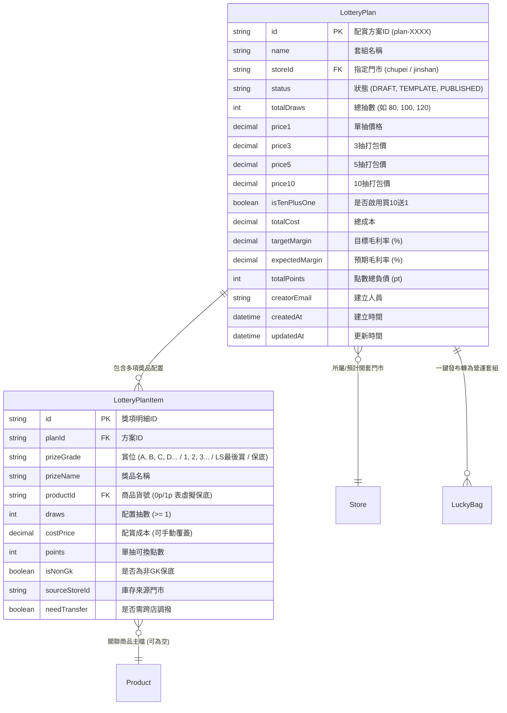

# OneSoul POS 一番賞配賞工作台規格書 (Prize Allocation Workbench Spec)

**版本**: v1.0.0  
**日期**: 2026-10-15  
**系統目標**: 為 OneSoul 實體玩具公仔連鎖門市提供旗艦級一番賞/福袋配賞工作台，支援 Sheet 常用配置快速載入、雙向毛利反推與正推定價、單抽/3抽/5抽/10抽階梯折扣、側邊門市即時現貨看板、雙軌點數負債試算、草稿與範本管理，以及一鍵發布上線開套並自動鎖定庫存。

---

## 1. 核心業務架構與數學公式引擎 (Formula Engine Spec)

### 1.1 財務指標與抽價階梯計算

| 參數代號 | 名稱 | 計算公式 / 說明 |
|---|---|---|
| $N$ | 總抽數 (Total Draws) | $\sum_{i=1}^{k} \text{draws}_i$ (各獎項抽數加總) |
| $C_{\text{total}}$ | 獎品總成本 (Total Cost) | $\sum_{i=1}^{k} (\text{draws}_i \times \text{cost}_i)$ |
| $P_1$ | 單抽基準價 (1 Draw Price) | 店長輸入，或由目標毛利率反推 |
| $R_3, R_5, R_{10}$ | 階梯折扣率 | 預設：3 抽 97 折 ($0.97$)、5 抽 95 折 ($0.95$)、10 抽 90 折 ($0.90$) |
| $P_3$ | 3 抽打包價 | $\text{RoundTen}(3 \times P_1 \times R_3)$ (四捨五入至整十元) |
| $P_5$ | 5 抽打包價 | $\text{RoundTen}(5 \times P_1 \times R_5)$ |
| $P_{10}$ | 10 抽打包價 | $\text{RoundTen}(10 \times P_1 \times R_{10})$ (若啟用 10 送 1 則為 $10 \times P_1$) |
| $P_{\text{eff}}$ | 加權有效單抽價 | 考量玩家行為分佈期望值：$P_{\text{eff}} = 0.35 P_1 + 0.20 \frac{P_3}{3} + 0.25 \frac{P_5}{5} + 0.20 \frac{P_{10}}{10}$ |
| $V_{\text{total}}$ | 預期總營收 (Total Revenue) | $N \times P_{\text{eff}}$ (或純單抽上限 $N \times P_1$) |
| $M_{\text{gross}}$ | 預期現金毛利率 | $\frac{V_{\text{total}} - C_{\text{total}}}{V_{\text{total}}} \times 100\%$ |
| $\text{Points}_{\text{total}}$ | 全套獎品轉換點數總和 | $\sum_{i=1}^{k} (\text{draws}_i \times \text{points}_i)$ |
| $L_{\text{points}}$ | 最大點數負債風險值 | $\text{Points}_{\text{total}} \times 20$ 元 ($1\text{pt} = \$20$) |
| $M_{\text{hybrid}}$ | 綜合期望毛利率 (8:2 帶走/轉點) | 綜合扣除 $20\%$ 轉點負債與 $80\%$ 實體成本後之動態毛利率 |

### 1.2 目標毛利率逆向反推算法 (Reverse Pricing)
當店長輸入目標毛利率 $M_{\text{target}}$（例如 $45\%$）時，自動反推建議單抽價：
$$P_{1, \text{suggested}} = \text{RoundTen}\left( \frac{C_{\text{total}}}{N \times (1 - M_{\text{target}}) \times (0.35 + 0.20 R_3 + 0.25 R_5 + 0.20 R_{10})} \right)$$

---

## 2. 資料模型規格 (Data Model Spec)

---

## 3. UI 佈局架構與操作流線 (Workbench UI UX)

### 3.1 雙欄響應式佈局 (Master-Detail Canvas)
- **左側主畫布 (Main Allocation Canvas - 70% 寬度)**：
  - **頂部工具列**：
    - 套組基本資訊：套組名稱、開套門市（竹北/金山）、範本切換（80抽標準/120抽豪華/單品快開）。
    - 快速動作：儲存草稿、存為範本、一鍵發布上線 POS、重設。
  - **階梯定價與指標卡片 (Financial Bar)**：
    - 單抽、3抽、5抽、10抽即時計算卡片（附折合單抽、折扣比例、整十元微調按鈕）。
    - 即時毛利率儀表板：綠色 ($\ge 35\%$)、橘色 ($20\% \sim 34\%$)、紅色警告 ($< 20\%$)。
    - 雙軌點數試算：總點數負債量、1pt=$20 換算價值。
  - **獎項配置表格 (Prize Grid)**：
    - 欄位：賞位、貨號（打字 Autocomplete）、品名、抽數、單件成本、單件點數、小計成本、庫存來源、操作。
    - 底部「一鍵自動補平非GK保底抽數」按鈕。
- **右側門市現貨抽屜看板 (Live In-Stock Panel - 30% 寬度)**：
  - **門市切換 Tab**：竹北店、金山店、全門市。
  - **篩選條件**：現貨 $\ge 1$、分類標籤（GK雕像、盲盒、景品、綜合...）、關鍵字搜尋防抖 200ms。
  - **商品卡片**：顯示品名、貨號、現貨數、配賞成本、售價、一鍵「＋配為下一賞」按鈕。
  - **跨店調撥標籤**：若該現貨在金山但目前配竹北，顯示橘色 `需調撥` 徽章。

---

## 4. 財務風控與防呆驗證規則 (Financial Guardrails)

1. **抽數平帳驗證**：已配抽數總和必須精準等於設定的 `totalDraws`，否則發布按鈕禁用並紅字提示差距抽數。
2. **大獎必填驗證**：至少必須指定 1 款實體商品（非GK保底抽數不可等於總抽數）。
3. **毛利率安全閥**：
   - 毛利率 $< 30\%$：黃色警示。
   - 毛利率 $< 15\%$：紅色高風險，發布時強制彈出店長覆核二次密碼驗證。
4. **現貨庫存防超配**：若選用實體商品且抽數大於該門市在線現貨，提示庫存不足或標記跨店調撥。
5. **原子級上線發布**：發布時於單一 DB Transaction 內寫入 `LuckyBag`、`LuckyBagPrize`，並自動將該門市商品之 `reservedStock` 累加鎖定。
