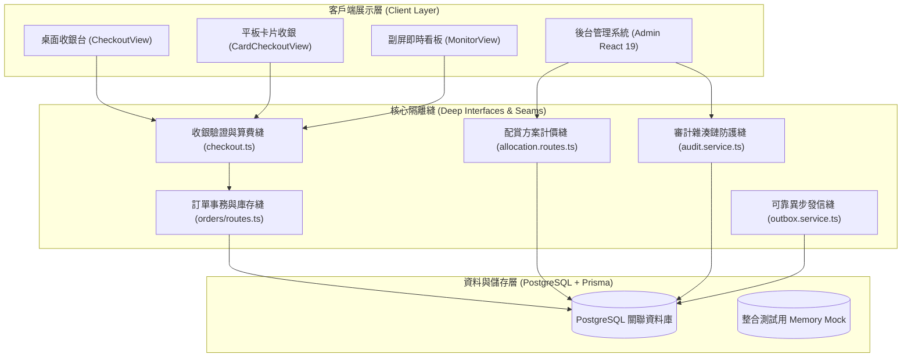
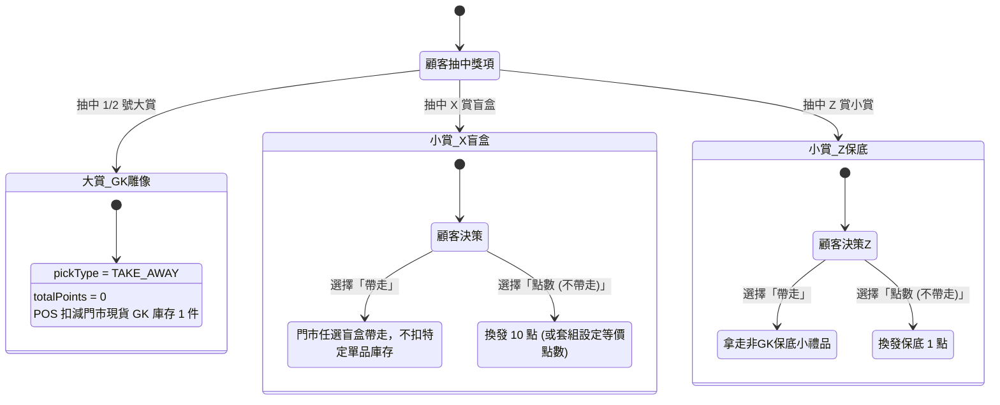
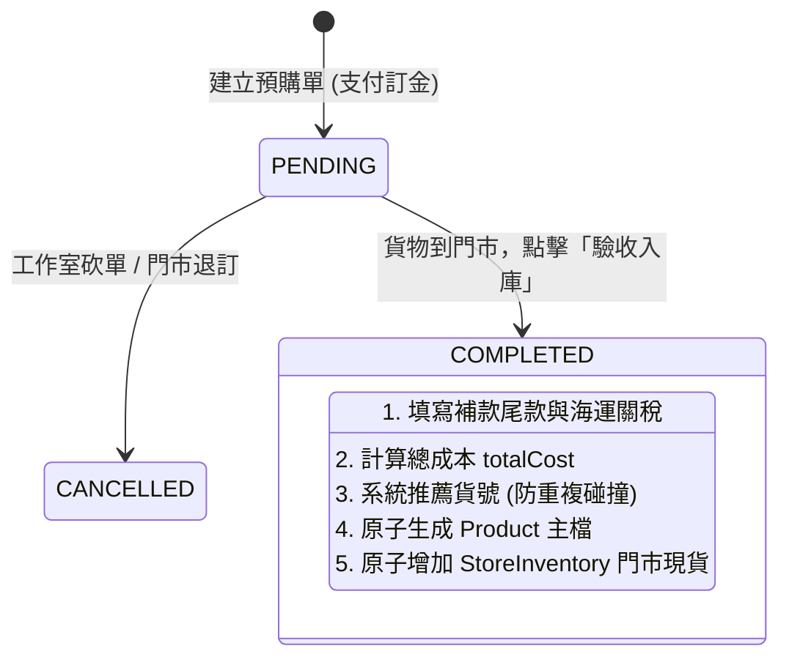

# OneSoul 模型玩具一番賞門市管理與即時營運系統規格書 (System Specification)

> **版本**：v2.6.0-argon  
> **標準依循**：Matt Cook (AI Hero) Engineering Methodology (`to-spec`, `domain-modeling`, `codebase-design`, `writing-for-agents`)  
> **關聯詞彙庫**：[GLOSSARY.md](../GLOSSARY.md)  
> **開發者 Agent 專屬指南**：[AGENTS.md](../AGENTS.md)  
> **目標讀者**：自主 AI 開發 Agent、系統架構師、門市系統維護工程師  

---

## 0. Agent Fast-Track Index & Decision Matrix (Agent 快速導航與決策矩陣)

為了讓自主開發 Agent（如 Google Antigravity、Claude Code、Cursor、Devin）以最小 Token 消耗精確定位，以下為全專案的快速決策索引：

| 開發任務場景 | 必讀規格與章節 | 核心檔案與程式碼指針 (SSOT) | 必過驗收指令 | 核心業務不變量與防呆 |
| :--- | :--- | :--- | :--- | :--- |
| **新增 / 修改業務 API** | 附錄 B.1 ~ B.17 | [`backend/src/app.ts`](file:///Users/heaton/code/onesoul_dev/backend/src/app.ts#L75-L88) 掛載於 `/api/v1/*` 或 `/api/admin/*` | `npm --prefix backend run test` | 嚴格使用 Zod Schema 驗證 Payload；禁止在 Log 輸出電話/Token (MASVS) |
| **修改收銀台結帳 / 算費** | 4.1 Seam 1 4.2 狀態機 1, 2 | [`web/src/logic/checkout.ts`](file:///Users/heaton/code/onesoul_dev/web/src/logic/checkout.ts) 純函數 `calcSummary` / `validateCheckout` | `npm --prefix web run test` | **不變量 #1 (散客穿透阻斷)** 限定點數套金額歸零，每抽扣除 `floor(單抽價/20)` 點 |
| **修改門市庫存 / 調撥 / 盤點** | 3.4 節 附錄 A.1 Models 8, 9, 10 | [`backend/src/modules/orders/routes.ts`](file:///Users/heaton/code/onesoul_dev/backend/src/modules/orders/routes.ts#L200-L240) [`backend/src/modules/stocktakes/routes.ts`](file:///Users/heaton/code/onesoul_dev/backend/src/modules/stocktakes/routes.ts) | `npm --prefix backend run test` | **不變量 #2 (發布開套不預扣)** **不變量 #3 (字典序防死鎖)** 任何庫存異動必須觸發 `InventoryLog` |
| **修改一番賞開套 / 配賞看板** | 3.1 節 4.1 Seam 3 | [`backend/src/modules/admin/allocation.routes.ts`](file:///Users/heaton/code/onesoul_dev/backend/src/modules/admin/allocation.routes.ts) [`admin/src/views/PrizeAllocationWorkbenchView.tsx`](file:///Users/heaton/code/onesoul_dev/admin/src/views/PrizeAllocationWorkbenchView.tsx) | `npm --prefix backend run test` | **不變量 #2 (在庫在場動態解耦)** X 賞等價 10 點、Z 賞保底 1 點注入；抽數必須嚴格平帳 |
| **修改會員點數 / 錢包** | 3.6 節 附錄 A.1 Models 5, 6 | [`backend/src/modules/members/routes.ts`](file:///Users/heaton/code/onesoul_dev/backend/src/modules/members/routes.ts) [`backend/src/modules/orders/routes.ts`](file:///Users/heaton/code/onesoul_dev/backend/src/modules/orders/routes.ts) | `npm --prefix backend run test` | **不變量 #1 (散客穿透阻斷)** 行級悲觀鎖 (`FOR UPDATE`) 保護點數扣減 |
| **修改資料庫模型 (Prisma)** | 附錄 A 全章 (29 Models, 19 Enums) | [`backend/prisma/schema.prisma`](file:///Users/heaton/code/onesoul_dev/backend/prisma/schema.prisma) | `npm --prefix backend run prisma:generate` | 遵循 `@@map` 蛇形命名規範；外鍵約束具備級聯完整性保護 |
| **修改廠商預購單 (PreOrders)** | 3.5 節 4.2 狀態機 3 | [`backend/src/modules/admin/preorders.routes.ts`](file:///Users/heaton/code/onesoul_dev/backend/src/modules/admin/preorders.routes.ts) | `npm --prefix backend run test` | 驗收入庫自動防禦貨號碰撞；原子生成 Product 主檔與門市庫存 |

---

## 1. Problem Statement (問題陳述)

傳統玩具模型與一番賞實體門市在日常營運中面臨嚴重斷裂與資產風險：
1. **試算表協作崩潰與庫存失準**：早期仰賴 Google Sheets 記錄銷售與獎項庫，遇到高頻抽獎或人潮高峰時頻繁爆發試算表並發鎖死、配額超限與公式損壞；更嚴重的是，門市現貨公仔與一番賞獎項各自為政，經常發生「店裡明明只有 1 隻雕像，卻同時被門市零售賣出又被店員配進一番賞套組」的重大超賣超發災難。
2. **一番賞配賞缺乏科學化模型**：店員自行排套時，無法即時得知架上真正剩餘哪些 GK 雕像現貨，且傳統配賞常混雜盲盒造成毛利不均；客人抽中小獎（X 賞盲盒、Z 賞非 GK 保底小物）若不要帶走，傳統換點規則缺乏防呆，容易造成收銀員算錯點數、甚至發生「抽中大獎帶回家卻誤算為換點倒賺」的嚴重門市資產倒貼。
3. **散客與會員錢包漏洞**：實體店散客（如未註冊會員、散客電話 `111111`）經常被誤用點數結帳或參與點數套，導致點數負數、零元零點白嫖等財務破洞。
4. **廠商預購週期冗長難追蹤**：高單價 GK 雕像預購通常經歷數月至一年以上，包含付訂金、補尾款、海運關稅等複雜流程，傳統筆記帳常導致到貨時遺忘訂單或無法自動入庫轉為門市現貨。
5. **日結與審計黑箱**：門市交班實盤現金缺乏嚴謹的溢短帳稽核（Z-Report），缺乏防篡改的審計日誌（Audit Logs），難以防範內部舞弊與事後甩鍋。

---

## 2. Solution (解決方案)

OneSoul 建立了一套專為模型玩具與一番賞實體連鎖門市設計的現代化即時營運架構：
1. **高效能現代化雙端架構**：
   - 後端採用 Fastify + TypeScript + Prisma ORM (PostgreSQL)，以行級悲觀鎖（Row-level Lock）保護會員點數錢包與庫存扣減，並內建結帳冪等保護鍵（Anti-Tampering `checkoutUID`）。
   - 前端收銀台（Web POS）採用 React 19 + Vite 8 + Tailwind，具備「卡片式平板視圖」、「桌面表格視圖」與「雙螢幕副屏廣播（MonitorView）」。
   - 前端管理後台（Admin）整合門市現貨看板、一番賞配賞工作台、預購單生命週期、會員營運、排班打卡與日結審計。
2. **現貨 GK 配賞工作台與雙小賞兌點架構**：
   - 門市現貨配賞看板預設篩選 `mainCategory: 'GK'`，不拿盲盒配大獎，確保獎品全為真實在庫公仔。
   - 內建標準化 X/Z 雙小賞：**X 賞（店內盲盒任選）**不要帶走換發全域等價點數（預設 10 點）；**Z 賞（一番賞小東西）**不要帶走換發 1 點。
   - 支援「限定點數套（`isPointsSet = true`）」，每抽扣點 `floor(單抽價 / 20)`，不收現金；提貨模式嚴格防呆，抽中實體大賞帶走不誤加點數，實體庫存扣減原子綁定 POS 提貨（發布開套不預扣，根除雙重扣庫存）。
3. **全域與套組雙層設定**：後台提供門市全域品牌設定（匯率 1 點 = $20、X 賞 10 點、Z 賞 1 點），配賞開套時可自動同步全域值，亦支援單套方案微調覆蓋。
4. **嚴格防呆與散客穿透阻斷**：收銀台全時段校驗會員錢包餘額，不足時標紅阻擋；後端嚴密阻斷散客號碼進行任何扣點、折抵或抽點數套。
5. **預購單閉環轉換**：預購單歷經「等待發貨（付訂金）」➜「補款驗收入庫」，自動計算總成本並原子轉為商品主檔與指定門市現貨庫存，自動推薦貨號並防禦碰撞。
6. **iCHEF 標準 Z-Report 與密碼學審計鏈**：收銀開班設備金、關班實盤抽屜現金自動計算溢短帳並凍結財務報表；所有管理操作均記入具備前後雜湊鏈（`prevHash` + `currentHash`）之不可變審計日誌。

---

## 3. User Stories (極致詳細之使用者故事清單)

### 3.1 一番賞配賞與開套管理 (Prize Allocation & LuckyBag Lifecycle)
1. **作為門市店長**，我想要在配賞工作台直接瀏覽當前門市所有「現貨 >= 1」的商品，以便確認店內真有庫存再開套，避免配出空單。
2. **作為門市店長**，我希望配賞看板側欄預設僅篩選「GK 雕像」，以便迅速挑選高階雕像作為大獎，不會誤拿盒玩盲盒來配大獎。
3. **作為門市店長**，我想要能夠切換大項分類為「全部商品」或「盒玩盲盒」，以便在特殊主題套組中偶爾搭配特定盒玩。
4. **作為配賞人員**，我希望系統提供 80 抽、100 抽、120 抽等經典常用範本，以便一鍵載入標準大獎與小賞比例，大幅節省排套時間。
5. **作為配賞人員**，我希望每套方案能自訂或自動計算 1抽、3抽（97折）、5抽（95折）、10抽（90折）的階梯優惠價，以便門市執行促銷。
6. **作為配賞人員**，我希望系統即時計算當前配置的總成本、預估總營收與預期毛利率，以便掌握套組盈虧風險。
7. **作為配賞人員**，我希望系統在小賞預設配置 X 賞（盲盒任選）與 Z 賞（非 GK 保底），以便符合門市營運慣例。
8. **作為配賞人員**，我希望系統能快捷新增「LAST 最後賞」，以便鼓勵客人全包清套。
9. **作為配賞人員**，我希望系統提供「一鍵補平抽數」功能，當大獎排定後，點擊一鍵自動將剩餘抽數全部分配給 Z 賞，確保抽數平帳。
10. **作為配賞人員**，我希望系統具備「臨時有事放著（掛單暫存）」與 LocalStorage 自動還原機制，以便在排套中途被客人打斷時，下次打開不會遺失進度。
11. **作為門市經理**，我希望能夠勾選「🎟️ 限定點數套」，系統自動以「單抽價 ÷ 20」計算每抽扣抵點數，以便推出純點數抽獎套組。
12. **作為門市經理**，我希望在排套時能自訂該套組的「X 賞盲盒等價點數」，微調時自動連動該套所有 X 賞項目的點數數值。
13. **作為配賞人員**，我希望在發布方案時支援「一次開 N 套（batchCount）」，以便熱門套組直接批次產生連續序號上架。
14. **作為系統**，在管理員發布套組上線時，嚴禁預先扣減門市單品實體庫存，避免與收銀台提貨重複扣減引發結帳阻斷。
15. **作為門市店長**，當一套一番賞因殘套過久需要作廢清場時，我希望能夠進行「廢套作廢」，系統自動統計已抽總數、實際營收、已支出成本與殘值損益，並存入 `VoidSetLog`。

### 3.2 收銀台 POS 核心結帳 (Cash Register & POS Checkout)
16. **作為門市收銀員**，我想要在輸入一番賞套號與賞位（如 `LB-01`、`A`）時，系統自動帶出大套名稱、單抽價格、獎項名稱與剩餘抽數。
17. **作為門市收銀員**，我希望輸入賞位大小寫（如 `z` 或 `Z`、`x` 或 `X`）時系統自動正規化比對，避免因輸入習慣不一致導致找不到獎項。
18. **作為門市收銀員**，當輸入抽數超過該獎項目前在庫的剩餘抽數時，系統應自動防呆截斷為最大剩餘抽數，防止超抽超賣。
19. **作為門市收銀員**，當顧客抽中獎品時，系統預設提貨模式為「帶走」，此時獎項折算點數應為 0 點，結帳後實體公仔自動扣除庫存。
20. **作為門市收銀員**，當顧客抽中 X 賞盲盒並明確表示「不要帶走，我要換點數」時，我切換為「點數」，系統自動帶入該套組設定之等價點數（預設 10 點）。
21. **作為門市收銀員**，當顧客抽中 Z 賞保底小賞並表示「不要帶走」時，我切換為「點數」，系統自動帶入保底 1 點。
22. **作為門市收銀員**，當結帳「限定點數套」時，系統應自動將金額設為 0 元，提貨模式預設為「帶走」，並自動填入「扣抵點數」為 `(單抽價 ÷ 20) × 抽數`。
23. **作為門市收銀員**，在結帳限定點數套時，若顧客同時抽中 X 賞且選「不要帶走換點數」，系統應自動在總點數異動中進行扣抵相消（扣抽套點數 + 補小賞點數）。
24. **作為門市收銀員**，我想要在同一個購物車內同時輸入一番賞抽獎與直購商品（如 GK 現貨、盒玩、飲料），系統自動合併加總金額與點數。
25. **作為門市收銀員**，當掃描或輸入商品貨號時，若為 GK 類別商品，系統應自動將付款方式切換為「點數兌換」，並提示建議點數。
26. **作為門市收銀員**，我想要支援輸入特殊代碼 `88888`（手動贈送點數）與 `99999`（手動扣除點數），並強制要求填寫備註原因。
27. **作為門市收銀員**，我希望在結帳時支援複合支付：現金、信用卡、LINE Pay、銀行匯款與點數折抵，且實收總和必須 100% 等於應付金額方可結帳。
28. **作為門市收銀員**，在平板操作時，我想要使用「卡片式視圖（CardCheckoutView）」，系統在點數套時清楚顯示「扣抵點數」輸入框，而非單純金額 0。
29. **作為門市收銀員**，在桌面電腦操作時，我想要使用「表格視圖（CheckoutView）」，具備緊湊高效的鍵盤快速跳格輸入體驗。
30. **作為門市收銀員**，當顧客點數不足或未輸入會員電話時，介面上的點數異動區應立即顯示紅字「⚠️ 不足 (Xp)」，結帳按鈕點擊時跳出具體阻擋警示。
31. **作為門市老闆**，我希望後端結帳 API 嚴格攔截散客（`111111`、`散客`、`現場`），若散客交易包含任何點數扣抵、點數換商品或點數套，後端強制回傳 400 阻擋，杜絕零元零點白嫖。
32. **作為現場顧客**，我希望透過門市面向顧客的副屏（MonitorView）即時看到收銀員正在輸入的抽獎明細、應付金額與目前點數餘額。
33. **作為門市收銀員**，當上一筆訂單輸錯需要作廢時，我希望點擊「作廢訂單」，系統原子回退所有已扣庫存、回滾一番賞抽數、並退回或扣回會員點數。

### 3.3 門市班次開關帳與日結報表 (Cash Register Sessions & Z-Report)
34. **作為開班店員**，在每日開始營業時，我需要輸入當班開箱零錢備金（如 $3,000），系統建立開啟狀態之 `CashRegisterSession`。
35. **作為當班店員**，在營業過程中，所有訂單必須自動關聯到當前開啟中的收銀班次，確保帳目歸屬明確。
36. **作為交班店員**，在營業結束關帳時，我需要清點抽屜實際現金並輸入「實盤現金」，系統自動比對 `(開箱備金 + 現金營收)` 計算「溢短帳」。
37. **作為門市店長**，關帳時系統應自動計算當班之總營收、信用卡、匯款、發出點數、扣除點數、作廢筆數與作廢金額，生成不可修改的 Z-Report 財務快照。
38. **作為管理人員**，我希望在管理後台「班次管理」中隨時檢視歷史所有班次的開關帳時間、操作人員、溢短現金與營業額統計。

### 3.4 商品主檔與跨店庫存管理 (Products & Inventory Management)
39. **作為庫存管理員**，我想要維護全門市商品主檔，包含貨號、條碼、品名、品牌、系列、大項（GK / BLIND_BOX / GENERAL）、次項（IP 分類）、成本與建議售價。
40. **作為門市人員**，我想要查看特定商品在「竹北店」、「金山店」與「中央總倉」的各自庫存分佈與安全庫存水位。
41. **作為門市店員**，當遇到客人要買本店缺貨但別店有貨的商品時，POS 自動以跨店 fallback 帶入品名並標注「在金山店」，方便即時為客人調貨。
42. **作為店長**，當需要將 5 隻海賊王雕像從竹北店調往金山店時，我可以在後台發起「跨店調撥單（TransferOrder）」，經歷出庫扣減、在途標記、金山店驗收入庫，確保責任轉移清楚。
43. **作為盤點人員**，我希望發起門市全面盤點（Stocktake），店員輸入實盤數量後，系統自動計算盤盈盤虧差異，審核過帳後自動修正庫存並寫入異動日誌。
44. **作為店長**，我希望每一次庫存變動（銷售出庫、作廢入庫、盤點調整、手動進貨）都在 `InventoryLog` 留下操作人、時間、前後結存與原因。

### 3.5 廠商預購與期貨入庫追蹤 (Pre-orders & Procurement Lifecycle)
45. **作為採購經理**，在向工作室下訂 GK 雕像時，我希望建立「預購單」，記錄廠商名稱、商品名稱、版本、預購數量與已付訂金。
46. **作為採購經理**，在工作室通知補款出貨時，我可以填寫補款尾款與運費/關稅，系統自動精確計算該批雕像的單件實際總成本。
47. **作為門市店長**，當貨品實體送達門市時，點擊「驗收入庫」，系統自動推薦未使用的下一個商品貨號，並提示指定入庫門市。
48. **作為系統**，在預購驗收入庫時，嚴格防禦貨號碰撞：若指定的貨號已存在於商品主檔，系統拒絕靜默覆蓋，要求更換貨號以保全資料完整性。
49. **作為門市店長**，驗收入庫完成後，系統應原子建立 `Product` 商品主檔，並在 `StoreInventory` 增加相應門市庫存，同時將預購單狀態推進至 `COMPLETED`。
50. **作為採購經理**，若遇工作室流單或砍單，可執行「取消退訂」，將預購單標記為 `CANCELLED`，保留完整採購追蹤紀錄。

### 3.6 會員忠誠點數與客群經營 (Members & Loyalty)
51. **作為收銀員**，結帳時輸入顧客手機號碼（支援輸入前 3 碼或姓名動態搜尋），快速綁定會員。
52. **作為收銀員**，若顧客為初次到店，可在 POS 介面直接輸入姓名與電話快速建檔成為會員。
53. **作為門市經理**，我希望會員點數永久有效，每次消費賺取之點數與折抵扣除之點數均記錄在 `PointLog` 點數流水帳中。
54. **作為系統**，在進行任何點數異動時，必須採用資料庫行級鎖保護會員點數欄位，徹底防止並發結帳造成的超額扣點或資料競爭（Race Condition）。
55. **作為管理人員**，我希望在會員管理介面檢視會員的累計消費總額（totalSpent）、消費次數（orderCount）與最後到店日期，以便鎖定 VIP 熟客。

### 3.7 排班考勤與門市公告 (Schedules, Attendance & Notices)
56. **作為店長**，我可以在後台設定各門市的每日排班人員（Schedule），並標注公休日。
57. **作為門市店員**，上班到店時在 POS 點擊「上班打卡」，系統記錄打卡時間、門市與 IP 位址。
58. **作為系統**，打卡時自動比對門市營業時間與 15 分鐘寬限期（lateGraceMinutes），若遲到則自動計算遲到分鐘數並記錄。
59. **作為管理人員**，當店員超過寬限期仍未打卡時，系統自動跳出遲到提醒，並可透過 Outbox 任務發送通知。
60. **作為營運主管**，我可以在後台發布「即時緊急公告（EmergencyNotice）」，指定推播給竹北店、金山店或全部門市，POS 透過長連線或輪詢即時跳出公告視窗。

### 3.8 系統設定、品牌客製與密碼學審計 (Settings, Brand & Tamper-evident Audit)
61. **作為系統管理員**，我可以在「系統設定」維護門市清單（支援單門市與最多 5 間門市擴增），設定營業時間與打卡寬限。
62. **作為系統管理員**，我可以在後台設定「店家品牌資訊」：品牌名稱、副標題、Logo 字樣、客服電話、點數現金匯率（預設 $20/點）、X 賞盲盒等價點數（預設 10 點）與 Z 賞小賞點數（預設 1 點）。
63. **作為稽核人員**，我希望後台所有敏感操作（開套、調點、作廢、開關帳、修改庫存）均產生包含 `prevHash` 與 `currentHash` 之密碼學雜湊審計日誌（AuditLog），任何資料庫直接改動皆能被審計日誌檢測出鏈條斷裂。
64. **作為系統管理員**，我希望外部第三方服務（LINE Notify、Trello 卡片連動）透過 Transactional Outbox 異步可靠發送，避免第三方服務斷線影響門市 POS 結帳響應。

### 3.9 試算表歷史遷移、資料清洗與一致性防禦 (Data Cleaning, Migration & Consistency Guard)
65. **作為系統**，在進行歷史會員遷移時，必須對手機號碼進行強固型清洗與去重：去除空白、橫槓、括號，自動補齊遺漏之首碼 `0`，消除 `+886` 國碼，白名單保留系統特例號碼（`88888` 手動加點、`99999` 手動扣點），並主動標記攔截非法短碼與衝突電話。
66. **作為系統**，歷史會員生日必須相容多樣化格式解析：支援西元斜線/橫線、民國年轉換（如 `86/6/15`、`5/4/0090` 校正為真實西元生日）、Excel 浮點數天數序號換算，並嚴格過濾排除 1930 年以前與 2020 年以後之超自然或建檔誤植年份。
67. **作為系統**，商品主檔在 ETL 過程中必須透過跨表交叉比對（「銷售資料後台」、「福袋獎項庫」、「廢套紀錄」、「小葉貨品清單」），全面回補真實品名，徹底清除試算表「商品-ID」或純數字代號（除 88888 / 99999 系統特殊品項外）。
68. **作為系統**，商品主檔必須建立清晰二級分類體系：第一大項嚴格劃分為 `GK`（高階雕像）與 `BLIND_BOX`（盒玩盲盒），第二層次項精準歸納至 16 大真實動漫 IP（海賊王、火影、七龍珠、寶可夢、遊戲王、獵人、灌籃高手、鏈鋸咒術、宮崎駿、數碼寶貝、小新、安妮雅、潮玩、國漫、阿拉雷、綜合），完全消除無意義之 `GENERAL` 模糊分類。
69. **作為系統**，在清洗盲盒資料庫時，必須精確識別並濾除公式預留空行（如貨號 100376~104000 等無真實品名、成本 0、售價 0、庫存 0 之無效項目，包含 `103999`），杜絕幽靈虛擬商品流入主檔。
70. **作為系統**，商品庫存遷移必須將歷史資料精確拆分至「竹北店（chupei）」與「金山店（jinshan）」，並嚴格校驗非負數約束（`quantity >= 0`）與外鍵完整性，禁止產生孤兒庫存。
71. **作為系統**，歷史銷售交易明細必須經過平帳校驗，確保每筆訂單之 `receivedAmount` 與各支付管道（`cash + creditCard + remittance`）精確平衡；歷史自打品項自動對應至標準或系統虛擬 SKU（如 `SKU-SYS-Z-NON-GK`、`SKU-SYS-X-BOX`）。
72. **作為系統管理員**，我希望在執行遷移作業時支援 `dryRun` 預演檢查，預先輸出衝突清單與審計報告（`migration_audit_report.json`），確認無誤後方可正式向量化寫入資料庫。

---

## 4. Implementation Decisions & Critical Invariants (實作、架構決策與業務不變量)

遵循 Matt Cook 的 **Deep Modules** 與 **Clean Seams** 原則，系統劃分為高度內聚、隔離完整的四大 Seam：

### 4.1 核心模組與 Seam 切割設計

#### Seam 1: 收銀台算費與防呆純函數模組 ([`web/src/logic/checkout.ts`](file:///Users/heaton/code/onesoul_dev/web/src/logic/checkout.ts))
- **Interface**:
  - `calcSummary(lotteries, merchandises): { dueAmount, pointsChange }`
  - `applyLotteryUpdate(item, field, value, prizes): LotteryItem`
  - `applyMerchUpdate(item, field, value, stocks, crossStocks, blindBoxes): MerchItem`
  - `validateCheckout(input): string | null`
- **Depth**:
  - 封裝了限定點數套零元計算、單抽價除以 20 之點數成本折抵、X 賞 10 點與 Z 賞 1 點之小賞換點邏輯、GK 商品自動切換點數結帳、散客散號防呆、負數防禦、實收與應付平帳校驗、會員點數餘額即時比對。
  - 抽離任何 DOM 或 React 狀態，桌面視圖、卡片視圖與單元測試共用此單一 Seam。

#### Seam 2: 訂單結帳與事務原子庫存模組 ([`backend/src/modules/orders/routes.ts`](file:///Users/heaton/code/onesoul_dev/backend/src/modules/orders/routes.ts))
- **Interface**:
  - `POST /api/v1/orders/checkout`: 結帳下單 (含 Anti-Tampering, 冪等鍵, 散客防護, 行級鎖扣點, 實體商品原子出庫)
  - `POST /api/v1/orders/:checkoutUID/void`: 作廢訂單 (原子回補庫存、回滾抽數、反向退回點數)
- **Depth & Invariants**:
  - **散客防禦法則**：偵測到 `111111`、`散客`、`WALKIN` 時，若 `pointsDelta < 0` 或存在點數套，立即拒絕（HTTP 400）。
  - **防死鎖法則**：處理直購商品庫存扣減時，強制將 `productId` 進行字典序排列（`localeCompare`）後循序鎖定，徹底根除並發交叉死鎖（PostgreSQL 40P01）。
  - **實體庫存扣減時機**：只有一番賞提貨為 `TAKE_AWAY` 且對應實體商品貨號時扣減庫存；X/Z 虛擬小賞或選 `POINTS` 提貨不扣零售庫存。

#### Seam 3: 配賞工作台與生命週期模組 ([`backend/src/modules/admin/allocation.routes.ts`](file:///Users/heaton/code/onesoul_dev/backend/src/modules/admin/allocation.routes.ts))
- **Interface**:
  - `GET /api/admin/allocation/live-stock`: 門市現貨看板 (支援 `mainCategory: 'GK'`, `minQty: 1`)
  - `GET /api/admin/allocation/plans`: 取得草稿與內建模版
  - `POST /api/admin/allocation/plans/publish`: 發布開套 (支援限定點數套、X/Z 點數注入、批次開 N 套)
- **Depth & Invariants**:
  - **在庫在場動態解耦**：`live-stock` 動態統計活躍套組的獎項作為 `allocatedCount`，**發布開套時嚴禁預扣 `storeInventory`**，實體商品庫存統一由 POS 提貨時核銷，確保庫存不被雙重扣減。
  - **雙層設定 Fallback**：若方案未指定 `blindBoxPointsValue`，自動讀取 `STORE_BRAND_INFO` 設定作為預設點數。

#### Seam 4: 防篡改雜湊鏈審計日誌模組 ([`backend/src/modules/admin/audit.service.ts`](file:///Users/heaton/code/onesoul_dev/backend/src/modules/admin/audit.service.ts))
- **Interface**:
  - `recordAuditLog(tx, entry): Promise<AuditLog>`
- **Depth**:
  - 查詢上一筆 AuditLog 之 `currentHash` 作為 `prevHash`，結合當前 `operatorId`、`action`、`targetType`、`targetId`、`afterState` 與 `timestamp`，透過 SHA-256 密碼學雜湊計算產生 `currentHash`，形成不可竄改鏈條。

---

### 4.2 核心狀態機與資料流 (State Machines & Lifecycles)

#### 狀態機 1: 一番賞提貨與點數相消狀態機

#### 狀態機 2: 點數套抽獎與結帳清算模型
- **輸入**：點數套單號（`isPointsSet = true`）、單抽價 $400、抽數 2 抽。
- **計算公式**：
  $$\text{pointsCost} = \left\lfloor \frac{\text{unitPrice}}{20} \right\rfloor \times \text{draws} = \frac{400}{20} \times 2 = 40 \text{ pts}$$
  $$\text{dueAmount} = \$0$$
- **若第 1 抽中 1 號賞（帶走），第 2 抽中 X 賞（選點數換 10 點）**：
  $$\text{totalPoints} = 0 + 10 = 10 \text{ pts}$$
  $$\text{pointsChange} = \text{totalPoints} - \text{pointsCost} = 10 - 40 = -30 \text{ pts}$$
- **校驗**：顧客帳戶必須為合法會員，且 `customer.currentPoints >= 30`；結帳後扣除 30 點，GK 雕像出庫 1 件。

#### 狀態機 3: 廠商預購單生命週期 (Pre-order Lifecycle)

---

## 5. Testing Decisions & Checkable Completion Criteria (測試決策與可檢驗標準)

遵循 Matt Cook 的 **Test External Behavior, Not Implementation Details** 原則：
1. **測試最高層級的 Seam**：
   - 算費與防呆：透過 `validateCheckout` 與 `applyLotteryUpdate` 的完整輸入輸出進行黑箱驗證，不測試內部私有正則表達式。
   - 後端 API：透過 Fastify `app.inject()` 進行完整的 HTTP 請求模擬，驗證真實 Prisma 資料庫異動與 HTTP 回應狀態碼。
2. **Prior Art (既有測試資產)**：
   - 收銀邏輯測試：[`web/src/__tests__/checkout-logic.test.ts`](file:///Users/heaton/code/onesoul_dev/web/src/__tests__/checkout-logic.test.ts)（60 項測試，涵蓋 X 賞 10P、Z 賞 1P、點數套帶走/換點、會員餘額防呆、undefined 防護）。
   - 配賞整合測試：[`backend/tests/allocation.test.ts`](file:///Users/heaton/code/onesoul_dev/backend/tests/allocation.test.ts)（12 項測試，涵蓋現貨 GK 篩選、抽數未平帳拒絕、限定點數套發布、雙層點數注入）。
   - 預購單生命週期測試：[`backend/tests/preorders.test.ts`](file:///Users/heaton/code/onesoul_dev/backend/tests/preorders.test.ts)（7 項測試，涵蓋建立、入庫轉現貨、防貨號碰撞、散客防護）。
   - 資料一致性工作台測試：[`backend/tests/data-integrity-workbench.test.ts`](file:///Users/heaton/code/onesoul_dev/backend/tests/data-integrity-workbench.test.ts)（9 項測試，涵蓋銷售扣庫存、作廢回補、盤點審核過帳）。

### 5.1 Checkable Completion Criteria (可機器檢驗的完成標準)

| 檢驗項目 | 執行指令 | 驗收合格基準 (Passing Threshold) | 失敗處理指引 |
| :--- | :--- | :--- | :--- |
| **後端測試回歸** | `npm --prefix backend run test` | **12 Test Files Passed**, **125 Tests Passed**, Exit code 0 | 檢查 Fastify 路由前綴與 Prisma 事務 mock 是否回滾 |
| **收銀前端測試回歸** | `npm --prefix web run test` | **13 Test Files Passed**, **249 Tests Passed**, Exit code 0 | 檢查 `checkout.ts` 算費公式與邊界 undefined 處理 |
| **後台 TypeScript 建置** | `npm --prefix admin run build` | **0 TS errors**, 產出 `dist/assets/*.js`, Exit code 0 | 檢查型別定義與 API Response 介面 |
| **收銀台 TypeScript 建置** | `npm --prefix web run build` | **0 TS errors**, 產出 `dist/assets/*.js`, Exit code 0 | 檢查 React 19 與 Vite 8 模組依賴 |

---

## 6. Out of Scope (非本規格涵蓋範圍)

1. **線上電子商務購物車與線上金流串接**：本系統聚焦於實體門市現場收銀、一番賞開套與即時庫存，不包含對外線上公開電商（如 Shopify/ECPay 串接）。
2. **會計總帳 ERP 雙分錄借貸系統**：本系統產出 iCHEF 標準之收銀營收與溢短帳 Z-Report，不取代會計師專用之借貸憑證與稅務申報系統。
3. **自動人臉辨識打卡**：考勤採用店內 IP 鎖定、營業時間寬限與手動點擊打卡，不包含生物辨識鏡頭硬體整合。

---

## 7. Further Notes (維護指引與後續開發守則)

1. **單一真實來源 (Single Source of Truth)**：
   - 關於名詞定義，一律參照根目錄 [GLOSSARY.md](../GLOSSARY.md)，嚴禁混用同義詞。
   - 關於開發流程與不變量，一律參照根目錄 [AGENTS.md](../AGENTS.md)。
   - 關於資料模型，一律以 [`backend/prisma/schema.prisma`](file:///Users/heaton/code/onesoul_dev/backend/prisma/schema.prisma) 為唯一準則。
2. **後續 Agent 開發注意事項**：
   - 任何涉及「一番賞開套發布」的改動，切記不可在發布時預扣庫存，實體商品庫存一律由收銀台結帳核銷。
   - 任何涉及「點數套」的改動，預設提貨模式必須維持 `type = '帶走'`，客人抽中大賞是拿走實體，不可誤算為加發點數。
   - 任何涉及「結帳 API」的改動，必須確認散客代碼（如 `111111`）無法繞過扣點檢驗。
3. **部署與維護**：
   - 後端正式啟動：`npm --prefix backend run start` (預設連接 PostgreSQL 5432)。
   - 收銀台與後台建置：`npm --prefix admin run build` 與 `npm --prefix web run build`。

---

## 附錄 A：全資料庫 29 Models 與 19 Enums 資料字典 (Data Dictionary)

本資料字典直接對齊 [`backend/prisma/schema.prisma`](file:///Users/heaton/code/onesoul_dev/backend/prisma/schema.prisma)（802 行），為整個資料庫實體模型之唯一權威對照。

### A.1 核心實體模型 (29 Models)

| 編號 | Model 名稱 | 實體資料表名稱 (`@@map`) | 核心業務功能與欄位說明 | 主鍵 / 唯一鍵 / 索引 |
| :--- | :--- | :--- | :--- | :--- |
| 1 | `Store` | `stores` | 實體零售門市（竹北、金山）、中央總倉與快閃專櫃主檔。記錄營業時間、標準工時與打卡寬限。 | `id` (PK), `code` (Unique) |
| 2 | `CashRegisterSession` | `cash_register_sessions` | 收銀班次主檔。記錄開班備金、實盤現金、溢短帳、關帳時固化之 iCHEF 標準 Z-Report 營收與點數快照。 | `id` (PK, UUID), Index(`storeId, status`) |
| 3 | `TransferOrder` | `transfer_orders` | 門市與總倉間之跨店調撥單。管理出庫、在途（In-Transit）與驗收入庫生命週期。 | `id` (PK), `transferNo` (Unique), Index(`sourceStoreId, status`), Index(`targetStoreId, status`) |
| 4 | `TransferOrderItem` | `transfer_order_items` | 跨店調撥單明細。記錄調撥商品品項、申請數、實發數與實收數。 | `id` (PK), Unique(`transferId, productId`) |
| 5 | `Member` | `members` | 會員主檔與忠誠度錢包。支援手機查詢、條碼、LINE UID 綁定、有效點數、版本樂觀鎖與累計消費指標。 | `id` (PK), `phone` (Unique), `barcode` (Unique), `lineUserId` (Unique) |
| 6 | `PointLog` | `point_logs` | 會員點數不可逆流水帳本。精確記錄每次贈點（EARN）、折抵（REDEEM）、退貨（REFUND）與手動調整（MANUAL）之結餘。 | `id` (PK), Index(`memberId`) |
| 7 | `Category` | `categories` | 商品多層級樹狀目錄。支援大項分類、排序與父子目錄關係。 | `id` (PK), `code` (Unique), Index(`parentId`) |
| 8 | `Product` | `products` | 商品主檔。記錄貨號、條碼、品名、大項（GK/BLIND_BOX/GENERAL）、次項（IP名稱）、配賞成本、售價、建議點數與品相（NEW/盒損）。 | `id` (PK 貨號), `barcode` (Unique), Index(`category`), Index(`mainCategory`), Index(`mainCategory, subCategory`) |
| 9 | `StoreInventory` | `store_inventories` | 多門市庫存矩陣。以門市與商品複合鍵記錄特定門市在架現貨與安全庫存。 | `id` (PK), Unique(`storeId, productId`) |
| 10 | `InventoryLog` | `inventory_logs` | 庫存變更不可篡改日誌。記錄銷售出庫、作廢入庫、盤點盈虧、調撥與操作人員。 | `id` (PK), Index(`storeId, productId`), Index(`createdAt`) |
| 11 | `Stocktake` | `stocktakes` | 門市實盤主檔。記錄盤點門市、盤點人、審核過帳人與過帳時間。 | `id` (PK) |
| 12 | `StocktakeItem` | `stocktake_items` | 實盤明細品項。記錄商品之系統帳面數、門市實盤數與盤盈盤虧差額（variance）。 | `id` (PK), Unique(`stocktakeId, productId`) |
| 13 | `LuckyBag` | `lucky_bags` | 一番賞/福袋套組主檔。記錄套組代碼、門市、套名、單抽價格、是否限定點數套（`isPointsSet`）與狀態。 | `id` (PK) |
| 14 | `LuckyBagPrize` | `lucky_bag_prizes` | 一番賞獎項明細。記錄賞位代號（1/2/A/B/X/Z/LAST）、獎項名稱、商品貨號、等價點數、總抽數與已抽數。 | `id` (PK), Index(`bagId`) |
| 15 | `Order` | `orders` | 銷售訂單主檔。包含結帳冪等鍵（checkoutUID）、門市、班次、會員、應收、實收、複合支付 JSON 與點數淨異動。 | `id` (PK), `checkoutUID` (Unique), Index(`storeId, createdAt`), Index(`sessionId`), Index(`memberId`) |
| 16 | `OrderItem` | `order_items` | 訂單銷售明細。區分一番賞抽獎（LOTTERY）、商品直購（MERCHANDISE）與特殊加扣點（SPECIAL），並記錄提貨方式（TAKE_AWAY/POINTS）。 | `id` (PK) |
| 17 | `User` | `users` | 門市收銀與後台管理員帳號。記錄 Email、姓名、系統角色與派駐門市。 | `id` (PK), `email` (Unique) |
| 18 | `Schedule` | `schedules` | 門市每日排班記錄。記錄各門市指定日期的當班人員與公休日標記。 | `id` (PK), Unique(`storeId, date`) |
| 19 | `ShiftSchedule` | `shift_schedules` | 門市詳細班次排班。支援全班/早班/晚班班別標記與備註。 | `id` (PK), Unique(`storeId, date`) |
| 20 | `Attendance` | `attendances` | 店員打卡紀錄。記錄上下班打卡時間與正常/遲到狀態。 | `id` (PK) |
| 21 | `AttendanceRecord` | `attendance_records` | 考勤審計明細。記錄店員打卡、營業時間比對、遲到分鐘數、來源 IP 與備註。 | `id` (PK), Index(`storeId, clockInAt`) |
| 22 | `IntegrationConfig` | `integration_configs` | 外部第三方服務與系統全域設定。儲存店家品牌、點數現金匯率、X 賞盲盒等價點數與 LINE 憑證。 | `id` (PK), `key` (Unique, 如 `STORE_BRAND_INFO`) |
| 23 | `OutboxTask` | `outbox_tasks` | Transactional Outbox 可靠異步發信匣。確保 LINE 通知、Trello 卡片在資料庫事務成功後可靠投遞，支援失敗重試。 | `id` (PK), Index(`status, nextRetryAt`) |
| 24 | `EmergencyNotice` | `emergency_notices` | POS 即時緊急廣播公告。支援指定推播門市、等級（INFO/WARNING/CRITICAL）與過期時間。 | `id` (PK), Index(`isActive`) |
| 25 | `VoidSetLog` | `void_set_logs` | 一番賞作廢廢套損益日誌。記錄殘套作廢時之已抽總數、實際收入、總成本、殘值與淨損益結算。 | `id` (PK) |
| 26 | `AuditLog` | `audit_logs` | 密碼學前後雜湊鏈審計日誌。記錄操作人、受影響物件、前後狀態快照、SHA-256 前後雜湊鍵（`prevHash`, `currentHash`）。 | `id` (PK), Index(`targetType, targetId`), Index(`operatorId`), Index(`createdAt`) |
| 27 | `PurchaseOrder` | `purchase_orders` | 廠商採購訂單。記錄採購單號、品名、廠商、竹北/金山採購數量與總金額。 | `id` (PK), `orderNo` (Unique) |
| 28 | `PreOrder` | `pre_orders` | 廠商預購單與期貨追蹤。記錄高單價雕像之預付訂金、補款尾款、運費關稅、入庫門市、驗收入庫關聯貨號與狀態。 | `id` (PK), Index(`status`), Index(`supplier`), Index(`createdAt`) |
| 29 | `PrizeAllocationPlan`| `prize_allocation_plans` | 一番賞配賞方案與範本庫。儲存草稿箱、掛單暫存方案、80/100/120 抽經典模版、階梯優惠價與獎項 JSON。 | `id` (PK), Index(`storeId, status`) |

---

### A.2 全系統列舉型別字典 (19 Enums)

| 編號 | Enum 名稱 | 定義之列舉值清單 | 業務領域含義說明 |
| :--- | :--- | :--- | :--- |
| 1 | `StoreType` | `RETAIL`, `WAREHOUSE`, `POPUP` | 門市型態：實體零售門市（竹北、金山）、中央總倉、展場快閃專櫃。 |
| 2 | `SessionStatus` | `OPEN`, `CLOSED` | 收銀班次狀態：當前營業中開啟中（OPEN）、已清盤結帳固化關帳（CLOSED）。 |
| 3 | `TransferStatus` | `DRAFT`, `DISPATCHED`, `RECEIVED`, `CANCELLED` | 跨店調撥狀態：草稿待出庫、已發貨在途中、已驗收入庫完成、已作廢撤銷。 |
| 4 | `PointLogType` | `EARN`, `REDEEM`, `REFUND`, `MANUAL` | 點數流水類型：消費積點、消費折抵扣點、退貨退回點數、管理員人工調點。 |
| 5 | `ProductCondition` | `NEW`, `DISPLAY_OPENED`, `BOX_DAMAGED`, `SECOND_HAND` | 商品品相規格：全新未拆、拆擺無損、盒損特價、二手有瑕疵。 |
| 6 | `ProductCategory` | `GENERAL`, `GK`, `BLIND_BOX` | 商品向下相容大項分類：一般周邊、GK雕像收藏品、盒玩盲盒。 |
| 7 | `InventoryChangeType`| `SALE`, `SALE_VOID_RETURN`, `STOCKTAKE_ADJUST`, `MANUAL_ADJUST`, `TRANSFER_OUT`, `TRANSFER_IN`, `ALLOCATE_TO_LOTTERY` | 庫存異動原因：結帳出庫、作廢入庫、盤點盈虧調整、手動進貨損耗、調撥出庫、調撥入庫、開套鎖定。 |
| 8 | `StocktakeStatus` | `DRAFT`, `POSTED`, `CANCELLED` | 盤點狀態：盤點草稿中、已審核過帳修正庫存（POSTED）、已作廢取消。 |
| 9 | `LuckyBagStatus` | `ACTIVE`, `DEPLETED`, `VOIDED` | 一番賞套組狀態：在架開抽中、已全數抽完下架、管理員廢套作廢。 |
| 10 | `OrderStatus` | `COMPLETED`, `CANCELLED` | 銷售訂單狀態：結帳成功完成、訂單已作廢撤銷回補。 |
| 11 | `OrderItemType` | `LOTTERY`, `MERCHANDISE`, `SPECIAL` | 訂單銷售品項分類：一番賞抽獎、實體直購商品、特殊代碼（88888/99999）。 |
| 12 | `DrawPickType` | `TAKE_AWAY`, `POINTS` | 一番賞提貨決策方式：抽中帶走實體商品（TAKE_AWAY）、放棄實體折換點數（POINTS）。 |
| 13 | `Role` | `SUPER_ADMIN`, `STORE_MANAGER`, `CASHIER` | 系統身分權限：超級管理員、門市店長、門市收銀員。 |
| 14 | `AttendanceStatus` | `NORMAL`, `LATE`, `EARLY_LEAVE`, `ABSENT` | 考勤狀態：準時正常出勤、遲到、早退、缺勤曠職。 |
| 15 | `OutboxTaskType` | `LINE_SHIFT_CLOSED`, `LINE_ORDER_VOIDED`, `LINE_LATE_ALERT`, `TRELLO_GK_CARD` | 異步發信任務類型：LINE 日結關帳通知、LINE 作廢訂單通知、LINE 遲到警告、Trello 高價雕像卡片同步。 |
| 16 | `OutboxStatus` | `PENDING`, `PROCESSING`, `SUCCESS`, `FAILED` | 異步發信任務狀態：待處理、發送中、已發送成功、重試超過上限失敗。 |
| 17 | `NoticeLevel` | `INFO`, `WARNING`, `CRITICAL` | POS 緊急公告層級：一般資訊提醒、重要營運警告、緊急阻斷通知。 |
| 18 | `PurchaseOrderStatus`| `DRAFT`, `SUBMITTED`, `PARTIALLY_RECEIVED`, `COMPLETED`, `CANCELLED` | 採購單狀態：草稿、已送出、部分到貨、採購完成、取消採購。 |
| 19 | `PreOrderStatus` | `PENDING`, `COMPLETED`, `CANCELLED` | 廠商預購單狀態：等待到貨發貨中（已付訂金）、已補款驗收入庫轉現貨、砍單退訂取消。 |

---

## 附錄 B：全系統 97 個 REST API 路由註冊清單 (API Catalog)

本清單逐一對應 `backend/src/modules/` 中所實作之所有端點，以功能模組分門別類呈現。  
> **精準前綴規範**：  
> - 門市 POS 業務端點掛載於：`/api/v1/*`  
> - Admin ERP 管理端點掛載於：`/api/admin/*`  
> - 系統大盤與健康端點掛載於根路徑：`/health`, `/api/dashboard`

### B.1 收銀台核心與訂單模組 (Orders & POS, 7 端點)
- **檔案位置**：[`backend/src/modules/orders/routes.ts`](file:///Users/heaton/code/onesoul_dev/backend/src/modules/orders/routes.ts)
- **掛載前綴**：`/api/v1/orders`

| Method | Path | 主要功能與業務不變量 | 主要輸入 (Payload / Query) | 成功狀態碼 |
| :--- | :--- | :--- | :--- | :---: |
| `POST` | `/api/v1/orders/checkout` | POS 結帳下單（含 Anti-Tampering 冪等鍵、散客防護、行級鎖扣點、GK 庫存原子出庫、防死鎖排序）。 | `checkoutUID, customer, lotteries, merchandises, payment, summary` | `200 OK` |
| `GET` | `/api/v1/orders/daily` | 查詢當前門市今日銷售訂單清單（相容歷史格式）。 | `?branch=竹北&date=YYYY/MM/DD` | `200 OK` |
| `POST` | `/api/v1/orders/:checkoutUID/void` | 作廢整筆結帳訂單（原子回補商品庫存、回滾一番賞抽數、反向退回點數）。 | `checkoutUID` (URL Param), `{ reason }` | `200 OK` |
| `GET` | `/api/v1/orders` | 依門市、日期與分頁查詢訂單主檔清單。 | `?storeId=chupei&startDate=&endDate=&page=&pageSize=` | `200 OK` |
| `POST` | `/api/v1/orders/drafts` | 暫存收銀台購物車草稿（掛單暫存）。 | `{ sessionId, cartData }` | `200 OK` |
| `GET` | `/api/v1/orders/drafts` | 取得當前收銀機之未結掛單草稿。 | `?sessionId=` | `200 OK` |
| `DELETE` | `/api/v1/orders/drafts/:sessionId` | 清除指定班次之暫存掛單。 | `sessionId` (URL Param) | `200 OK` |

---

### B.2 一番賞套組與獎項庫模組 (LuckyBags & Prizes, 3 端點)
- **檔案位置**：[`backend/src/modules/luckybags/routes.ts`](file:///Users/heaton/code/onesoul_dev/backend/src/modules/luckybags/routes.ts)
- **掛載前綴**：`/api/v1/luckybags`

| Method | Path | 主要功能與業務不變量 | 主要輸入 (Payload / Query) | 成功狀態碼 |
| :--- | :--- | :--- | :--- | :---: |
| `GET` | `/api/v1/luckybags/prizes` | 查詢門市目前所有在架活躍之一番賞獎項庫明細（供收銀台自動帶入品名與點數）。 | `?branch=竹北` (或全部) | `200 OK` |
| `GET` | `/api/v1/luckybags/draw-counts` | 取得門市各套組各賞位的即時抽數統計（大盤 MasterView）。 | 無 | `200 OK` |
| `DELETE` | `/api/v1/luckybags/:id` | 快速下架特定一番賞套組。 | `id` (套號) | `200 OK` |

---

### B.3 配賞工作台模組 (Allocation Workbench, 5 端點)
- **檔案位置**：[`backend/src/modules/admin/allocation.routes.ts`](file:///Users/heaton/code/onesoul_dev/backend/src/modules/admin/allocation.routes.ts)
- **掛載前綴**：`/api/admin/allocation`

| Method | Path | 主要功能與業務不變量 | 主要輸入 (Payload / Query) | 成功狀態碼 |
| :--- | :--- | :--- | :--- | :---: |
| `GET` | `/api/admin/allocation/live-stock` | 門市即時現貨看板（預設 `mainCategory: 'GK'`、`minQty: 1`，動態扣除在場已配賞公仔）。 | `?storeId=&mainCategory=GK&category=&q=&minQty=1` | `200 OK` |
| `GET` | `/api/admin/allocation/plans` | 取得配賞方案清單（包含草稿箱 drafts 與預設 80/100/120 抽範本庫 templates）。 | 無 | `200 OK` |
| `POST` | `/api/admin/allocation/plans` | 儲存或更新配賞草稿 / 範本。 | `{ id, name, storeId, totalDraws, price1, items }` | `200 OK` |
| `DELETE` | `/api/admin/allocation/plans/:id` | 刪除配賞草稿。 | `id` (方案 ID) | `200 OK` |
| `POST` | `/api/admin/allocation/plans/publish` | 正式發布開套上線開抽（支援批次開 N 套、限定點數套、X/Z 點數注入、嚴禁預扣庫存）。 | `{ plans: [...] }` 或單方案 `{ name, totalDraws, price1, items, isPointsSet, blindBoxPointsValue, batchCount }` | `201 Created` |

---

### B.4 收銀班次與開關帳模組 (Cash Register Sessions & Z-Report, 9 端點)
- **檔案位置**：[`backend/src/modules/sessions/routes.ts`](file:///Users/heaton/code/onesoul_dev/backend/src/modules/sessions/routes.ts) 與 [`backend/src/modules/admin/sessions.routes.ts`](file:///Users/heaton/code/onesoul_dev/backend/src/modules/admin/sessions.routes.ts)
- **掛載前綴**：`/api/v1/sessions` (POS 端) 與 `/api/admin/sessions` (管理端)

| Method | Path | 主要功能與業務不變量 | 主要輸入 (Payload / Query) | 成功狀態碼 |
| :--- | :--- | :--- | :--- | :---: |
| `GET` | `/api/v1/sessions/current` | POS 查詢當前開啟中之收銀班次與開箱備金。 | `?storeId=` | `200 OK` |
| `GET` | `/api/v1/sessions/active` | 快速判定門市當前是否有收銀班次正在運作中。 | `?storeId=` | `200 OK` |
| `POST` | `/api/v1/sessions/open` | POS 收銀開班（輸入零錢備金開箱）。 | `{ storeId, openingCash, openedBy }` | `200 OK` |
| `POST` | `/api/v1/sessions/close` | POS 收銀交班關帳（實盤現金、計算溢短帳、固化 Z-Report 快照）。 | `{ sessionId, actualCash, note, closedBy }` | `200 OK` |
| `GET` | `/api/v1/sessions` | 查詢指定門市歷史開關帳班次清單與財務指標。 | `?storeId=&startDate=&endDate=` | `200 OK` |
| `GET` | `/api/admin/sessions/live-shift` | 後台即時監控各門市當前當班人員與開班時間。 | `?storeId=` | `200 OK` |
| `POST` | `/api/admin/sessions/open` | 後台管理員遠端協助開班。 | `{ storeId, openingCash, openedBy }` | `200 OK` |
| `POST` | `/api/admin/sessions/close` | 後台管理員遠端強制結算關班。 | `{ sessionId, actualCash, note }` | `200 OK` |
| `POST` | `/api/admin/sessions/simulate-order`| 測試模擬產生訂單以驗證交班計算。 | `{ sessionId, amount }` | `200 OK` |

---

### B.5 商品主檔與庫存工作台模組 (Products & Inventory, 10 端點)
- **檔案位置**：[`backend/src/modules/products/routes.ts`](file:///Users/heaton/code/onesoul_dev/backend/src/modules/products/routes.ts) 與 [`backend/src/modules/admin/inventory.routes.ts`](file:///Users/heaton/code/onesoul_dev/backend/src/modules/admin/inventory.routes.ts)
- **掛載前綴**：`/api/v1/products` (POS 端) 與 `/api/admin/inventory` (管理端)

| Method | Path | 主要功能與業務不變量 | 主要輸入 (Payload / Query) | 成功狀態碼 |
| :--- | :--- | :--- | :--- | :---: |
| `GET` | `/api/v1/products` | 查詢全系統商品主檔列表（支援關鍵字、大項、次項搜尋）。 | `?q=&category=&mainCategory=` | `200 OK` |
| `GET` | `/api/v1/products/stocks` | 查詢多門市在庫現貨庫存矩陣。 | `?storeId=&lowStockOnly=` | `200 OK` |
| `GET` | `/api/v1/products/blindboxes` | 取得盒玩盲盒專用子主檔列表。 | 無 | `200 OK` |
| `GET` | `/api/admin/inventory/suggest` | 智能推薦可用商品貨號（避免碰撞）。 | `?prefix=GK` | `200 OK` |
| `GET` | `/api/admin/inventory/summary` | 後台庫存管理主視圖（分頁、排序、低庫存過濾、多門市跨欄）。 | `?page=&pageSize=&q=&category=&lowStockOnly=&sortBy=&sortOrder=` | `200 OK` |
| `POST` | `/api/admin/inventory/products` | 新增單件商品主檔並初始化各門市現貨。 | `{ id, name, category, mainCategory, subCategory, costPrice, sellingPrice, storeQuantities }` | `201 Created` |
| `PUT` | `/api/admin/inventory/products/:id` | 修改商品主檔資訊與售價點數。 | `id` (貨號), `{ name, sellingPrice, suggestedPoints, ... }` | `200 OK` |
| `POST` | `/api/admin/inventory/adjust-stock` | 手動調整門市庫存（進貨/損耗/校正），強制記錄 `InventoryLog`。 | `{ storeId, productId, delta, reason }` | `200 OK` |
| `POST` | `/api/admin/inventory/batch-update` | 批次修改商品主檔與分類屬性。 | `{ updates: [{ id, changes }] }` | `200 OK` |
| `POST` | `/api/admin/inventory/products/bulk-import` | 批次大宗匯入商品主檔。 | `{ products: [...] }` | `200 OK` |

---

### B.6 盒玩盲盒專區模組 (BlindBoxes, 3 端點)
- **檔案位置**：[`backend/src/modules/admin/blindboxes.routes.ts`](file:///Users/heaton/code/onesoul_dev/backend/src/modules/admin/blindboxes.routes.ts)
- **掛載前綴**：`/api/admin/blindboxes`

| Method | Path | 主要功能與業務不變量 | 主要輸入 (Payload / Query) | 成功狀態碼 |
| :--- | :--- | :--- | :--- | :---: |
| `GET` | `/api/admin/blindboxes` | 取得清洗後之官方盒玩盲盒系列列表與單抽價、等價點數。 | `?series=&brand=&q=` | `200 OK` |
| `PUT` | `/api/admin/blindboxes/:id` | 修改單款盲盒之建議售價或兌換點數。 | `id` (盲盒 ID), `{ manualPrice, points }` | `200 OK` |
| `POST` | `/api/admin/blindboxes/batch-update`| 批次儲存盲盒價格與對應關聯。 | `{ items: [...] }` | `200 OK` |

---

### B.7 廠商預購單與期貨入庫追蹤模組 (PreOrders, 5 端點)
- **檔案位置**：[`backend/src/modules/admin/preorders.routes.ts`](file:///Users/heaton/code/onesoul_dev/backend/src/modules/admin/preorders.routes.ts)
- **掛載前綴**：`/api/admin/preorders`

| Method | Path | 主要功能與業務不變量 | 主要輸入 (Payload / Query) | 成功狀態碼 |
| :--- | :--- | :--- | :--- | :---: |
| `GET` | `/api/admin/preorders` | 查詢預購單清單與統計指標（總等待單數、累計已付訂金、預估總尾款）。 | `?status=&supplier=&q=` | `200 OK` |
| `GET` | `/api/admin/preorders/suggest-next-id`| 推薦下一個未被使用之入庫公仔貨號。 | `?prefix=GK` | `200 OK` |
| `POST` | `/api/admin/preorders` | 建立全新預購單（記錄廠商、品名、數量、預付訂金）。 | `{ name, version, quantity, deposit, supplier, targetStoreId, note }` | `201 Created` |
| `POST` | `/api/admin/preorders/:id/receive` | 補款驗收入庫（計算總成本，防禦貨號碰撞，原子建立商品主檔與門市庫存）。 | `id` (預購單 ID), `{ productId, finalPayment, shippingFee, targetStoreId, retailPrice, points }` | `200 OK` |
| `POST` | `/api/admin/preorders/:id/cancel` | 取消退訂預購單（標記為 CANCELLED）。 | `id` (預購單 ID), `{ reason }` | `200 OK` |

---

### B.8 會員錢包與經營分析模組 (Members & Loyalty, 7 端點)
- **檔案位置**：[`backend/src/modules/members/routes.ts`](file:///Users/heaton/code/onesoul_dev/backend/src/modules/members/routes.ts) 與 [`backend/src/modules/admin/members.routes.ts`](file:///Users/heaton/code/onesoul_dev/backend/src/modules/admin/members.routes.ts)
- **掛載前綴**：`/api/v1/members` (POS 端) 與 `/api/admin/members` (管理端)

| Method | Path | 主要功能與業務不變量 | 主要輸入 (Payload / Query) | 成功狀態碼 |
| :--- | :--- | :--- | :--- | :---: |
| `GET` | `/api/v1/members` | 收銀台快速查詢會員電話清單。 | `?q=` | `200 OK` |
| `GET` | `/api/v1/members/:phone` | 依電話查詢單一會員詳細資訊與當前有效點數。 | `phone` (手機號碼) | `200 OK` |
| `POST` | `/api/v1/members` | POS 現場快速新增會員註冊。 | `{ phone, name, note }` | `201 Created` |
| `GET` | `/api/v1/members/:phone/history` | 查詢會員歷史結帳抽獎與購物明細。 | `phone` (手機號碼) | `200 OK` |
| `GET` | `/api/admin/members` | 後台會員營運總表（分頁、排序、累計消費額、訂單次數、點數排序）。 | `?q=&tier=&page=&pageSize=&sortBy=&sortOrder=` | `200 OK` |
| `POST` | `/api/admin/members/:id/adjust-points`| 管理員手動調整會員點數（行級鎖保護、強制記錄 PointLog 與原因）。 | `id` (會員 ID), `{ delta, reason }` | `200 OK` |
| `GET` | `/api/admin/members/:id/history` | 後台調閱會員完整點數流水帳與訂單軌跡。 | `id` (會員 ID) | `200 OK` |

---

### B.9 門市主檔管理模組 (Stores, 6 端點)
- **檔案位置**：[`backend/src/modules/stores/routes.ts`](file:///Users/heaton/code/onesoul_dev/backend/src/modules/stores/routes.ts) 與 [`backend/src/modules/admin/settings.routes.ts`](file:///Users/heaton/code/onesoul_dev/backend/src/modules/admin/settings.routes.ts)
- **掛載前綴**：`/api/v1/stores` (POS 端) 與 `/api/admin/settings/stores` (管理端)

| Method | Path | 主要功能與業務不變量 | 主要輸入 (Payload / Query) | 成功狀態碼 |
| :--- | :--- | :--- | :--- | :---: |
| `GET` | `/api/v1/stores` | 取得有效門市清單（竹北店、金山店、中央總倉）。 | 無 | `200 OK` |
| `GET` | `/api/v1/stores/:id` | 查詢單一門市基本資訊。 | `id` (門市代碼) | `200 OK` |
| `GET` | `/api/admin/settings/stores` | 後台查詢門市主檔配置與擴增元資料（上限 5 間門市）。 | 無 | `200 OK` |
| `POST` | `/api/admin/settings/stores` | 新增營運門市（門市名稱、代碼、營業時間、打卡寬限）。 | `{ name, code, openTime, standardHours }` | `201 Created` |
| `PUT` | `/api/admin/settings/stores/:id` | 修改門市營業時間與設定。 | `id` (門市 ID), `{ name, openTime, standardHours }` | `200 OK` |
| `DELETE` | `/api/admin/settings/stores/:id` | 刪除停用指定門市。 | `id` (門市 ID) | `200 OK` |

---

### B.10 門市實盤作業模組 (Stocktakes, 3 端點)
- **檔案位置**：[`backend/src/modules/stocktakes/routes.ts`](file:///Users/heaton/code/onesoul_dev/backend/src/modules/stocktakes/routes.ts)
- **掛載前綴**：`/api/v1/stocktakes`

| Method | Path | 主要功能與業務不變量 | 主要輸入 (Payload / Query) | 成功狀態碼 |
| :--- | :--- | :--- | :--- | :---: |
| `GET` | `/api/v1/stocktakes/checklist` | 產出門市現況盤點檢查清單（自動載入當前系統帳面數）。 | `?storeId=` | `200 OK` |
| `POST` | `/api/v1/stocktakes` | 提交門市盤點記錄（記錄實盤數、自動比對盤盈盤虧差額）。 | `{ storeId, countedBy, items: [{ productId, actualQty, remark }] }` | `201 Created` |
| `POST` | `/api/v1/stocktakes/:id/post` | 審核過帳盤點單（原子修正 `StoreInventory`，寫入 `InventoryLog` 調整日誌）。 | `id` (盤點單 ID), `{ postedBy }` | `200 OK` |

---

### B.11 排班、考勤與打卡模組 (Schedules & Attendance, 9 端點)
- **檔案位置**：[`backend/src/modules/operations/routes.ts`](file:///Users/heaton/code/onesoul_dev/backend/src/modules/operations/routes.ts) 與 [`backend/src/modules/admin/schedule.routes.ts`](file:///Users/heaton/code/onesoul_dev/backend/src/modules/admin/schedule.routes.ts)
- **掛載前綴**：`/api/v1/operations` (POS 端) 與 `/api/admin/schedule`, `/api/admin/attendance` (管理端)

| Method | Path | 主要功能與業務不變量 | 主要輸入 (Payload / Query) | 成功狀態碼 |
| :--- | :--- | :--- | :--- | :---: |
| `GET` | `/api/v1/operations/config` | 取得門市考勤設定（營業時間、遲到寬限）。 | `?storeId=` | `200 OK` |
| `GET` | `/api/v1/operations/schedule` | 查詢門市今日排班人員與公休狀態。 | `?storeId=&date=` | `200 OK` |
| `GET` | `/api/v1/operations/attendance` | 查詢門市今日店員打卡狀態。 | `?storeId=&date=` | `200 OK` |
| `POST` | `/api/v1/operations/clock-in` | POS 門市店員上班打卡（記錄時間、IP、自動核算遲到分鐘數）。 | `{ storeId, userEmail, userName }` | `200 OK` |
| `GET` | `/api/admin/schedule/month` | 後台查詢門市整月排班日曆矩陣。 | `?storeId=chupei&yearMonth=YYYY-MM` | `200 OK` |
| `PUT` | `/api/admin/schedule/days` | 後台批量儲存或修改指定日期排班人員名單。 | `{ storeId, days: [{ date, staffName, isClosed }] }` | `200 OK` |
| `GET` | `/api/admin/attendance/records` | 查詢打卡審計明細清單（支援遲到狀態過濾）。 | `?storeId=&startDate=&endDate=&status=` | `200 OK` |
| `GET` | `/api/admin/attendance` | 取得打卡摘要清單。 | `?storeId=` | `200 OK` |
| `POST` | `/api/admin/attendance/clock-in` | 管理員手動補登或調整打卡紀錄。 | `{ storeId, userEmail, clockInAt, status }` | `200 OK` |

---

### B.12 報表分析、訂單作廢與大宗匯出模組 (Reports & Exports, 4 端點)
- **檔案位置**：[`backend/src/modules/admin/reports.routes.ts`](file:///Users/heaton/code/onesoul_dev/backend/src/modules/admin/reports.routes.ts)
- **掛載前綴**：`/api/admin/reports`, `/api/admin/orders`, `/api/admin/export`

| Method | Path | 主要功能與業務不變量 | 主要輸入 (Payload / Query) | 成功狀態碼 |
| :--- | :--- | :--- | :--- | :---: |
| `GET` | `/api/admin/reports/sales` | 營運銷售明細報表（分頁、門市、區間、支付渠道分佈）。 | `?storeId=&startDate=&endDate=&page=&pageSize=` | `200 OK` |
| `GET` | `/api/admin/reports/analytics` | 門市營運分析儀表板（客單價、客品數、熱銷賞位排行、毛利率走勢）。 | `?storeId=&period=day/week/month` | `200 OK` |
| `POST` | `/api/admin/orders/:id/void` | 後台主管權限訂單作廢核准（回退庫存、回滾抽數、退還點數）。 | `id` (訂單 ID), `{ reason, authorizedBy }` | `200 OK` |
| `GET` | `/api/admin/export/:resource` | CSV/Excel 大宗資料匯出（支援 `sales`, `inventory`, `members`, `luckybags`）。 | `resource` (URL Param, 如 `inventory`) | `200 OK` (檔案串流) |

---

### B.13 系統品牌設定與即時緊急公告模組 (Settings & Notices, 8 端點)
- **檔案位置**：[`backend/src/modules/admin/settings.routes.ts`](file:///Users/heaton/code/onesoul_dev/backend/src/modules/admin/settings.routes.ts)
- **掛載前綴**：`/api/admin/settings`

| Method | Path | 主要功能與業務不變量 | 主要輸入 (Payload / Query) | 成功狀態碼 |
| :--- | :--- | :--- | :--- | :---: |
| `GET` | `/api/admin/settings/brand` | 讀取店家品牌設定（品牌名稱、Logo文字、點數現金匯率、X 賞盲盒等價點數、Z 賞點數）。 | 無 | `200 OK` |
| `PUT` | `/api/admin/settings/brand` | 更新店家全域品牌設定與點數規則（雙層設定之全域第一層）。 | `{ brandName, pointRateTwd, blindBoxPointsValue, smallPrizePointsValue, supportPhone }` | `200 OK` |
| `GET` | `/api/admin/settings/integrations` | 讀取第三方整合金鑰與參數（LINE Notify Token、Trello Board ID）。 | 無 | `200 OK` |
| `PUT` | `/api/admin/settings/integrations` | 更新第三方服務配置。 | `{ key, value, isEnabled }` | `200 OK` |
| `POST` | `/api/admin/settings/line-test` | 測試發送 LINE 測試推播訊息。 | `{ token, message }` | `200 OK` |
| `GET` | `/api/admin/settings/emergency-notices`| 查詢當前有效之即時廣播緊急公告。 | 無 | `200 OK` |
| `POST` | `/api/admin/settings/emergency-notices`| 發布全新緊急廣播公告至指定門市 POS 螢幕。 | `{ title, content, level, targetStoreIds, expiresAt }` | `201 Created` |
| `DELETE` | `/api/admin/settings/emergency-notices/:id`| 撤回下架指定緊急公告。 | `id` (公告 ID) | `200 OK` |

---

### B.14 密碼學雜湊審計日誌模組 (Audit Logs, 1 端點)
- **檔案位置**：[`backend/src/modules/admin/audit.routes.ts`](file:///Users/heaton/code/onesoul_dev/backend/src/modules/admin/audit.routes.ts)
- **掛載前綴**：`/api/admin/audit-logs`

| Method | Path | 主要功能與業務不變量 | 主要輸入 (Payload / Query) | 成功狀態碼 |
| :--- | :--- | :--- | :--- | :---: |
| `GET` | `/api/admin/audit-logs` | 調閱防篡改雜湊鏈審計軌跡（支援操作人、對象型態過濾，含鏈條完整性標記）。 | `?operatorId=&targetType=&targetId=&page=&pageSize=` | `200 OK` |

---

### B.15 通知推播與即時看板模組 (Notifications & Dashboard, 4 端點)
- **檔案位置**：[`backend/src/modules/notifications/routes.ts`](file:///Users/heaton/code/onesoul_dev/backend/src/modules/notifications/routes.ts) 與 [`backend/src/modules/dashboard/routes.ts`](file:///Users/heaton/code/onesoul_dev/backend/src/modules/dashboard/routes.ts)
- **掛載前綴**：`/api/v1/notifications` 與根路徑 `/api/dashboard`, `/health`

| Method | Path | 主要功能與業務不變量 | 主要輸入 (Payload / Query) | 成功狀態碼 |
| :--- | :--- | :--- | :--- | :---: |
| `GET` | `/api/v1/notifications/channels` | 查詢可發送之即時通知管道狀態。 | 無 | `200 OK` |
| `POST` | `/api/v1/notifications/send` | 手動推播自訂通知至指定頻道。 | `{ channel, message, priority }` | `200 OK` |
| `GET` | `/api/v1/notifications/quota` | 查詢第三方通知發送配額餘額。 | 無 | `200 OK` |
| `GET` | `/api/dashboard` | 後台首頁即時大盤總覽指標（今日營業額、客單價、在架套組數、庫存警戒數）。 | `?storeId=` | `200 OK` |
| `GET` | `/health` | 後端服務健康檢查。 | 無 | `200 OK` |

---

### B.16 試算表遷移與維運服務模組 (Migration Engine, 4 端點)
- **檔案位置**：[`backend/src/modules/admin/migration.routes.ts`](file:///Users/heaton/code/onesoul_dev/backend/src/modules/admin/migration.routes.ts)
- **掛載前綴**：`/api/admin/migration`

| Method | Path | 主要功能與業務不變量 | 主要輸入 (Payload / Query) | 成功狀態碼 |
| :--- | :--- | :--- | :--- | :---: |
| `GET` | `/api/admin/migration/status` | 查詢歷史資料遷移現況與各資料表筆數校驗。 | 無 | `200 OK` |
| `POST` | `/api/admin/migration/run` | 一鍵啟動全量歷史試算表 ETL 清洗與資料庫寫入作業。 | `{ dryRun, overwrite }` | `200 OK` |
| `GET` | `/api/admin/migration/progress` | 輪詢遷移執行進度與百分比。 | 無 | `200 OK` |
| `GET` | `/api/admin/migration/history` | 查閱歷次遷移執行結果與稽核比對報告。 | 無 | `200 OK` |

---

### B.17 一番賞後台維護模組 (Admin Lottery Management, 8 端點)
- **檔案位置**：[`backend/src/modules/admin/lottery.routes.ts`](file:///Users/heaton/code/onesoul_dev/backend/src/modules/admin/lottery.routes.ts)
- **掛載前綴**：`/api/admin/lottery`

| Method | Path | 主要功能與業務不變量 | 主要輸入 (Payload / Query) | 成功狀態碼 |
| :--- | :--- | :--- | :--- | :---: |
| `GET` | `/api/admin/lottery/overview` | 後台管理員調閱所有一番賞套組清單與抽數總覽。 | `?storeId=&status=` | `200 OK` |
| `POST` | `/api/admin/lottery/boxes` | 手動獨立開套上架（相容舊版單套上架流程）。 | `{ storeId, name, price, prizes: [...] }` | `200 OK` |
| `PATCH` | `/api/admin/lottery/boxes/:id` | 修改在架套組之基本資訊或單抽售價。 | `id` (套號), `{ name, unitPrice }` | `200 OK` |
| `POST` | `/api/admin/lottery/boxes/:id/void` | 廢套作廢並計算殘值損益，自動產出 `VoidSetLog`。 | `id` (套號), `{ reason, operator }` | `200 OK` |
| `POST` | `/api/admin/lottery/boxes/:id/prizes`| 為既有套組追加獎項項目。 | `id` (套號), `{ prizeGrade, prizeName, draws, points }` | `201 Created` |
| `PATCH` | `/api/admin/lottery/prizes/:id` | 修改特定獎項名稱、點數或總抽數。 | `id` (獎項 ID), `{ prizeName, points, draws }` | `200 OK` |
| `POST` | `/api/admin/lottery/prizes/:id/toggle` | 快捷標記獎項為已被抽出 / 恢復未抽。 | `id` (獎項 ID), `{ isDrawn }` | `200 OK` |
| `DELETE` | `/api/admin/lottery/prizes/:id` | 刪除套組中之特定賞位。 | `id` (獎項 ID) | `200 OK` |
| `POST` | `/api/admin/lottery/simulate` | 模擬連續抽獎以驗證機率分佈與平帳計算。 | `{ bagId, drawsCount }` | `200 OK` |
