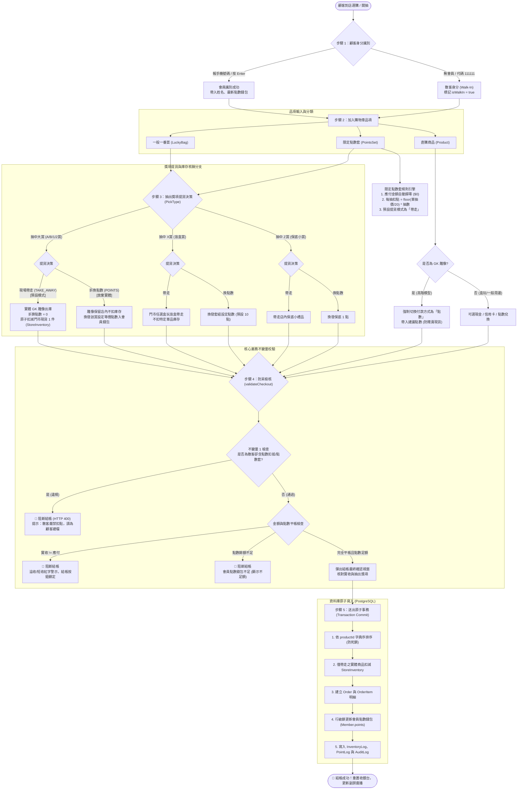
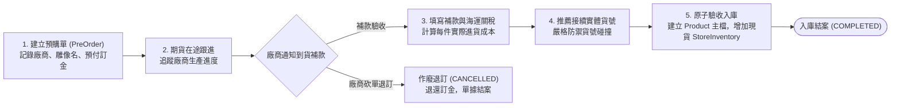
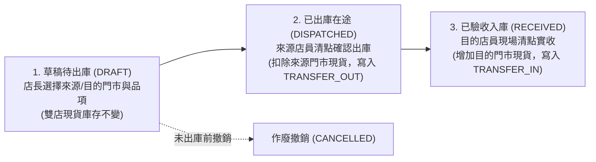

# OneSoul 模型玩具一番賞門市管理與即時營運系統使用說明書 (USER_MANUAL.md)

> **版本**：v2.6.0-argon  
> **系統架構**：雙端獨立展示層（POS Web 前台 5173 / Admin ERP 後台 5174）+ 工業級 Fastify 後端服務（3000）+ PostgreSQL 5432 持久層  
> **適用對象**：門市收銀人員、前台店員、門市店長、連鎖營運主管與系統管理員  
> **編寫基準**：`GLOSSARY.md`、`docs/SYSTEM_SPECIFICATION.md`、`AGENTS.md`、`docs/BRAND_LOGO_GUIDELINES.md`  

---

## 目錄索引 (Table of Contents)

- [第 1 章：OneSoul 系統概述與架構拓撲](#第-1-章onesoul-系統概述與架構拓撲)
  - [1.1 系統使命與核心解決方案](#11-系統使命與核心解決方案)
  - [1.2 系統雙端架構拓撲 (POS Web 5173 vs Admin ERP 5174)](#12-系統雙端架構拓撲-pos-web-5173-vs-admin-erp-5174)
  - [1.3 核心隔離縫 (Clean Seams) 與不可變帳本原則](#13-核心隔離縫-clean-seams-與不可變帳本原則)
- [第 2 章：系統三大不可破壞之核心業務不變量與防呆守則](#第-2-章系統三大不可破壞之核心業務不變量與防呆守則)
  - [2.1 不變量 1：散客（Walk-In）點數穿透阻斷不變量](#21-不變量-1散客walk-in點數穿透阻斷不變量)
    - [2.1.1 技術定義與零元購風險](#211-技術定義與零元購風險)
    - [2.1.2 前端防呆與後端 400 攔截實作](#212-前端防呆與後端-400-攔截實作)
    - [2.1.3 門市第一線作業規範與話術](#213-門市第一線作業規範與話術)
  - [2.2 不變量 2：一番賞開套不預扣庫存，提貨核銷不變量](#22-不變量-2一番賞開套不預扣庫存提貨核銷不變量)
    - [2.2.1 技術定義與實體資產在庫解耦](#221-技術定義與實體資產在庫解耦)
    - [2.2.2 開套零扣減與現貨雷達動態試算](#222-開套零扣減與現貨雷達動態試算)
    - [2.2.3 收銀台提貨方式（帶走 vs 換點）原子核銷機制](#223-收銀台提貨方式帶走-vs-換點原子核銷機制)
    - [2.2.4 雙重扣減與超賣客訴防範](#224-雙重扣減與超賣客訴防範)
  - [2.3 不變量 3：多商品併發鎖序字典序防死鎖不變量](#23-不變量-3多商品併發鎖序字典序防死鎖不變量)
    - [2.3.1 PostgreSQL 行級悲觀鎖與 40P01 死鎖原理](#231-postgresql-行級悲觀鎖與-40p01-死鎖原理)
    - [2.3.2 `localeCompare` 字典序鎖定機制](#232-localecompare-字典序鎖定機制)
    - [2.3.3 尖峰時段多櫃檯結帳操作守則](#233-尖峰時段多櫃檯結帳操作守則)
- [第 3 章：領域名詞標準術語庫與合規禁用詞規範](#第-3-章領域名詞標準術語庫與合規禁用詞規範)
  - [3.1 一番賞與配賞標準術語與定義](#31-一番賞與配賞標準術語與定義)
  - [3.2 商品與庫存標準術語與定義](#32-商品與庫存標準術語與定義)
  - [3.3 收銀與門市營運標準術語與定義](#33-收銀與門市營運標準術語與定義)
  - [3.4 嚴格禁止使用之錯誤名詞對照與紅線清單](#34-嚴格禁止使用之錯誤名詞對照與紅線清單)
- [第 4 章：門市收銀人員標準作業指引 (POS Web, Port 5173)](#第-4-章門市收銀人員標準作業指引-pos-web-port-5173)
  - [4.1 門市開班與收銀班次 (CashRegisterSession) 開啟](#41-門市開班與收銀班次-cashregistersession-開啟)
  - [4.2 會員查詢、快速建檔與錢包餘額檢視](#42-會員查詢快速建檔與錢包餘額檢視)
  - [4.3 一番賞開抽與結帳操作 (單抽、多抽、包套)](#43-一番賞開抽與結帳操作-單抽多抽包套)
  - [4.4 限定點數套 (PointsSet) 專屬操作規範 ($0 結帳、扣點公式、預設帶走)](#44-限定點數套-pointsset-專屬操作規範-0-結帳扣點公式預設帶走)
  - [4.5 抽中獎項提貨核銷模式 (現場帶走 `TAKE_AWAY` vs 折換點數 `POINTS`)](#45-抽中獎項提貨核銷模式-現場帶走-take_away-vs-折換點數-points)
  - [4.6 雙小賞點數折算規則 (X賞盲盒等價折點 vs Z賞保底 1 點)](#46-雙小賞點數折算規則-x賞盲盒等價折點-vs-z賞保底-1-點)
  - [4.7 直購商品結帳與混合購物車 (GK雕像自動切換點數、88888/99999 特殊品項)](#47-直購商品結帳與混合購物車-gk雕像自動切換點數8888899999-特殊品項)
  - [4.8 複合支付拆帳與金額平帳驗證 (現金、信用卡、LINE Pay、匯款、點數折抵)](#48-複合支付拆帳與金額平帳驗證-現金信用卡line-pay匯款點數折抵)
  - [4.9 雙視圖切換 (桌面表格視圖 vs 平板卡片視圖) 與副屏即時看板 (MonitorView)](#49-雙視圖切換-桌面表格視圖-vs-平板卡片視圖-與副屏即時看板-monitorview)
  - [4.10 訂單錯誤反向作廢 (Void Order) 與補償回滾](#410-訂單錯誤反向作廢-void-order-與補償回滾)
  - [4.11 收銀班次交班清點與日結關帳報表 (Z-Report) 凍結](#411-收銀班次交班清點與日結關帳報表-z-report-凍結)
- [第 5 章：門市店長與後台管理員營運指引 (Admin ERP, Port 5174)](#第-5-章門市店長與後台管理員營運指引-admin-erp-port-5174)
  - [5.1 店家品牌資訊與標誌 (Logo) 規範管理](#51-店家品牌資訊與標誌-logo-規範管理)
    - [5.1.1 橫式 Logo 與方形 Logo 規格約束 (2MB, PNG/WebP/SVG, 寬高比)](#511-橫式-logo-與方形-logo-規格約束-2mb-pngwebpsvg-寬高比)
    - [5.1.2 雙模式主題預覽 (深色/淺色) 與一鍵還原系統預設](#512-雙模式主題預覽-深色淺色-與一鍵還原系統預設)
  - [5.2 一番賞開套配賞工作台 (Prize Allocation Workbench)](#52-一番賞開套配賞工作台-prize-allocation-workbench)
    - [5.2.1 門市現貨雷達 (Live Stock Radar) 即時在庫檢視與跨套沙盤防撞運作指引](#521-門市現貨雷達-live-stock-radar-即時在庫檢視與跨套沙盤防撞運作指引)
    - [5.2.2 範本庫載入 (80/100/120抽) 與掛單草稿暫存 (LocalStorage)](#522-範本庫載入-80100120抽-與掛單草稿暫存-localstorage)
    - [5.2.3 階梯促銷價引擎 (3抽97折、5抽95折、10抽90折)](#523-階梯促銷價引擎-3抽97折5抽95折10抽90折)
    - [5.2.4 實體大賞配置 (ProductAutocomplete) 與雙小賞點數注入](#524-實體大賞配置-productautocomplete-與雙小賞點數注入)
    - [5.2.5 財務底欄 HUD 即時指標 (毛利率、損益平衡、點數負債)](#525-財務底欄-hud-即時指標-毛利率損益平衡點數負債)
    - [5.2.6 一鍵補平 Z 賞抽數與批次發布開套 (batchCount)](#526-一鍵補平-z-賞抽數與批次發布開套-batchcount)
    - [5.2.7 一番賞殘套作廢 (VoidSetLog) 損益結算](#527-一番賞殘套作廢-voidsetlog-損益結算)
  - [5.3 庫存管理與決策工作台 (Inventory Workbench)](#53-庫存管理與決策工作台-inventory-workbench)
    - [5.3.1 跨門市 (竹北、金山、總倉) 庫存分佈檢視](#531-跨門市-竹北金山總倉-庫存分佈檢視)
    - [5.3.2 宏觀商品類型分析看板 (海賊王、火影熱滯銷分析)](#532-宏觀商品類型分析看板-海賊王火影熱滯銷分析)
    - [5.3.3 跨店調撥單 (TransferOrder) 全生命週期 (發起/出庫/在途/驗收入庫)](#533-跨店調撥單-transferorder-全生命週期-發起出庫在途驗收入庫)
    - [5.3.4 門市實盤 (Stocktake) 盤點過帳、差異核銷與庫存異動日誌 (InventoryLog)](#534-門市實盤-stocktake-盤點過帳差異核銷與庫存異動日誌-inventorylog)
  - [5.4 商品主檔管理 (Product Master)](#54-商品主檔管理-product-master)
    - [5.4.1 商品新增與貨號自動推薦](#541-商品新增與貨號自動推薦)
    - [5.4.2 類別選擇器 (Spinner) 與自訂 IP 分類](#542-類別選擇器-spinner-與自訂-ip-分類)
  - [5.5 廠商預購單 (PreOrder) 期貨追蹤與驗收入庫轉現貨](#55-廠商預購單-preorder-期貨追蹤與驗收入庫轉現貨)
  - [5.6 會員忠誠點數與客群經營管理](#56-會員忠誠點數與客群經營管理)
  - [5.7 系統 3 級角色模型 (Role) 與門市操作權限矩陣](#57-系統-3-級角色模型-role-與門市操作權限矩陣)
    - [5.7.1 角色定義與門市派駐綁定 (assignedStoreId)](#571-角色定義與門市派駐綁定-assignedstoreid)
    - [5.7.2 Admin ERP 與 POS Web 操作權限矩陣表](#572-admin-erp-與-pos-web-操作權限矩陣表)
    - [5.7.3 權限越權防禦與核心不變量守則 (RBAC & Invariant Protection)](#573-權限越權防禦與核心不變量守則-rbac--invariant-protection)
  - [5.8 門市排班考勤與即時緊急公告 (EmergencyNotice)](#58-門市排班考勤與即時緊急公告-emergencynotice)
  - [5.9 密碼學雜湊審計鏈 (AuditLog) 檢視與合規性稽核](#59-密碼學雜湊審計鏈-auditlog-檢視與合規性稽核)
- [第 6 章：核心業務流程圖與狀態機解構 (Mermaid Workflows)](#第-6-章核心業務流程圖與狀態機解構-mermaid-workflows)
  - [6.1 收銀結帳與提貨核銷流程狀態機](#61-收銀結帳與提貨核銷流程狀態機)
  - [6.2 一番賞套組開套配賞生命週期流程圖](#62-一番賞套組開套配賞生命週期流程圖)
  - [6.3 廠商預購單期貨流轉生命週期](#63-廠商預購單期貨流轉生命週期)
  - [6.4 跨店調撥單在途追蹤生命週期](#64-跨店調撥單在途追蹤生命週期)
- [第 7 章：第一線門市異常排除與常見問答 (Troubleshooting & FAQ)](#第-7-章第一線門市異常排除與常見問答-troubleshooting--faq)
  - [7.1 收銀結帳高頻錯誤提示與秒級排除指南](#71-收銀結帳高頻錯誤提示與秒級排除指南)
  - [7.2 點數套與小賞換點常見疑難問答](#72-點數套與小賞換點常見疑難問答)
  - [7.3 門市實盤盤盈盤虧與調撥異常處理](#73-門市實盤盤盈盤虧與調撥異常處理)
  - [7.4 離線緊急應變與網路故障處置措施](#74-離線緊急應變與網路故障處置措施)
- [第 8 章：附錄與速查清單 (Appendix)](#第-8-章附錄與速查清單-appendix)
  - [8.1 全系統 29 個實體資料模型與 19 個列舉型別速查](#81-全系統-29-個實體資料模型與-19-個列舉型別速查)
  - [8.2 核心 REST API 路由目錄索引 (POSIX Prefix: `/api/v1/*` vs `/api/admin/*`)](#82-核心-rest-api-路由目錄索引-posix-prefix-apiv1-vs-apiadmin)
  - [8.3 門市開關帳檢核標準確認表 (Daily Closing Checklist)](#83-門市開關帳檢核標準確認表-daily-closing-checklist)

---

<span id="第-1-章onesoul-系統概述與架構拓撲"></span>
## 第 1 章：OneSoul 系統概述與架構拓撲

<span id="11-系統使命與核心解決方案"></span>
### 1.1 系統使命與核心解決方案

OneSoul 是一套專為實體動漫玩具、GK 雕像模型專賣店打造之一番賞開套配賞、收銀結帳、跨店庫存調撥、會員點數錢包與門市即時營運系統。

在傳統實體玩具門市經營中，店家面臨諸多營運痛點：
1. **實體模型共用衝突**：架上高階 GK 雕像既作為一般零售商品直接陳列販售，又同時作為店內一番賞的大賞獎項。傳統進銷存系統若在後台排賞時即扣庫存，會造成架上明明有現貨卻無法零售；若不扣庫存，又常發生收銀員零售賣出後，抽獎客人同時間抽出該實體 GK 雕像的嚴重超賣災難。
2. **散客代碼點數穿透漏洞**：現場散客若使用門市共用代碼（如 `111111`）結帳，傳統系統若未防呆阻斷，可能被有心人士利用累積點數或直接零元抽取限定點數套，形成資產損失漏洞。
3. **並發結帳資料庫死鎖**：多台收銀機於熱門動漫發售日同時結帳熱門單品時，資料庫行級排他鎖若無特定鎖序，極易引發交叉死鎖而中斷結帳。
4. **跨門市存貨動銷不均**：分店間（如竹北店與金山店）缺乏即時 IP 動銷指標，無法秒級察覺各系列模型商品的偏好落差與調撥時機。

OneSoul 系統透過**乾淨隔離縫（Clean Seams）**架構，建立純函數算費模組、配賞現貨雷達、動態階梯定價與密碼學防篡改審計鏈，提供門市端極致流暢且兼顧資產安全的數位營運方案。

---

<span id="12-系統雙端架構拓撲-pos-web-5173-vs-admin-erp-5174"></span>
### 1.2 系統雙端架構拓撲 (POS Web 5173 vs Admin ERP 5174)

系統由前端雙展示層與單一工業級後端服務構成，拓撲架構如下：

```
+-----------------------------------------------------------------------------------+
|                                前端展示層 (Frontend)                              |
|                                                                                   |
|  [ POS Web 前台收銀台 ]                           [ Admin ERP 旗艦管理後台 ]       |
|  - 端口：http://localhost:5173                    - 端口：http://localhost:5174   |
|  - 目錄：web/ (React 19 + Vite 8)                 - 目錄：admin/ (React 19+Vite 8)|
|  - 職責：開抽結帳、提貨核銷、考勤、日結關帳報表   - 職責：配賞工作台、庫存調撥、審計|
+-----------------------------------------------------------------------------------+
                                    |                           |
                                    | HTTP / JSON               | HTTP / JSON
                                    | Prefix: /api/v1/*         | Prefix: /api/admin/*
                                    v                           v
+-----------------------------------------------------------------------------------+
|                                後端服務層 (Industrial Backend)                     |
|                                                                                   |
|  [ Fastify v4 核心伺服器 ]                                                         |
|  - 端口：http://localhost:3000                    - 目錄：backend/src/app.ts      |
|  - 路由分流：                                                                     |
|    - 業務路由掛載：/api/v1/* (orders, members, luckybags, stocktakes 等)           |
|    - 管理路由掛載：/api/admin/* (allocation, inventory, preorders, settings 等)   |
|  - 安全守則：Zod Schema 嚴格校驗 Payload、x-caller-email 白名單鑑權                 |
+-----------------------------------------------------------------------------------+
                                                |
                                                v
+-----------------------------------------------------------------------------------+
|                                儲存持久層 (Persistence)                           |
|                                                                                   |
|  [ Prisma Client v5 ORM ]                                                         |
|  - 模式綱要：backend/prisma/schema.prisma (29 個 Models, 19 個 Enums)              |
|  - 生產資料庫：PostgreSQL 5432 (行級悲觀鎖、事務 Transaction、蛇形欄位映射 @@map)  |
+-----------------------------------------------------------------------------------+
```

---

<span id="13-核心隔離縫-clean-seams-與不可變帳本原則"></span>
### 1.3 核心隔離縫 (Clean Seams) 與不可變帳本原則

1. **純函數無副作用 Seam**：
   收銀台算費純函數（`web/src/logic/checkout.ts` 之 `calcSummary`）與開套計算核心（`backend/src/modules/admin/allocation/allocation.calculator.ts`）完全與 UI 視圖、DOM 事件及 React Hooks 解耦。任何算費皆保證相同的輸入必產出精確相同的輸出。
2. **不可變審計帳本 (Append-Only Ledger)**：
   門市現貨的所有異動（`InventoryLog`）、會員點數的所有增減（`PointLog`）與全站敏感管理操作（`AuditLog`）皆為**只增不修**的歷史流水帳。每筆 `AuditLog` 透過密碼學 SHA-256 結合前一筆日誌之雜湊值生成當前雜湊鏈（`prevHash` $\to$ `currentHash`），任何對資料庫的非法直接修改皆會導致鏈條斷裂。

---

<span id="第-2-章系統三大不可破壞之核心業務不變量與防呆守則"></span>
## 第 2 章：系統三大不可破壞之核心業務不變量與防呆守則

OneSoul 系統內建三大核心業務不變量，這是門市運營資產安全與資料庫穩定的最高鐵律。

---

<span id="21-不變量-1散客walk-in點數穿透阻斷不變量"></span>
### 2.1 不變量 1：散客（Walk-In）點數穿透阻斷不變量

<span id="211-技術定義與零元購風險"></span>
#### 2.1.1 技術定義與零元購風險
- **散客身分識別**：未在系統中完成會員手機號碼綁定之顧客。包含系統保留散客電話代碼（`111111`、`222222`、`333333`、`88888`、`99999`、`000000`、`888888`、`999999`）或姓名/電話包含散客關鍵字（如「散客」、「現場」、「WALKIN」）者。
- **零元購重大資產風險**：
  若允許散客參與點數相關操作，因散客無真實點數帳戶可供扣除，顧客可能在收銀台以散客代碼開抽「限定點數套」（應付金額 $0 元），在未扣取任何點數的情況下抱走店內高達數千甚至數萬元的實體 GK 雕像；或是前一位散客留下的殘留點數被下一位現場客人任意抵扣現金，引發門市資產嚴重流失。

<span id="212-前端防呆與後端-400-攔截實作"></span>
#### 2.1.2 前端防呆與後端 400 攔截實作
系統在收銀前端與後端交易層設下四重全維度阻斷：
1. **點數折抵現金阻斷**：`payment.pointsUsed > 0` 立即阻擋。
2. **商品點數兌換阻斷**：購物車內商品付款方式為「點數」立即阻擋。
3. **一番賞換點與點數套阻斷**：一番賞獎項提貨方式為「點數」、或抽獎列為限定點數套、或扣點額度大於 0 立即阻擋。
4. **淨點數異動阻斷**：整單結算淨點數異動為負數時立即阻擋。

- **前端報錯字串**（`web/src/constants/messages.ts`）：
  ```
  無法結帳：散客無會員帳號，嚴禁使用點數折抵、兌換商品或抽取限定點數套，請先為顧客建檔綁定會員手機號碼。
  ```
- **後端防禦代碼**（`backend/src/modules/orders/routes.ts:121-135`）：
  後端在交易開啟前強制比對散客特徵，違規者直接回傳 HTTP 400 Bad Request：
  ```json
  {
    "success": false,
    "message": "散客不可使用點數折抵、兌換品項或抽點數套，請先為顧客註冊會員"
  }
  ```

<span id="213-門市第一線作業規範與話術"></span>
#### 2.1.3 門市第一線作業規範與話術

> [!WARNING]
> **🚨 系統核心不變量守則 1：散客（Walk-In）點數穿透嚴格阻斷**
> - **第一線作業原則**：散客只能使用全額現金、信用卡或匯款購買一般一番賞或零售商品。**散客抽出的一番賞獎項一律只能選擇「帶走」實體商品，嚴禁切換為點數**。
> - **話術指引**：當現場顧客欲抽取限定點數套或要求點數折抵時，店員請親切說明：「您好，限定點數套與點數折抵為會員專屬福利，請提供 10 碼手機號碼，我現場為您免費完成快速建檔！」

---

<span id="22-不變量-2一番賞開套不預扣庫存提貨核銷不變量"></span>
### 2.2 不變量 2：一番賞開套不預扣庫存，提貨核銷不變量

<span id="221-技術定義與實體資產在庫解耦"></span>
#### 2.2.1 技術定義與實體資產在庫解耦
在 OneSoul 系統中，管理員於後台發布一番賞套組（`POST /api/admin/allocation/plans/publish`）時，**嚴禁預先扣除門市實體商品現貨庫存 (`StoreInventory`)**。
架上現貨在未被客人抽出帶走前，始終保持為門市可售之實體資產。

<span id="222-開套零扣減與現貨雷達動態試算"></span>
#### 2.2.2 開套零扣減與現貨雷達動態試算
- **開套零扣減**：後台建立一番賞套組時，交易事務內僅建立 `LuckyBag` 主檔與 `LuckyBagPrize` 賞位抽數記錄，`StoreInventory` 現貨數量完全不變。
- **動態現貨雷達**（`LiveStockRadar`）：
  後端即時計算各商品之在場活躍套組佔用量（$A_{\text{alloc}}$），並動態試算可配現貨：
  $$\text{availableStock} = \max(0, \text{stock} - A_{\text{alloc}})$$
  既能防止主管排賞時重複配置超出現貨量，又不會死鎖實體商品庫存。

<span id="223-收銀台提貨方式帶走-vs-換點原子核銷機制"></span>
#### 2.2.3 收銀台提貨方式（帶走 vs 換點）原子核銷機制
實體庫存的核銷 100% 延後至收銀台結帳：
- **提貨方式選「帶走 (`TAKE_AWAY`)」**：顧客現場拿走實體 GK 雕像。系統在資料庫交易中原子扣除該商品 `StoreInventory` 1 件，寫入 `InventoryLog`（銷售出庫），折算點數必為 0 點。
- **提貨方式選「點數 (`POINTS`)」**：顧客放棄實體模型換取點數。模型保留在店內架上，系統**絕不扣減門市現貨庫存**，僅換發對應會員點數。

<span id="224-雙重扣減與超賣客訴防範"></span>
#### 2.2.4 雙重扣減與超賣客訴防範

> [!WARNING]
> **🚨 系統核心不變量守則 2：一番賞開套絕不預扣庫存，提貨核銷才扣減**
> - **雙重扣減防範**：若開套即預扣現貨，客人抽出大賞帶走時若系統再度扣減，現貨庫存將產生負數（`quantity < 0`）並導致日結關帳報表 (Z-Report) 帳實分裂。
> - **提貨模式防呆**：當客人現場抱走實體大賞時，收銀員**切勿誤將提貨方式切換為「點數」**！若誤選點數，客人既抱走實體 GK 雕像，會員錢包又憑空多出大筆點數，將造成門市雙重資產虧損！

---

<span id="23-不變量-3多商品併發鎖序字典序防死鎖不變量"></span>
### 2.3 不變量 3：多商品併發鎖序字典序防死鎖不變量

<span id="231-postgresql-行級悲觀鎖與-40p01-死鎖原理"></span>
#### 2.3.1 PostgreSQL 行級悲觀鎖與 40P01 死鎖原理
在大型活動或發售日尖峰，若兩位收銀員同時在不同櫃檯結帳包含多件相同商品（或 GK 雕像）的訂單：
- 櫃檯 A 結帳順序為：先更新商品 `GK-01`，再更新商品 `GK-02`。
- 櫃檯 B 結帳順序為：先更新商品 `GK-02`，再更新商品 `GK-01`。
當兩筆交易在同一毫秒交叉獲取行級排他鎖時，將引發 PostgreSQL `ERROR 40P01: deadlock detected` 交叉死鎖，導致其中一筆結帳交易被迫回滾中斷。

<span id="232-localecompare-字典序鎖定機制"></span>
#### 2.3.2 `localeCompare` 字典序鎖定機制
後端在執行任何涉及多件商品出庫的事務前（`backend/src/modules/orders/routes.ts:292-294`），強制將所有品項貨號依字典序嚴格由小到大排序：
```typescript
const sortedMerchandises = [...payload.merchandises].sort((a, b) => a.id.localeCompare(b.id));
```
所有交易均遵循同一全域順序依序獲取行級鎖，徹底消滅交叉等待條件。

<span id="233-尖峰時段多櫃檯結帳操作守則"></span>
#### 2.3.3 尖峰時段多櫃檯結帳操作守則

> [!NOTE]
> **💡 系統核心不變量守則 3：多商品併發鎖序字典序防死鎖**
> - 系統結帳前端具備 `checkoutUID` 交易唯一識別碼與防抖保護機制。
> - 在尖峰結帳時若遇到短暫網路延遲，收銀員**切勿連續狂點「確認送出結帳」按鈕**，系統正以微秒級循序處理鎖定排隊，稍候 1 秒即可順利完成並列印單據。

---

<span id="第-3-章領域名詞標準術語庫與合規禁用詞規範"></span>
## 第 3 章：領域名詞標準術語庫與合規禁用詞規範

為確保系統代碼、資料庫模型、操作介面與日常口語高度一致，全員必須嚴格遵行標準術語。

---

<span id="31-一番賞與配賞標準術語與定義"></span>
### 3.1 一番賞與配賞標準術語與定義

1. **一番賞套組 / 福袋 (`LuckyBag`)**：門市在場開抽之一番賞主體，具有固定單抽價格、總抽數、開套門市與獎項配置清單。
2. **獎項 (`Prize`)**：一番賞套組內所配置的具體賞位等級，包含抽數、已抽數、對應實體商品或換算點數。
3. **大賞 / 大獎 (`GrandPrize`)**：一番賞套組中的前排核心吸引物，通常為門市現貨之 GK 雕像或高階模型（如 1、2 號賞或 A、B 賞）。
4. **X賞 / 盲盒賞 (`X-Prize`)**：一番賞中固定的小賞配置，代表顧客可在門市任選一盒盒玩盲盒帶走，若不帶走則可依店家設定等價兌換會員點數（預設 10 點）。
5. **Z賞 / 保底小賞 (`Z-Prize`)**：一番賞中大量的保底小周邊（如非 GK 小物），抽中若不帶走可折換保底 1 點。
6. **限定點數套 / 點數套 (`PointsSet`)**：限定只能使用會員點數抽獎的一番賞套組，結帳金額為 $0 元，每抽自動扣除固定點數（$\lfloor \text{單抽價}/20 \rfloor$）。
7. **提貨方式 (`PickType`)**：顧客抽出一番賞獎項後的決策行為，分為「帶走（實體出庫）」與「點數（放棄實體折換點數）」。

---

<span id="32-商品與庫存標準術語與定義"></span>
### 3.2 商品與庫存標準術語與定義

1. **商品主檔 (`Product`)**：系統中具備獨立貨號之實體收藏品、零售商品或特殊系統代碼（如 88888 加點 / 99999 扣點）。
2. **GK雕像 / 潮流雕像 (`GK`)**：具備獨立動漫或原創 IP 分類的高單價樹脂/PVC 收藏模型雕像，為門市配賞現貨之核心來源。
3. **盒玩盲盒 (`BlindBox`)**：以單抽或整中盒形式零售之封閉式盒玩商品，亦可作為一番賞 X 賞之兌換標的。
4. **門市現貨 (`StoreInventory`)**：特定門市或總倉實際在庫且可供銷售、配賞的實體商品數量。
5. **跨店調撥單 (`TransferOrder`)**：記錄商品自出庫門市發往入庫門市之在途物流調撥生命週期。
6. **門市實盤 (`Stocktake`)**：由店員在特定門市針對架上現貨進行盤點，並由系統比對出盤盈或盤虧之正式過帳審核程序。

---

<span id="33-收銀與門市營運標準術語與定義"></span>
### 3.3 收銀與門市營運標準術語與定義

1. **銷售訂單 (`Order`)**：收銀台完成結帳交易後產生的不可變主檔，記錄抽獎明細、商品銷售、複合支付明細與點數異動。
2. **散客 (`WalkIn`)**：未在門市系統中完成會員手機號碼綁定與驗證之現場散客（如代碼 111111），嚴禁參與任何點數折抵、點數換商品或抽點數套。
3. **收銀班次 (`CashRegisterSession`)**：收銀機由開班填寫開櫃準備金開始，至交班實盤抽屜現金並結算溢短帳為止的時間與財務區間。
4. **日結關帳報表 (`Z-Report`)**：於收銀班次結束時固化產生之營運與財務審計報表，永久凍結當班之現金營收、非現金支付、發點、扣點與作廢紀錄。
5. **預購單 (`PreOrder`)**：追蹤向廠商預訂特定高階 GK 雕像之完整採購生命週期（已付訂金、補款驗收入庫、取消退訂）。
6. **不可變審計日誌 (`AuditLog`)**：包含密碼學前後雜湊鏈（`prevHash` 與 `currentHash`）之防篡改操作軌跡。

---

<span id="34-嚴格禁止使用之錯誤名詞對照與紅線清單"></span>
### 3.4 嚴格禁止使用之錯誤名詞對照與紅線清單

為維護系統專業標準與避免概念混淆，全員在文檔與系統操作中**嚴禁使用以下各類錯誤名詞**：

| 官方標準術語 | 規範指引與概念紅線 | 說明與糾正依據 |
| :--- | :--- | :--- |
| **一番賞套組 / 福袋** | 禁止使用民間雜牌盒裝、包裝袋或服飾成套名詞。 | 福袋與一番賞套組為具有獨立單抽價格與配置之抽獎主體，非一般包裝商品。 |
| **獎項** | 禁止使用實體商品條目或清單條目稱呼賞位等級。 | 獎項代表賞位等級（A賞、B賞、X賞、Z賞），並非特定實體物品。 |
| **大賞 / 大獎** | 禁止使用傳統彩券名詞（如特等賞、頭等大獎）。 | 一番賞產業標準統一定名為大賞或大獎。 |
| **X賞 / 盲盒賞** | 禁止將特定賞位名稱與動名詞行為混用。 | X賞為固定賞位代號，具備等價折換點數特性。 |
| **Z賞 / 保底小賞** | 門市一番賞強調「張張有獎」，禁止出現任何負面退縮用語（如銘謝參與、安慰賞）。 | 門市保障每位抽獎客人皆能獲得實物或保底點數。 |
| **限定點數套** | 禁止將點數套稱為免付費套組或單一貨幣套組。 | 會員點數為顧客真實累積之儲備資產，非免費贈品。 |
| **提貨方式** | 禁止使用非標準取貨名詞或動作列舉。 | 系統代碼與規格書唯一規範為提貨方式 (`PickType`)。 |
| **商品主檔** | 禁止將實體商品稱為製造業料號或口語物品。 | 商品主檔為門市 ERP 核心品項主體。 |
| **GK雕像 / 潮流雕像** | 禁止將高單價樹脂收藏雕像貶稱為廉價玩偶或一般塑膠玩偶。 | GK 雕像具備高資產收藏屬性，門市營運必須嚴格區隔。 |
| **盒玩盲盒** | 禁止將密封盒玩稱為神秘箱盒或機台投幣玩具。 | 官方定名為盒玩盲盒，支援整盒零售與 X 賞兌換。 |
| **門市現貨** | 禁止將特定門市在庫資產簡稱為模糊之在架數量。 | 門市現貨強調特定門市實際在架之實體資產。 |
| **跨店調撥單** | 禁止將跨店物流單據簡化為貨運單或送貨單。 | 調撥單具有雙門市經手人責任移轉與審計生命週期。 |
| **門市實盤** | 禁止使用非本地之盤存簡稱。 | 門市實盤強調店員現場清點架上實物之事實動作。 |
| **銷售訂單** | 禁止將收銀結帳單據混稱為發票或應付帳單。 | 銷售訂單為 POS 完成結帳後產生之核心單據。 |
| **散客** | 禁止將未綁定手機之顧客稱為暫時來賓或過路客人。 | 統一定名為散客 (`WalkIn`)，明確界定其無點數權限。 |
| **收銀班次** | 禁止單寫輪班班別，避免與店員打卡考勤混淆。 | 收銀班次綁定錢箱與特定收銀機的財務生命週期。 |
| **日結關帳報表** | 嚴格禁止稱為「關帳單」或「每日結算」等非標準稱呼。 | 零售業標準術語為日結關帳報表 (`Z-Report`)，永久凍結當班之營收與審計快照。 |
| **預購單** | 禁止將高單價雕像期貨採購混稱為一般庫存進貨單。 | GK 雕像具備訂金與海運尾款特性，統一定名預購單。 |
| **不可變審計日誌** | 禁止將具備密碼學雜湊鏈之審計軌跡稱為一般系統記錄。 | 審計日誌具備 SHA-256 防篡改鏈條，具備法律與對帳效力。 |

---

<span id="第-4-章門市收銀人員標準作業指引-pos-web-port-5173"></span>
## 第 4 章：門市收銀人員標準作業指引 (POS Web, Port 5173)

門市收銀台是門市營運的核心前台，網址預設為 `http://localhost:5173`。

---

<span id="41-門市開班與收銀班次-cashregistersession-開啟"></span>
### 4.1 門市開班與收銀班次 (CashRegisterSession) 開啟

#### 作業步驟引導
1. **開啟瀏覽器並登入**：
   - 瀏覽器存取 `http://localhost:5173`，進入深色夜幕漸層登入畫面。
   - 點擊畫面中央 Google Identity 原生登入按鈕，選擇授權信箱登入。
   - 系統依據 `AUTH_ROLES` 白名單自動驗證門市權限（如 `onesoul.chupei@gmail.com` 具備竹北與金山權限）。
   - 若為非授權帳號，系統立即彈出紅底框警示：`⚠️ [Email] 不在授權名單中`，禁止進入。
2. **排班打卡彈窗 (`ClockInModal`)**：
   - 登入成功後，若今日排定營業且收銀員尚未完成今日打卡，畫面將彈出全螢幕阻斷式打卡視窗。
   - 視窗顯示值班人員、所屬門市（竹北為翡翠綠漸層、金山為紫羅蘭漸層）與秒級跳動之即時時鐘。
   - 系統自動比對門市排班時間（如 14:00），動態標註出勤狀態：
     - `提早 N 分鐘 👍`（綠字）
     - `準時 ✅`（綠字）
     - `已遲到 N 分鐘`（紅字）
   - 點擊按鈕：`✅ 確認上班`。打卡成功後視窗關閉並寫入出勤紀錄。
   - *遲到提醒機制*：若逾期未打卡，超過 15 分鐘寬限期將定時彈出提醒（每 60 分鐘一次，最多 3 次）。
3. **設定開櫃準備金（零錢備金）**：
   - 點擊頂部 Tab 切換至「當日銷售」分頁。
   - 於卡片 1「開櫃準備金」輸入現場抽屜實盤零錢總額（例如 $5,000 元）。
   - 按下鍵盤 `Enter` 鍵或點擊輸入框外失焦，系統自動呼叫後端 API 永久儲存開櫃金，作為收銀班次日結關帳盤差計算基準。

---

<span id="42-會員查詢快速建檔與錢包餘額檢視"></span>
### 4.2 會員查詢、快速建檔與錢包餘額檢視

#### 作業步驟引導
1. **即時自動補全查詢 (Autocomplete)**：
   - 結帳介面卡片 1「顧客資訊」之「電話號碼」輸入框中輸入手機號碼。
   - 輸入滿 2 碼時，系統即時比對本機會員快取清單（最多顯示 10 筆），下拉選單列出會員姓名、手機號碼與當前累積點數（如 `150 pts`）。點擊即可直接帶入。
2. **遠端 Enter 鍵強制查點**：
   - 若店員輸入完整 10 碼電話，**請務必按下鍵盤 `Enter` 鍵**。
   - 系統發送查詢請求，畫面顯示「查詢會員中…」橫幅。
   - 查詢成功後跳出綠色橫幅：`✓ 找到會員: 王小明，點數 150`。
   - 輸入框下方亮起綠色已綁定標籤：`已帶入會員：王小明`，右側以大字體紫色數字顯示會員最新可用點數錢包。
3. **現場快速建檔**：
   - 若輸入電話後系統提示找不到會員，店員可在「顧客姓名」欄位直接輸入客人姓名（例如「陳大雄」）。
   - 結帳送出時系統將自動在後台完成會員建檔與手機號碼綁定，將本次交易產生的點數即時存入其新帳戶中。

> [!TIP]
> **⌨️ 快速鍵技巧**：在輸入電話號碼後直接敲擊鍵盤 `Enter` 鍵，系統會在 0.2 秒內完成遠端查點並自動帶入最新錢包點數，無需動用滑鼠點擊。

---

<span id="43-一番賞開抽與結帳操作-單抽多抽包套"></span>
### 4.3 一番賞開抽與結帳操作 (單抽、多抽、包套)

#### 作業步驟引導
1. **進入抽獎清單區**：
   - 收銀介面卡片 3 為琥珀色標頭之「抽獎與福袋清單」。
   - 點擊「獎項庫挑選」按鈕可直接預覽目前在場套組剩餘籤況；或點擊「手動新增列」加入抽獎項目。
2. **12 欄位結構操作規範**：
   - **欄 1 單號**：輸入一番賞套組編號（如 `S1`、`101`），系統自動帶出套組名稱與單抽價。
   - **欄 2 獎項**：輸入抽中賞位代碼（如 `A`、`B`、`X`、`Z`、`LAST` 等），系統自動帶出獎項名稱與該賞設定點數。
   - **欄 3 抽數**：
     - 單抽：輸入 `1`。
     - 多抽：輸入抽數（如 `5`）。
     - 包套（全包）：輸入該套目前剩餘的所有總抽數，並於獎項輸入 `LAST` 或對應大賞。系統具備防呆截斷，輸入抽數不可超過該套剩餘抽數。
   - **欄 4 帶走/點數**：下拉選擇提貨方式。預設為綠底「帶走」，若客人不拿實體商品可切換為藍底「點數」。
   - **欄 5~8（套名、單抽價、名稱、單抽點）**：系統唯讀欄位，自動連動顯示。
   - **欄 9 點數**：唯讀顯示。選「帶走」顯示 `0`；選「點數」顯示紫底高亮 `+N` 點。
   - **欄 10 金額**：一般套組顯示 `抽數 * 單抽價`；限定點數套自動歸零。
   - **欄 11 備註**：選填文字，記錄特殊需求。
   - **欄 12 操作**：點擊垃圾桶圖示可刪除該列。
3. **大賞換點防手滑二次打勾確認機制 (`ConfirmCheckoutModal`)**：
   - 點擊「送出結帳」後，系統彈出結帳二次核對視窗。
   - **防呆鐵律**：若收銀員將非 X、Z 之實體大賞（如 A賞、B賞、LAST賞）設定為「點數」，視窗將跳出醒目紅底警示框：
     `!!! 大獎換點再三確認 !!! 下方大獎被設定為「點數」，客人將不會帶走實體商品`。
   - **按鈕強制死鎖**：確認送出按鈕反灰鎖定，文字轉為 `大獎換點需打勾確認`。收銀員必須在現場向客人再次口頭確認，並手動勾選核對框：`我已再三確認以上大獎「換為虛擬點數」，且不須交付實體商品`，確認按鈕方才亮起綠色允許結帳。

---

<span id="44-限定點數套-pointsset-專屬操作規範-0-結帳扣點公式預設帶走"></span>
### 4.4 限定點數套 (PointsSet) 專屬操作規範 ($0 結帳、扣點公式、預設帶走)

#### 作業步驟引導
1. **套組識別與金額歸零**：
   - 當輸入之套組單號屬於限定點數套（`isPointsSet = true`）時，系統自動將該列備註標記為「點數套」。
   - **應付金額鎖定為 $0 元**，金額輸入框鎖定粉紅底，嚴禁手動覆寫金額。
2. **每抽扣點計算公式**：
   系統自動執行扣點計算公式：
   $$\text{pointsCost} = \left\lfloor \frac{\text{unitPrice}}{20} \right\rfloor \times \text{draws}$$
   - *計算範例 A*：單抽定價 $350 元，抽 1 抽 $\to \lfloor 350 / 20 \rfloor \times 1 = 17 \times 1 = 17$ 點。
   - *計算範例 B*：單抽定價 $400 元，抽 3 抽 $\to \lfloor 400 / 20 \rfloor \times 3 = 20 \times 3 = 60$ 點。
3. **預設提貨方式與防呆（帶走 TAKE_AWAY 折算點數 0 點）**：
   - 顧客花費點數抽限定點數套，抽中大賞是**現場抱走實體 GK 雕像**。
   - 系統強制將提貨方式預設為「帶走」，折算點數 `totalPoints` 嚴格為 **0 點**。
   - **絕對禁止**：絕不可將提貨方式手動改成「點數」，更不可誤將賞位預設點數算為額外贈送給客人，否則會發生客人花 20 點抽大賞、拿走實體 GK 雕像又被系統多送 100 點的重大虧損！
4. **點數餘額檢驗**：
   若會員點數錢包餘額小於本單需扣除的總點數，送出結帳時系統立即阻擋並紅字提示：
   `無法結帳：點數餘額不足！本單需扣除：X 點，會員目前僅有：Y 點`。

---

<span id="45-抽中獎項提貨核銷模式-現場帶走-take_away-vs-折換點數-points"></span>
### 4.5 抽中獎項提貨核銷模式 (現場帶走 `TAKE_AWAY` vs 折換點數 `POINTS`)

收銀員抽獎登記時，必須與顧客確認每抽的提貨方式：

| 提貨方式 | 顧客現場行為 | 介面顯示 | 點數錢包影響 | 門市實體現貨 | 後端出庫日誌 |
| :--- | :--- | :--- | :--- | :--- | :--- |
| **`帶走` (TAKE_AWAY)** | 現場領取實體商品帶走 | 綠底 `帶走` | 點數增加 `0` 點 | **原子扣除 1 件** | 寫入 `InventoryLog` 銷貨出庫 |
| **`點數` (POINTS)** | 放棄實體，折換會員點數 | 藍底 `點數` | 點數增加 `+N` 點 | **不扣庫存**（留架上）| 不寫入出庫日誌 |

---

<span id="46-雙小賞點數折算規則-x賞盲盒等價折點-vs-z賞保底-1-點"></span>
### 4.6 雙小賞點數折算規則 (X賞盲盒等價折點 vs Z賞保底 1 點)

一番賞中抽中 X 賞與 Z 賞屬於門市全域配置的小賞：
1. **X賞（盲盒賞）**：
   - 獎項代碼輸入 `x` 或 `X`，備註自動帶出「盲盒」。
   - 若客人選「帶走」：引導客人於現場盒玩盲盒區任選一盒帶走。不扣減特定單品實體現貨。
   - 若客人選「點數」：系統自動帶出該套組設定之等價點數（**預設 10 點**），直接存入會員點數錢包。
2. **Z賞（保底小賞）**：
   - 獎項代碼輸入 `z` 或 `Z`，獎項名稱自動帶出「非GK保底小物」。
   - 若客人選「帶走」：現場交付非 GK 小周邊。不扣減特定單品實體現貨。
   - 若客人選「點數」：系統自動折換保底 **1 點**，存入會員點數錢包。

---

<span id="47-直購商品結帳與混合購物車-gk雕像自動切換點數8888899999-特殊品項"></span>
### 4.7 直購商品結帳與混合購物車 (GK雕像自動切換點數、88888/99999 特殊品項)

收銀介面卡片 4 為粉紅玫瑰色標頭之「直購商品清單」，支援與一番賞混合結帳：
1. **商品貨號輸入與現貨自動帶出**：
   - 輸入貨號或條碼（支援掃描槍），系統自動帶出商品名稱、售價與建議點數。
   - **GK 雕像強制點數防呆**：若命中主分類為 `GK` 之高單價雕像，付款方式**自動強制切換為「點數」**，防止店員誤以現金賤賣店內珍貴展示品。
   - **跨店現貨查詢**：若本店無現貨但其他分店有現貨，系統自動在備註標記（例如 `在金山店`），店員可告知客人代為調撥。
2. **特殊系統代碼（手動加扣點）**：
   - 輸入貨號 `88888`：品名自動帶出 `手動加點 (隨便加)`，付款方式鎖定 `贈送`，點數異動為 `+ 數量`。
   - 輸入 `99999`：品名自動帶出 `手動扣點 (隨便扣)`，付款方式鎖定 `贈送`，點數異動為 `- 數量`。
   - **強制備註防呆**：使用 88888 或 99999 時，**必須在該列備註欄填寫原因**（例如「活動贈點」或「活動扣點」），否則結帳驗證直接阻擋。

---

<span id="48-複合支付拆帳與金額平帳驗證-現金信用卡line-pay匯款點數折抵"></span>
### 4.8 複合支付拆帳與金額平帳驗證 (現金、信用卡、LINE Pay、匯款、點數折抵)

1. **金額平帳鐵律**：
   顧客實付總額（現金 + 信用卡 + 匯款 + LINE Pay）必須**精確等於系統應付總額**（一番賞應付 + 零售商品應付 - 點數折抵）。
   若有 1 元誤差，結帳按鈕強制鎖定並提示：
   `無法結帳：實收總額 ($X) 與系統應付總額 ($Y) 不符`。
2. **點數折抵現金換算**：
   - 點數折抵現金匯率預設為 $1\text{ 點} = \text{NT\$ } 20\text{ 元}$。
   - 會員可選擇使用點數折抵應付金額，折抵點數不可超過會員可用點數餘額，折抵金額不可大於本單應付總額。
3. **整數防禦**：全站所有交易金額與點數必須為大於等於 0 之整數，不允許任何小數（如 0.5 元）或負數。

---

<span id="49-雙視圖切換-桌面表格視圖-vs-平板卡片視圖-與副屏即時看板-monitorview"></span>
### 4.9 雙視圖切換 (桌面表格視圖 vs 平板卡片視圖) 與副屏即時看板 (MonitorView)

1. **桌面與平板雙視圖**：
   - 收銀台頂部支援視圖切換：桌面視圖（高密度表格，適合鍵盤快速 Key 單）與平板視圖（大按鈕卡片，適合觸控螢幕操作）。
2. **副屏即時看板 (`MonitorView`)**：
   - 面向顧客之延伸顯示器可開啟副屏視圖 (`/monitor`)。
   - 即時連動顯示當前顧客歡迎詞、結帳品項明細、累計點數錢包、以及大獎抽出的動態歡慶動畫。

---

<span id="410-訂單錯誤反向作廢-void-order-與補償回滾"></span>
### 4.10 訂單錯誤反向作廢 (Void Order) 與補償回滾

若收銀員輸入錯誤或客人現場取消，店員可執行作廢：
1. 切換至「當日銷售」分頁，於銷售訂單清單找到該筆單號，點擊紅色「作廢」按鈕。
2. 系統彈出 `VoidSaleModal` 視窗，提示該單顧客電話、金額、品項數與點數異動。
3. 閱讀警告：`作廢後，該筆當日銷售訂單將被刪除，且其產生的點數變化會自動退回給會員。⚠️ 此操作無法復原。`
4. 點擊確認作廢。後端在單一事務中自動：
   - 退回/補回會員點數錢包。
   - 回復一番賞套組獎項抽數。
   - 銷退之實體商品自動加回門市現貨。
   - 自今日收銀班次累計營業額中扣除。

---

<span id="411-收銀班次交班清點與日結關帳報表-z-report-凍結"></span>
### 4.11 收銀班次交班清點與日結關帳報表 (Z-Report) 凍結

收銀班次結束時，必須執行最嚴格之日結關帳對帳程序：
1. **發起關帳**：
   切換至「當日銷售」分頁，點擊右上角「執行關帳」按鈕（Archive 圖示），開啟 `ClosingModal` 視窗。
2. **左側盤點與溢短帳計算**：
   - 系統自動帶出：今日開櫃金、今日現金營收、計算得出「現金應收總計」：
     $$\text{expectedCash} = \text{openingCash} + \sum \text{cashSales}$$
   - 店員現場實盤錢櫃現金，於「現金實盤」輸入實際數額。系統即時計算盤差：
     $$\text{diffCash} = \text{actualCashInput} - \text{expectedCash}$$
   - 同步核對刷卡機「信用卡實盤」與網銀「匯款實盤」。
3. **右側實物清點三大必核清單**：
   店員必須於架上逐件清點當日出庫實體商品，並手動打勾核對：
   - `福袋抽中獎項 👉 要帶走的款式`：核對實體現貨確實已被客人帶走。
   - `福袋抽中獎項 👉 換成點數的款式`：核對實體現貨確實依然在庫架上。
   - `點數直購區 👉 客戶用點數兌換的商品`：核對會員點數兌換之實體商品已出庫。
4. **解鎖送出之三大一票否決驗收機制 (`canSubmit`)**：
   關帳按鈕解鎖**必須同時 100% 滿足以下三大條件**，缺一不可：
   - [x] **全數填寫**：現金、信用卡、匯款三個管道之實盤金額皆已輸入。
   - [x] **盤差全數為 0**：**現金盤差、信用卡盤差、匯款盤差必須全部嚴格為 0 元**。若有溢短帳，送出按鈕反灰鎖定！
   - [x] **實物 100% 打勾**：右側所有實體現貨清查項目全數勾選完畢。
5. **凍結產生日結關帳報表 (Z-Report)**：
   點擊紫藍色按鈕「確認送出關帳」。系統永久凍結當日帳目，產出不可篡改之日結關帳報表快照，收銀機開櫃金重置歸零。

---

<span id="第-5-章門市店長與後台管理員營運指引-admin-erp-port-5174"></span>
## 第 5 章：門市店長與後台管理員營運指引 (Admin ERP, Port 5174)

門市主管與管理員後台入口預設為 `http://localhost:5174`。

---

<span id="51-店家品牌資訊與標誌-logo-規範管理"></span>
### 5.1 店家品牌資訊與標誌 (Logo) 規範管理

管理路徑：左側導覽列「設定」(`SettingsView`) $\to$「品牌與標誌設定」。

<span id="511-橫式-logo-與方形-logo-規格約束-2mb-pngwebpsvg-寬高比"></span>
#### 5.1.1 橫式 Logo 與方形 Logo 規格約束 (2MB, PNG/WebP/SVG, 寬高比)
1. **格式與體積硬限制**：
   - **單檔上限**：嚴格限制 **2.0 MB**。超出者前端直接攔截。
   - **允許格式**：僅支援 `image/png`、`image/webp`、`image/svg+xml`（相容 `image/jpeg`）。嚴禁任何可執行檔。
   - **SVG XSS 防禦**：後端針對 SVG XML 實體進行惡意腳本（`<script>`、`onload`、`<iframe>`）深度過濾。
2. **規格尺寸建議**：
   - **橫式橫幅標誌 (Horizontal Banner)**：建議比例 **3:1 ~ 4:1**（如 $1200 \times 300\text{ px}$），最小寬度 $\ge 300\text{ px}$。應用於 Admin 展開側邊欄與 POS 登入畫面。
   - **方形吉祥物標章 (Square Mascot / Icon)**：建議比例嚴格 **1:1**（如 $512 \times 512\text{ px}$），最小寬度 $\ge 128\text{ px}$。應用於收合 Icon、瀏覽器 Favicon 與 POS 頂部門市吉祥物。

<span id="512-雙模式主題預覽-深色淺色-與一鍵還原系統預設"></span>
#### 5.1.2 雙模式主題預覽 (深色/淺色) 與一鍵還原系統預設
1. **三情境即時預覽**：支援切換「雙色並排」、「深色夜間 (#0b0f19)」與「淺色明亮 (#FFFFFF)」預覽。方形標章同時預覽正方形卡片與圓形頭像裁切效果。
2. **一鍵還原預設**：提供「還原橫式標誌」、「還原方形標誌」與「全數還原預設值」按鈕，點擊可秒級恢復為官方內建標誌（`/logo-horizontal.png` 與 `/logo-square.png`）。
3. **門市擴增上限**：系統支援設定 1 至 5 間門市，全系統**最多上限 5 間分店**，且必須至少保留 1 間主要門市不可刪除。

---

<span id="52-一番賞開套配賞工作台-prize-allocation-workbench"></span>
### 5.2 一番賞開套配賞工作台 (Prize Allocation Workbench)

管理路徑：左側導覽列「一番賞配賞」(`PrizeAllocationWorkbenchView`)。

<span id="521-門市現貨雷達-live-stock-radar-即時在庫檢視與跨套沙盤防撞運作指引"></span>
<span id="521-門市現貨雷達-live-stock-radar-即時在庫檢視-預設-gk-雕像"></span>
#### 5.2.1 門市現貨雷達 (Live Stock Radar) 即時在庫檢視與跨套沙盤防撞運作指引

工作台右側常駐「門市現貨雷達看板」（`LiveStockRadar`），是門市主管配置一番賞大賞時的「實體模型指揮塔」。系統透過記憶體沙盤推演機制，即時解決「門市有限實體現貨」與「多個排賞草稿同時試配」之間的資源競爭衝突。

##### 1. 看板介面配置與品項過濾器
- **常駐防撞標章**：頂部右上角標註琥珀色「`正在配防撞`」徽章，提示雷達看板已納入工作台「所有未發布方案草稿」的即時累加用量。
- **大項分類切換**：
  - `👑 GK 雕像 (預設)`：優先過濾展示門市在庫之高單價 GK 雕像，確保大賞配置真實有貨。
  - `全部商品`：展開全店所有零售周邊，供靈活混搭。
  - `🎁 盒玩盲盒`：篩選店內盲盒庫存，便於配置 X 賞與次級賞。
- **門市與類別下拉**：支援「全店門市現貨」或特定門市（竹北店、金山店）切換，並可連動 IP 類別（海賊王、火影忍者等）與貨號/品名關鍵字搜尋。

##### 2. `workbenchAllocMap` 跨草稿沙盤推演累加機制 (Multi-Draft Sandboxing)
門市主管常會在後台同時暫存多個排賞方案草稿（如「方案 A：海賊四皇大亂鬥 100 抽」、「方案 B：和之國精選 80 抽」）進行毛利比對。
為避免發布時才爆發庫存爭搶，前端引擎透過 `workbenchAllocMap` 在記憶體中進行跨草稿總量累加：
1. **各方案用量獨立聚合**：
   $$\text{workbenchAlloc} = \sum_{p \in \text{plans}} \text{plan.draws}(\text{productId})$$
   - $\text{thisPlanQty}$：當前正處於編輯畫面的方案所配入之抽數。
   - $\text{otherPlanAlloc} = \max(0, \text{workbenchAlloc} - \text{thisPlanQty})$：工作台其他暫存草稿已佔用的試配抽數。
   - $\text{plansInvolvedCount}$：參與試用該商品的所有草稿方案總套數。
2. **總需求動態推演公式**：
   $$\text{totalDemand} = sAlloc + \text{workbenchAlloc}$$
   - $sStock$：門市實體在庫庫存（`StoreInventory`）。
   - $sAlloc$：在場機台活躍套組中已配入且尚未被顧客抽走的已鎖定數量。
   - $\text{totalDemand}$：在場活躍機台需求量 + 工作台所有草稿方案試配總量。

##### 3. 雙重沙盤衝突警示顏色與標準排除作業指引

系統依照物理庫存極限與多方案爭搶情境，在雷達清單中以醒目的「深色卡片邊框」與「雙聯微型狀態徽章」呈現雙重警示：

| 警示層級與情境 | UI 視覺特徵 | 觸發判斷條件 | 業務意涵與風險評估 | 主管標準排除作業 SOP |
| :--- | :--- | :--- | :--- | :--- |
| 🚨 **紅色脈衝警示<br>(總需求超配)** | 整列卡片轉為**深玫瑰紅** (`bg-rose-950/25 border-rose-500/50`)，雙聯徽章右側呈現**紅色脈衝動態閃爍** (`animate-pulse`)，醒目標記「**超配 X**」 | $\text{totalDemand} > sStock$<br>（在場抽況 + 各草稿試配總和超過門市實體在庫現貨） | **物理現貨嚴重不足！** 若強行發布開套，顧客抽出實體 GK 雕像將因門市實體庫存為 0 而無法核銷出庫，造成嚴重客訴。 | 1. **發起跨店調撥**：立即至庫存工作台建立 `TransferOrder`，由總倉或其他分店調入現貨。<br>2. **清理多餘草稿**：檢查其他暫存草稿方案，將無效或廢棄草稿的該品項抽數歸零。<br>3. **縮減本套抽數**：將當前方案該大賞配置抽數減少至淨餘現貨內，或改配其他充裕實體商品。 |
| ⚠️ **琥珀色警示<br>(稀有單品多套爭搶)** | 整列卡片轉為**琥珀橙色** (`bg-amber-950/20 border-amber-500/40`)，雙聯徽章右側標記「**N套共用**」 | $sStock \le 1 \land \text{plansInvolvedCount} > 1$<br>（門市現貨 $\le 1$ 且有超過 1 套草稿方案試配） | **極稀有孤品多案競爭！** 門市僅剩 1 尊珍稀 GK，多套草稿同時將其列為主打。草稿階段允許並行試算毛利，但**實體世界上架只能擇一**。 | 1. **沙盤財務比選**：透過底部財務 HUD，比較各草稿方案的預估毛利率與損益平衡點。<br>2. **發布前擇一保留**：在正式點擊「發布開套」前，主管必須決策由哪一套方案配入該孤品；其餘方案必須移除該 GK 雕像商品，改配其他貨號。 |

##### 4. 雙聯微型狀態徽章 (Double-joint Micro Status Badge) 六態速查
每筆現貨品項右側均具備寬度 $96\text{px}$ 的雙聯微型狀態徽章（左聯為門市實體在庫量，右聯為動態沙盤推演語意），由高至低依序套用以下 6 大狀態語意：

```
┌──────┬─────────────────┐
│ 現 N │  動態沙盤語意   │  (總寬度: 96px)
└──────┴─────────────────┘
 [左聯]       [右聯]
```

1. **`現 N ┆ 超配 X`**（左灰 / 右玫瑰紅動態脈衝 `bg-rose-500/25 text-rose-300 animate-pulse`）：
   - 條件：$\text{totalDemand} > sStock$。
   - 說明：超配 $X$ 隻（$X = \text{totalDemand} - sStock$）。禁止發布，必須調撥或減抽。
2. **`現 N ┆ N套共用`**（左灰 / 右琥珀橙 `bg-amber-500/20 text-amber-300`）：
   - 條件：$sStock \le 1$ 且 $\text{plansInvolvedCount} > 1$。
   - 說明：門市僅 1 尊但已有 $N$ 套草稿試用。發布前需擇一保留。
3. **`現 N ┆ 機台抽中`**（左灰 / 右暗岩灰 `bg-slate-800 text-slate-400`）：
   - 條件：$sAlloc > 0$ 且 $sStock \le sAlloc$。
   - 說明：店內現貨已全數被在場機台活躍套組鎖定或抽走，目前不可再分配。
4. **`現 N ┆ 本套試配`**（左灰 / 右靛藍色 `bg-indigo-500/20 text-indigo-300`）：
   - 條件：$\text{thisPlanQty} > 0$。
   - 說明：當前正在編輯的方案已配入該 GK 雕像商品（品名旁同步標註靛藍色「`本套xM`」徽章）。
5. **`現 N ┆ 他套試算`**（左灰 / 右紫羅蘭色 `bg-purple-500/15 text-purple-300`）：
   - 條件：$\text{otherPlanAlloc} > 0$。
   - 說明：其他暫存草稿方案正在試算此品項，但未引發稀有爭搶或超配。
6. **`現 N ┆ 可試配`**（左灰 / 右翡翠綠 `bg-emerald-500/15 text-emerald-300`）：
   - 條件：無上述任何佔用與衝突。
   - 說明：在庫現貨充足，隨時可自由配入當前方案。

##### 5. 懸浮完整推演 Tooltip 與一秒快速帶入
- **懸浮情報面板**：滑鼠游標移至品項列時，系統展示完整推演浮動視窗：
  ```text
  【羅羅亞·索隆 鬼氣九刀流阿修羅 GK】
  • 門市實體現貨: 2 尊
  • 在場機台已開抽: 1 尊
  ────────────────────────
  • 當前方案試配: 1 尊
  • 其他草稿方案試配: 0 尊 (共 1 個方案試用中)
  ────────────────────────
  ▸ 扣除目前所有試配後淨餘: 0
  ```
- **一鍵快速帶入**：點擊列右側金色「`+`」按鈕，秒級將該 GK 雕像商品貨號、品名、成本與建議點數帶入左側賞位清單。若該品項處於衝突狀態，按鈕外框將顯示琥珀色警示框，提示主管發布前需決策。

<span id="522-範本庫載入-80100120抽-與掛單草稿暫存-localstorage"></span>
#### 5.2.2 範本庫載入 (80/100/120抽) 與掛單草稿暫存 (LocalStorage)
- 頂部支援「載入配置範本」：提供標準 80 抽、100 抽、120 抽等業界標準一番賞籤紙結構。
- **掛單草稿暫存**：排賞排到一半若門市有突發狀況，可點擊「掛單暫存」。草稿安全保存在瀏覽器 LocalStorage 中，即使關閉瀏覽器或重開機皆可完整還原。

<span id="523-階梯促銷價引擎-3抽97折5抽95折10抽90折"></span>
#### 5.2.3 階梯促銷價引擎 (3抽97折、5抽95折、10抽90折)
輸入單抽牌價 $P_1$（如 $350 元），定價引擎自動計算整十元四捨五入促銷價：
- 3 抽價：$P_3 = \text{round}(3 \times P_1 \times 0.97 / 10) \times 10$
- 5 抽價：$P_5 = \text{round}(5 \times P_1 \times 0.95 / 10) \times 10$
- 10 抽價：$P_{10} = \text{round}(10 \times P_1 \times 0.90 / 10) \times 10$（若勾選「10送1」則為 $10 \times P_1$）。

<span id="524-實體大賞配置-productautocomplete-與雙小賞點數注入"></span>
#### 5.2.4 實體大賞配置 (ProductAutocomplete) 與雙小賞點數注入
- **實體大賞配置**：賞位清單支援「+ 數字大賞 (1, 2, 3...)」與「+ 字母大賞 (A, B, C...)」。在貨號欄輸入時觸發輕量自動補全 API（早停響應 $<2\text{ ms}$，記憶體快取 60s），自動帶入商品品名、成本與建議點數，並自動剝離品名前贅字。
- **雙小賞點數注入**：
  - 點擊「🎁 + X 盲盒」：注入代碼 `x`，設定點數換算值（預設 10 點）。
  - 點擊「⭐ + Z(0P) 保底小賞」或「⭐ + Z(1P) 保底小賞」：注入保底代碼，換算點數為 1 點。

<span id="525-財務底欄-hud-即時指標-毛利率損益平衡點數負債"></span>
#### 5.2.5 財務底欄 HUD 即時指標 (毛利率、損益平衡、點數負債)
工作台底部常駐即時財務 HUD 駕駛艙：
- **分段彩色抽數條**：金色（大賞）、紫色（次賞）、洋紅（X盲盒賞）、綠色（Z保底小賞）、紅色脈衝（未配平缺額）。
- **財務即時核算**：
  - 預估總營收 $R$（加權單抽 35%、3 抽 20%、5 抽 25%、10 抽 20%）。
  - 獎項總成本 $C = \sum (\text{抽數}_i \times \text{進貨成本}_i)$。
  - 現金毛利率 $\text{Margin} = (R - C) / R \times 100\%$。
  - 點數負債風險值（預估發行點數 $\times \$20$）。
- **目標毛利反推單抽價**：輸入期望毛利率（如 40%），點擊「反推抽價」，系統依目前大賞成本反推建議之單抽整十元定價。

<span id="526-一鍵補平-z-賞抽數與批次發布開套-batchcount"></span>
#### 5.2.6 一鍵補平 Z 賞抽數與批次發布開套 (batchCount)
- **⚡ 一鍵補平 0P / 1P**：當大賞配置完畢後，點擊底欄補平按鈕，系統自動計算剩餘抽數差距（如還差 58 抽），秒級填滿最後一個 Z 賞抽數，抽數條亮起綠燈「已平帳」。
- **批次開多套**：可設定批次開套數量 `batchCount`（如開 3 套），系統自動將套組名稱格式化附加 `#1`、`#2`、`#3`。
- **發布上架**：點擊「正式發布開抽」。系統在資料庫建立套組，**絕不預扣門市實體現貨庫存（恪守 Invariant #2）**，POS 前台即時上架可開抽。

<span id="527-一番賞殘套作廢-voidsetlog-損益結算"></span>
#### 5.2.7 一番賞殘套作廢 (VoidSetLog) 損益結算
若套組在門市抽到剩下少數小賞且長期滯銷，主管可執行殘套作廢結案：
- 填寫殘套作廢原因（如「大賞已出完，殘套出清」）。
- 系統將剩餘未抽出的獎項抽數結案，未出庫的大賞實體現貨解除鎖定，完整記錄於 `VoidSetLog` 供財務結算。

---

<span id="53-庫存管理與決策工作台-inventory-workbench"></span>
### 5.3 庫存管理與決策工作台 (Inventory Workbench)

管理路徑：左側導覽列「庫存管理」(`InventoryView`)。

<span id="531-跨門市-竹北金山總倉-庫存分佈檢視"></span>
#### 5.3.1 跨門市 (竹北、金山、總倉) 庫存分佈檢視
工作台支援切換「全部門市」、「竹北店」、「金山店」：
- 試算表橫向展開「竹北現貨」、「金山現貨」與全門市現貨總量。
- 後端透過 $O(1)$ 記憶體字典映射，一次性聚合數千筆商品的跨店現貨分佈與安全庫存預警。

<span id="532-宏觀商品類型分析看板-海賊王火影熱滯銷分析"></span>
#### 5.3.2 宏觀商品類型分析看板 (海賊王、火影熱滯銷分析)
頂部動銷決策看板 (`DecisionDashboard`) 提供四大決策維度：
1. **IP 存量雙店平衡指標卡片**：
   - 涵蓋海賊王 🏴‍☠️、火影忍者 🍥、七龍珠 🐉、咒術迴戰 👁️ 等熱門 IP。
   - 雙店佔比條清楚呈現竹北（藍）與金山（綠）存貨比，並給出自動調撥建議：
     - `BALANCED`（雙店平衡）
     - `CHUPEI_DEFICIT`（竹北缺貨，建議由金山調撥 N 隻補平）
     - `JINSHAN_DEFICIT`（金山缺貨，建議由竹北調撥 N 隻補平）
   - 點擊任一 IP 卡片，下方試算表即時連動過濾該 IP 全品項。
2. **爆款狂銷榜 Top 5**：統計近 30 天銷量最高單品，提示預估斷貨天數與追單建議。
3. **庫存積壓滯銷預警 Top 5**：統計現貨積壓且近 30 天零銷量單品，揭示壓資金額與處置建議（如放入一番賞 1/2 號大賞加速消化）。
4. **近 30 天銷量走勢與動態節奏**：視覺化呈現各 IP 銷量佔比與 4 週動銷節奏變化走勢。

<span id="533-跨店調撥單-transferorder-全生命週期-發起出庫在途驗收入庫"></span>
#### 5.3.3 跨店調撥單 (TransferOrder) 全生命週期 (發起/出庫/在途/驗收入庫)
跨店調撥單遵循嚴格的 ERP 審計生命週期，資料庫列舉狀態流轉為：`DRAFT` $\to$ `DISPATCHED` $\to$ `RECEIVED` / `CANCELLED`：
1. **`DRAFT` (調撥草稿)**：店長選擇來源門市與目的門市，加入調撥商品與申請數量。此時兩店庫存皆不變。
2. **`DISPATCHED` (已出庫在途 / In-Transit)**：來源門市店員清點發貨，點擊「確認出庫」。系統寫入發貨時間戳記 (`dispatchedAt`)，**來源門市現貨扣除調撥數量**，寫入 `InventoryLog` (`TRANSFER_OUT`)，貨品進入物流在途狀態。
3. **`RECEIVED` (已驗收入庫完成)**：貨到目的門市後，店員現場拆箱清點驗收，輸入實收數量點擊「確認入庫」。系統寫入驗收時間戳記 (`receivedAt`)，**目的門市現貨增加實收數量**，寫入 `InventoryLog` (`TRANSFER_IN`)，調撥單正式結案。
4. **`CANCELLED` (已作廢撤銷)**：若在出庫發貨前取消，單據標記作廢撤銷，雙店現貨維持原狀。

<span id="534-門市實盤-stocktake-盤點過帳差異核銷與庫存異動日誌-inventorylog"></span>
#### 5.3.4 門市實盤 (Stocktake) 盤點過帳、差異核銷與庫存異動日誌 (InventoryLog)
門市定期實盤確保帳實相符：
1. **生成門市實盤清單**：選擇門市，系統產出該店所有在架商品清單。
2. **店員現場清點**：店員進行現場盲盤，輸入實盤數量，系統自動計算盤差：
   $$\text{variance} = \text{actualQty} - \text{systemQty}$$
3. **送審草稿**：儲存為門市實盤草稿（`DRAFT` 狀態）。
4. **管理員審核過帳**：
   - 主管確認盤差原因後，點擊「審核過帳」（端點 `POST /api/v1/stocktakes/:id/post`，需管理員權限）。
   - **原子增量核銷**：系統僅針對 `variance !== 0` 之品項執行原子加減（`quantity: { increment: variance }`），絕非硬性覆蓋，避免覆蓋盤點期間門市前台的正常銷量。
   - 自動寫入 `InventoryLog`，變更類型為 `STOCKTAKE_ADJUST`，留存完整審計線索。

---

<span id="54-商品主檔管理-product-master"></span>
### 5.4 商品主檔管理 (Product Master)

<span id="541-商品新增與貨號自動推薦"></span>
#### 5.4.1 商品新增與貨號自動推薦
點擊「新增商品」按鈕開啟 `CreateProductModal`：
- **必填欄位**：商品品名、建議售價、進貨成本、安全庫存（預設 2 件）。
- **點數連動公式**：輸入建議售價後，系統自動試算建議折抵點數：
   $$\text{suggestedPoints} = \text{round}(\text{sellingPrice} \times 0.05)$$
- **貨號與條碼自動推薦**：留空點擊「自動產生」自動以分類前綴生成不重複貨號；點擊「產生 471 條碼」自動生成標準 EAN-13 國際條碼。
- **期初現貨輸入**：支援同時輸入竹北與金山門市之期初現貨數量，送出時原子寫入。

<span id="542-類別選擇器-spinner-與自訂-ip-分類"></span>
#### 5.4.2 類別選擇器 (Spinner) 與自訂 IP 分類
- **類別選擇組件 (`CategorySpinnerCell`)**：
  涵蓋核心大類（一般商品、GK 雕像、盒玩盲盒、FIGURE 分類項目）與現存熱門 IP 系列。
- **自訂新增類別流程**：
  下拉選單滑至最下方點選 `+ 新增自訂類別...`，單元格切換為行內輸入框。輸入新分類名稱（如「排球少年」）按 `Enter`，系統自動將新分類註冊進全域類別庫並完成商品分類更新。
- **試算表鍵盤導航與雙軌儲存**：
  - 雙向凍結：左側貨號與品名欄位水平凍結，右側自由滑動。
  - 鍵盤快捷：`Tab` / `Shift+Tab` 橫向移動，`Enter` 縱向換列。
  - 雙軌儲存：支援即時自動儲存或批次暫存模式（黃底高亮，`Ctrl+S` / `Cmd+S` 一鍵原子儲存）。

---

<span id="55-廠商預購單-preorder-期貨追蹤與驗收入庫轉現貨"></span>
### 5.5 廠商預購單 (PreOrder) 期貨追蹤與驗收入庫轉現貨

高階 GK 雕像具備期貨特性，透過預購單管理：
1. **建立預購**：記錄預購雕像名稱、廠商名稱、預付訂金 (`deposit`)。
2. **到貨補款**：通知到貨後填寫尾款 (`finalPayment`) 與海運關稅運費 (`shippingFee`)。
3. **自動平均成本計算**：
   $$\text{unitCost} = \text{round}\left(\frac{\text{deposit} + \text{finalPayment} + \text{shippingFee}}{\text{quantity}}\right)$$
4. **推薦接續貨號 (`suggest-next-id`)**：自動推薦實體 GK 區段專用接續貨號（如 `4108`），排除系統虛擬代碼。
5. **嚴格防禦貨號碰撞**：若指定的貨號已存在於商品主檔，系統拒絕覆蓋，強制彈出錯誤警示。
6. **原子入庫轉現貨**：點擊「驗收入庫」，系統原子建立商品主檔並在目的門市現貨中增加數量，預購單標記為 `COMPLETED`。

---

<span id="56-會員忠誠點數與客群經營管理"></span>
### 5.6 會員忠誠點數與客群經營管理

管理路徑：左側導覽列「會員管理」(`MembersView` / `MemberDetailView`)。
1. **會員名冊檢索**：支援姓名、手機動態搜尋，依會員等級（一般、VIP、SVIP）或點數餘額排序。
2. **手動調點防呆守則**：
   - 店長手動增減會員點數時，**調帳原因必須至少填寫 4 個字元**（如「週年慶補發」），完整寫入審計鏈供稽核。
   - **負數防呆**：手動扣點額度不得大於會員現有點數，嚴禁產生負數點數帳本。
3. **全視角客群情報畫像**：
   - 統計顧客終身消費總額 (LTV)、平均客單價 (AOV) 與歷次訂單總數。
   - IP 偏好雷達：分析顧客消費分佈（如海賊王佔 68%），標記專屬標籤（如「雕像重度玩家」）。
   - 完整歷程時間軸：展開歷次抽獎訂單、點數借貸帳本 (`PointLog`) 與專屬審計軌跡 (`AuditLog`)。

---

<span id="57-系統-3-級角色模型-role-與門市操作權限矩陣"></span>
### 5.7 系統 3 級角色模型 (Role) 與門市操作權限矩陣

OneSoul 系統依循實體動漫一番賞連鎖門市的組織分工，建立工業級基於角色的存取控制體系（Role-Based Access Control, RBAC），將所有系統操作帳號劃分為 3 個標準角色等級，並以門市綁定識別碼（`assignedStoreId`）建立嚴密的跨門市水平資料隔離邊界。

<span id="571-角色定義與門市派駐綁定-assignedstoreid"></span>
#### 5.7.1 角色定義與門市派駐綁定 (assignedStoreId)

根據資料庫實體模型（`backend/prisma/schema.prisma`），系統定義三大角色：

1. **`SUPER_ADMIN` (總部大師超級管理員)**：
   - **身分定位**：連鎖品牌創辦人、總部營運總監、全域系統管理員。
   - **門市派駐綁定**：`assignedStoreId = null`（無特定門市限制，具備全門市通配穿透存取權限）。
   - **核心職責**：全連鎖店家品牌視覺與標誌（Logo）設定、門市擴增管理（最多 5 間分店）、跨店全面門市實盤審核過帳、商品主檔與分類體系建立、全門市調撥單流轉、大額會員點數手動調節、以及密碼學防竄改雜湊鏈審計稽核。
2. **`STORE_MANAGER` (門市店長 / 當班主管)**：
   - **身分定位**：分店最高負責人（如竹北旗艦店店長、金山概念店店長）。
   - **門市派駐綁定**：`assignedStoreId` 綁定特定分店代碼（例如 `chupei` 或 `jinshan`）。
   - **核心職責**：本門市一番賞開套排賞工作台操作與方案正式發布、門市在庫現貨與 IP 動銷看板監控、發起並執行跨店調撥單（出庫與驗收）、覆核本門市實盤清點資料、審核查看本門市歷次收銀班次與日結關帳報表（Z-Report）、執行後台主管級訂單反向作廢、以及本門市人員考勤排班與公告發布。
   - **存取邊界**：受限於派駐門市範疇，禁止修改品牌全域 Logo 與系統底層參數，無權越權過帳非所屬門市之門市實盤記錄。
3. **`CASHIER` (門市收銀員 / 第一線前台店員)**：
   - **身分定位**：第一線收銀服務專員、兼職人員。
   - **門市派駐綁定**：`assignedStoreId` 綁定特定分店代碼。
   - **核心職責**：專注於門市櫃台 POS Web（監聽端口 5173）前台作業，包含輸入開班備金、一番賞開抽結帳（單抽/多抽/包套/限定點數套）、現場帶走核銷與換點處理、零售商品條碼掃描、混合購物車複合支付平帳、現場會員查詢與快速建檔、當班錯打訂單即時作廢、以及交班抽屜實盤現金清點與日結關帳。
   - **存取邊界**：無 Admin ERP 後台管理功能存取權限（呼叫 `/api/admin/*` 將受 `403 Forbidden` 攔截）；禁止私自修改商品售價、禁止後台手動調節會員點數、禁止審核門市實盤過帳。

---

<span id="572-admin-erp-與-pos-web-操作權限矩陣表"></span>
#### 5.7.2 Admin ERP 與 POS Web 操作權限矩陣表

系統各模組作業、API 端點與三大角色之操作授權矩陣如下表所示：

| 業務模組 | 操作功能項與對應 API 端點 | `SUPER_ADMIN`<br>(總部超管) | `STORE_MANAGER`<br>(門市店長) | `CASHIER`<br>(收銀店員) | 門市資料隔離限制<br>(Store Scope) | 核心防呆與業務不變量保護 |
| :--- | :--- | :---: | :---: | :---: | :--- | :--- |
| **品牌與設定** | 店家品牌 Logo 上傳 / 預覽 / 還原預設<br>`POST /api/admin/settings/brand/logo` | ✅ **允許** | ❌ 阻斷 | ❌ 阻斷 | 全連鎖全域生效 | 限制 2MB，僅支援 PNG/WebP/SVG，需相容雙主題 |
| **品牌與設定** | 門市擴增建檔與營業時間設定<br>`POST /api/admin/stores` | ✅ **允許** | ❌ 阻斷 | ❌ 阻斷 | 全連鎖門市清單 | 分店上限 5 間，嚴禁重複門市代碼 |
| **一番賞配賞** | 配賞工作台沙盤排賞與現貨雷達檢視<br>`GET /api/admin/allocation/*` | ✅ **允許** | ✅ **允許** | ❌ 阻斷 | 店長僅能載入派駐門市現貨 | 預設篩選 GK 雕像現貨，多草稿沙盤防撞警告 |
| **一番賞配賞** | 一番賞方案正式發布開套<br>`POST /api/admin/allocation/plans/publish` | ✅ **允許** | ✅ **允許** | ❌ 阻斷 | 僅限派駐門市或總部指定門市 | **不變量 #2：發布開套嚴禁預扣門市實體庫存**；X/Z 雙小賞等價點數注入 |
| **一番賞配賞** | 一番賞殘套作廢清場與損益結算<br>`POST /api/admin/lottery/boxes/:id/void` | ✅ **允許** | ✅ **允許** | ❌ 阻斷 | 僅限本門市在場活躍套組 | 結算實際營收與剩餘殘值，寫入 `VoidSetLog` |
| **門市庫存** | 跨門市庫存分佈與 IP 動銷看板檢視<br>`GET /api/admin/inventory/*` | ✅ **允許** | ✅ **允許** | ❌ 阻斷 | 店長可視全門市分佈但僅能編修本門市 | 單元格原地打字輸入，公式即時連動 |
| **跨店調撥** | 跨店調撥單發起草稿 (`DRAFT`)<br>`POST /api/admin/transfers` | ✅ **允許** | ✅ **允許** | ❌ 阻斷 | 調出門市店長發起 | 庫存失衡建議自動帶入，需指定來源與目的門市 |
| **跨店調撥** | 調撥出庫並標記在途 (`DISPATCHED`)<br>`POST /api/admin/transfers/:id/dispatch` | ✅ **允許** | ✅ **允許** | ❌ 阻斷 | 僅調出門市店長或超管可執行 | 扣除調部門市實體庫存，轉入在途狀態 |
| **跨店調撥** | 調撥實體到貨驗收入庫 (`RECEIVED`)<br>`POST /api/admin/transfers/:id/receive` | ✅ **允許** | ✅ **允許** | ❌ 阻斷 | 僅調入門市店長或超管可執行 | 原子增加調入門市實體庫存，完成責任移轉 |
| **門市實盤** | 門市實盤盲盤發起與清點數量輸入<br>`POST /api/stocktakes` | ✅ **允許** | ✅ **允許** | ✅ **允許** | 限當前操作門市 | 盲盤模式不向第一線清點人員揭示帳面庫存 |
| **門市實盤** | 門市實盤審核過帳與差異核銷 (`POSTED`)<br>`POST /api/stocktakes/:id/post` | ✅ **允許** | ✅ **允許**<br>(經總部授權) | ❌ 阻斷 | 限派駐門市實盤記錄 | 後端 `requireAdmin` 阻斷；原子增減庫存差額並寫入 `InventoryLog` |
| **商品主檔** | 新增/修改商品主檔與自訂 IP 類別<br>`POST /api/admin/inventory/products` | ✅ **允許** | ✅ **允許** | ❌ 阻斷 | 全門市商品主檔共享 | 接續貨號自動推薦，防禦貨號重複碰撞 |
| **廠商預購** | GK 雕像預購單建立、補款與驗收入庫<br>`POST /api/admin/preorders/*` | ✅ **允許** | ✅ **允許** | ❌ 阻斷 | 入庫時指定目的門市 | 自動防禦貨號碰撞，原子建立 Product 與門市現貨 |
| **會員管理** | 會員資料查詢與客群情報雷達檢視<br>`GET /api/admin/members/*` | ✅ **允許** | ✅ **允許** | ❌ 阻斷 | 全連鎖會員名冊 | 脫敏展示，遮蔽敏感個資 |
| **會員管理** | 後台會員點數手動調節 (加點/扣點)<br>`POST /api/admin/members/:id/adjust-points` | ✅ **允許** | ✅ **允許** | ❌ 阻斷 | 全連鎖會員名冊 | **強制填寫 $\ge 4$ 字元原因**；負數防呆；寫入 `PointLog` 與 `AuditLog` |
| **收銀前台** | 門市開班零錢備金輸入<br>`POST /api/v1/sessions/open` | ✅ **允許** | ✅ **允許** | ✅ **允許** | 僅限當前收銀櫃檯門市 | 建立當班 `CashRegisterSession`，綁定當班店員帳號 |
| **收銀前台** | 一番賞開抽與一般零售商品結帳<br>`POST /api/v1/orders/checkout` | ✅ **允許** | ✅ **允許** | ✅ **允許** | 僅限當前收銀櫃檯門市 | **不變量 #1：散客嚴禁扣點與抽點數套**；**不變量 #2：帶走才扣庫存**；**不變量 #3：多品項字典序防死鎖** |
| **收銀前台** | 臨櫃特殊贈扣點 (88888 / 99999)<br>`POST /api/v1/orders/checkout` | ✅ **允許** | ✅ **允許** | ✅ **允許** | 僅限當前收銀櫃檯門市 | 購物車內操作，強制要求收銀員輸入備註原因 |
| **收銀前台** | POS 當班訂單即時反向作廢<br>`POST /api/v1/orders/:checkoutUID/void` | ✅ **允許** | ✅ **允許** | ✅ **允許** | 僅限當班未關帳訂單 | 原子回退庫存、抽數與點數，記錄當班作廢筆數 |
| **收銀前台** | POS 交班抽屜現金清點與日結關帳報表 (Z-Report)<br>`POST /api/v1/sessions/close` | ✅ **允許** | ✅ **允許** | ✅ **允許** | 僅限當班收銀班次 | 鍵入實盤現金，自動比對營收計算溢短帳 |
| **後台訂單** | 後台主管級跨收銀班次/跨日銷售訂單反向作廢<br>`POST /api/admin/orders/:id/void` | ✅ **允許** | ✅ **允許** | ❌ 阻斷 | 僅限派駐門市歷史銷售訂單 | 沖正帳面現金與營收，原子回退庫存與點數並產生不可變審計日誌 |
| **日結審計** | 門市日結關帳報表 (Z-Report) 凍結檢視<br>`GET /api/admin/sessions/*` | ✅ **允許** | ✅ **允許** | ❌ 阻斷 | 店長僅能調閱本門市歷史收銀班次 | 快照凍結財務數據，防範內部舞弊 |
| **門市考勤** | 每日排班考勤設定與緊急公告推播<br>`POST /api/admin/schedules`, `POST /notices` | ✅ **允許** | ✅ **允許** | ❌ 阻斷 | 店長設定本門市人員與公告 | 推播至 POS 前台全螢幕強提醒彈窗 |
| **密碼學審計** | 防竄改前後雜湊鏈日誌檢驗與合規查閱<br>`GET /api/admin/audit/*` | ✅ **允許** | ❌ 阻斷 | ❌ 阻斷 | 全系統不可篡改審計鏈 | 檢驗 SHA-256 鏈條連續性（`prevHash` ➜ `currentHash`） |

> [!NOTE]
> 標示為「✅ 允許」代表該角色擁有操作介面與對應後端 API 存取權；標示為「❌ 阻斷」代表系統在前端隱藏操作入口，且後端透過 `auth.ts` 之 `requireAdmin` 或身分白名單回傳 HTTP `403 Forbidden`。

---

<span id="573-權限越權防禦與核心不變量守則-rbac--invariant-protection"></span>
#### 5.7.3 權限越權防禦與核心不變量守則 (RBAC & Invariant Protection)

1. **管理端點全域守衛 (`requireAdmin`)**：
   所有 Admin ERP 功能模組（`/api/admin/*`）在 Fastify 後端均透過 `preHandler: requireAdmin` 進行行級與路由級強校驗。前台收銀員 `CASHIER` 帳號若意圖透過腳本或篡改前端發送請求，後端一律拋出 `403 權限不足：此操作需要大師管理員權限`。
2. **三大業務不變量凌駕於任何角色授權之上**：
   系統的業務不變量具有最高優先級，**即使是 `SUPER_ADMIN` 超級管理員亦無法違背以下紅線**：
   - **散客點數阻斷 (Invariant #1)**：無論操作人員是超管或店長，只要顧客電話符合散客規則（如 `111111`、`WALKIN`），結帳與調點 API 均強制拒絕扣抵點數或參與點數套。
   - **開套不預扣庫存 (Invariant #2)**：發布一番賞套組時，後端交易絕對禁止異動門市實體商品庫存 (`StoreInventory`)，提貨帶走（`TAKE_AWAY`）才是唯一扣減實體資產的合法時機。
   - **字典序防死鎖 (Invariant #3)**：涉及多商品出庫的併發結帳，資料庫鎖定一律強制依貨號字典序（`localeCompare`）循序獲取，杜絕交叉死鎖。
3. **敏感操作不可篡改密碼學鏈條**：
   凡涉及「商品改價」、「手動調點」、「庫存調整」、「一番賞開套發布」、「訂單反向作廢」等高權限操作，系統底層自動提取呼叫者之認證身分（`operatorId`），連同異動前後快照與時間戳，依序計算 SHA-256 雜湊鏈存入 `AuditLog`，確保權限運用全程可追溯、防抵賴與防內部舞弊。

---

<span id="58-門市排班考勤與即時緊急公告-emergencynotice"></span>
### 5.8 門市排班考勤與即時緊急公告 (EmergencyNotice)

1. **門市營運參數設定**：設定各門市營業時間（如 14:00）、標準工時（8 小時）與遲到寬限時間（15 分鐘）。
2. **即時緊急公告 (`EmergencyNotice`)**：
   - 主管可發布緊急通知，設定等級（`INFO` 資訊、`WARNING` 警告、`CRITICAL` 緊急）與目標門市。
   - 發布後，該門市 POS 收銀前台將即時跳出全螢幕強提醒彈窗，收銀員確認後方可繼續操作，確保總部重大營運決策秒級傳達。

---

<span id="59-密碼學雜湊審計鏈-auditlog-檢視與合規性稽核"></span>
### 5.9 密碼學雜湊審計鏈 (AuditLog) 檢視與合規性稽核

管理路徑：左側導覽列「審計日誌」(`AuditView`)。
- 全站所有敏感操作（商品改價、調點、現貨調整、開套發布、訂單作廢）皆自動寫入 `AuditLog`。
- **SHA-256 前後雜湊鏈條**：每筆日誌記錄操作人、時間戳、異動內容，並將上一筆之 `currentHash` 作為本筆之 `prevHash` 進行 SHA-256 密碼學運算。
- 審計視圖動態驗證雜湊鏈連續性，若有任何未授權之資料庫竄改行為，鏈條立即亮紅燈警告斷裂位置。

---

<span id="第-6-章核心業務流程圖與狀態機解構-mermaid-workflows"></span>
## 第 6 章：核心業務流程圖與狀態機解構 (Mermaid Workflows)

本章提供系統核心業務流程與狀態機的標準 Mermaid 視覺化流程圖。

---

<span id="61-收銀結帳與提貨核銷流程狀態機"></span>
### 6.1 收銀結帳與提貨核銷流程狀態機



---

<span id="62-一番賞套組開套配賞生命週期流程圖"></span>
### 6.2 一番賞套組開套配賞生命週期流程圖

```mermaid
flowchart TD
    AdminStart(["店長登入 Admin 後台 ERP"]) --> OpenWorkbench["開啟：一番賞開套配賞工作台<br/>(Prize Allocation Workbench)"]
    
    subgraph Step1_Radar["階段一：現貨雷達篩選 (Live Stock Radar)"]
        OpenWorkbench --> SelectStore["1. 選擇預計開套門市 (竹北店 / 金山店)"]
        SelectStore --> FilterGK["2. 系統預設篩選 mainCategory = 'GK'<br/>在庫現貨 minQty >= 1 (杜絕空套)"]
        FilterGK --> CalcRadar["3. 現貨雷達動態試算：<br/>可配現貨 = 門市現貨 - 在場活躍套組已配量<br/>(availableStock = stock - allocatedCount)"]
    end
    
    subgraph Step2_Config["階段二：方案基本設定與階梯折算引擎"]
        CalcRadar --> SetMetadata["1. 設定套組名稱與總抽數 (如 80抽 / 100抽 / 120抽)<br/>或一鍵載入經典配置範本庫"]
        SetMetadata --> SetPrice["2. 輸入單抽牌價 (如 $350) 或輸入目標毛利率反推定價"]
        SetPrice --> LadderCalc["3. 自動生成 3抽(97折)、5抽(95折)、10抽(90折) 階梯促銷價"]
        LadderCalc --> PointsSetToggle{"是否勾選 🎟️ 限定點數套?"}
        PointsSetToggle -- "是" --> EnablePointsSet["啟用點數套模式：<br/>- 應付現金自動歸零 ($0)<br/>- 每抽扣點 = floor(單抽價/20)"]
        PointsSetToggle -- "否" --> StandardSet["一般現金/點數雙軌套組"]
    end
    
    subgraph Step3_Prizes["階段三：獎位配置與雙小賞注入"]
        StandardSet --> AllocateGrand["1. 配置實體大賞 (1/2號賞 或 A/B賞)：<br/>自現貨雷達挑選真實在庫 GK 雕像 (ProductAutocomplete)"]
        EnablePointsSet --> AllocateGrand
        AllocateGrand --> AllocateSmall["2. 雙小賞點數注入：<br/>- X賞 (盒玩盲盒任選)：注入等價點數 (預設 10 點)<br/>- Z賞 (非GK保底小賞)：注入保底 1 點"]
        AllocateSmall --> AddLastPrize["3. 快捷配置 LAST 最後賞 (全包激勵大獎)"]
        AddLastPrize --> AutoFillDraws["4. 點擊「一鍵自動補平非GK保底抽數」<br/>剩餘抽數全部分配給 Z 賞，確保抽數平帳"]
    end
    
    subgraph Step4_HUD["階段四：即時財務底欄 HUD 動態核算"]
        AutoFillDraws --> CheckFinancialHUD["即時財務試算儀表板：<br/>- 總抽數平衡檢驗 (sumDraws == totalDraws)<br/>- 獎項總成本 (Total Cost)<br/>- 預估總營收 (Total Revenue)<br/>- 動態預期毛利率 (綠燈 >= 35% / 橘燈 20~34% / 紅燈 < 20%)<br/>- 點數負債風險值 (Total Points * $20)"]
    end
    
    Step4_HUD --> DecisionBranch{"方案決策"}
    DecisionBranch -- "尚未確定 / 門市臨時有事" --> ParkDraft["臨時有事放著 (掛單暫存)<br/>存入草稿箱，支援 LocalStorage 自動還原"]
    DecisionBranch -- "批次開多套" --> SetBatch["設定批次開套數量 batchCount = N<br/>(自動格式化套名 #1, #2... #N)"]
    DecisionBranch -- "立即發布" --> PublishValidation{"發布開套前置校驗 (validatePlanForPublish)"}
    SetBatch --> PublishValidation
    
    subgraph Step5_Publish["階段五：發布上線開套 (Publishing Transaction)"]
        PublishValidation -- "抽數未平帳 / 無實體大獎" --> ValidationReject["🚨 拒絕發布 (HTTP 400)<br/>標註未平帳差額或提示缺少大獎"]
        PublishValidation -- "校驗 100% 通過" --> ExecPublish["執行發布事務 (POST /api/admin/allocation/plans/publish)"]
        
        ExecPublish --> StepLuckyBag["1. 建立 LuckyBag 主檔 (status = ACTIVE)"]
        StepLuckyBag --> StepPrizes["2. 建立 LuckyBagPrize 賞位明細"]
        StepPrizes --> StepNoInventory["🚨 Invariant #2 嚴格遵守：<br/>絕不預扣 StoreInventory，門市實體資產在庫解耦！"]
        StepNoInventory --> StepAuditLog["3. 寫入密碼學前後雜湊鏈 AuditLog<br/>記錄開套人、IP、套號與涉及商品清單"]
    end
    
    StepAuditLog --> LiveActive(["🎉 開套發布成功！門市 POS 獎項庫即時上架開抽！"])
```



---

<span id="63-廠商預購單期貨流轉生命週期"></span>
### 6.3 廠商預購單期貨流轉生命週期



---

<span id="64-跨店調撥單在途追蹤生命週期"></span>
### 6.4 跨店調撥單在途追蹤生命週期



---

<span id="第-7-章第一線門市異常排除與常見問答-troubleshooting--faq"></span>
## 第 7 章：第一線門市異常排除與常見問答 (Troubleshooting & FAQ)

---

<span id="71-收銀結帳高頻錯誤提示與秒級排除指南"></span>
### 7.1 收銀結帳高頻錯誤提示與秒級排除指南

| 介面錯誤訊息文字 | 發生原因分析 | 秒級標準排除作業指引 |
| :--- | :--- | :--- |
| **`無法結帳：散客無會員帳號，嚴禁使用點數折抵、兌換商品或抽取限定點數套...`** | 顧客電話輸入了散客代碼（如 `111111`）或姓名為散客，但購物車內包含了點數套、點數折抵或獎項換點。 | 1. 詢問顧客 10 碼手機號碼，輸入後按 `Enter` 快速建檔。<br>2. 若顧客堅持不留資料，請將點數折抵清零，一番賞獎項全部改為「帶走」，以現金全額結帳。 |
| **`無法結帳：福袋區第 X 項為限定點數套，金額必須為 $0`** | 收銀員手動修改了限定點數套的金額欄位。 | 將該列金額欄位重新輸入為 `0`，系統將自動恢復每抽扣點公式計算。 |
| **`無法結帳：實收總額 ($X) 與系統應付總額 ($Y) 不符`** | 現金、信用卡、匯款輸入的總和與系統應收金額存在盤差（哪怕相差 1 元）。 | 核對結帳視窗各支付管道輸入值，確認各欄位加總精確等於系統應付總額。 |
| **`請先按下 Enter 完成會員查詢，確認會員身份與最新點數後再結帳`** | 店員輸入了會員電話但未敲擊 `Enter` 鍵，未與伺服器同步最新點數餘額。 | 將游標移至電話號碼輸入框，按下鍵盤 `Enter` 鍵，待出現綠色打勾標籤後再送出。 |
| **`大獎換點需打勾確認` (按鈕反灰)** | 抽中大賞被設定為「點數」，觸發防手滑鎖定。 | 在結帳確認彈窗中，與顧客再次口頭核對後，勾選確認核對框，按鈕即恢復綠色。 |

---

<span id="72-點數套與小賞換點常見疑難問答"></span>
### 7.2 點數套與小賞換點常見疑難問答

**Q1：客人抽限定點數套抽中 A 賞大獎，客人現場拿走實體 GK 雕像，收銀台要不要收錢？要不要發點數？**  
- **解答**：
  1. **不收錢**：應付現金為 $0 元，因為每抽已自動從客人會員錢包扣除 $\lfloor \text{單抽價}/20 \rfloor$ 點數。
  2. **不發點數**：提貨方式保持預設「帶走」，折算點數嚴格為 0 點。客人現場帶走實體商品，絕不可再將獎項點數誤加給客人！

**Q2：客人抽中 X 賞盲盒與 Z 賞保底小賞，現場如何交付？**  
- **解答**：
  - **選帶走**：X 賞帶走時，引導客人於現場盒玩盲盒區任選一盒；Z 賞帶走時交付店內小周邊。系統不扣減特定單品現貨。
  - **選點數**：X 賞不拿盲盒可換發套組設定點數（預設 10 點）；Z 賞不拿小物可換發保底 1 點。

**Q3：客人抽獎當下選了「點數（不帶走）」，過 5 分鐘後悔想拿實體 GK 雕像怎麼辦？**  
- **解答**：若該筆訂單已結帳完成，請至「當日銷售」分頁執行「作廢」，系統會自動收回剛才發放的點數；接著重新替客人結帳一次，將提貨方式正確選為「帶走」，並交付實體 GK 雕像。

---

<span id="73-門市實盤盤盈盤虧與調撥異常處理"></span>
### 7.3 門市實盤盤盈盤虧與調撥異常處理

**Q1：交班執行關帳時，「確認送出關帳」按鈕呈現灰色無法點擊，如何排除？**  
- **解答**：請依序檢查三大條件：
  1. 是否已在現金、信用卡、匯款三個欄位輸入實盤數額？（不能留空）
  2. 三個管道的「盤差」是否皆為 `0`？若有差額，必須找出錯帳並作廢修正。
  3. 右側三大實體現貨核查清單（要帶走的款式、換成點數的款式、客戶用點數兌換的商品）是否已 **100% 全部打勾**？

**Q2：門市實盤清點時發現架上少了一尊 GK 雕像（盤虧 -1），過帳會影響營運嗎？**  
- **解答**：實盤過帳採用原子增量核銷（`increment: -1`），僅會修正該品項的現貨庫存並留下不可變審計日誌，完全不會干擾門市前台正在進行的其他收銀交易。

---

<span id="74-離線緊急應變與網路故障處置措施"></span>
### 7.4 離線緊急應變與網路故障處置措施

> [!IMPORTANT]
> **🚨 網路異常緊急應變守則**
> - 本系統會員點數錢包與防穿透機制採即時資料庫校驗，**不支援完全離線開抽結帳**。
> - 若門市遭遇網路瞬斷，系統頂部將出現紅色離線警告橫幅。
> - **第一線處置程序**：
>   1. 立即暫停限定點數套開抽與會員點數折抵業務。
>   2. 一般一番賞與現金零售改用門市專用紙本手抄單暫存（記錄時間、品項、金額、提貨方式）。
>   3. 網路恢復連線後，依據手抄單按時間順序於 POS 補登結帳，確保帳目與點數完整入帳。

---

<span id="第-8-章附錄與速查清單-appendix"></span>
## 第 8 章：附錄與速查清單 (Appendix)

---

<span id="81-全系統-29-個實體資料模型與-19-個列舉型別速查"></span>
### 8.1 全系統 29 個實體資料模型與 19 個列舉型別速查 <a id="81-全系統-29-個實體資料模型與-19-個列舉型別速查"></a>

#### 核心實體模型 (Prisma Models 速查)
1. `Store`：門市主檔（竹北、金山、總倉）。
2. `CashRegisterSession`：收銀班次主檔，記錄開班備金、實盤現金、溢短帳與日結關帳報表（Z-Report）財務審計快照。
3. `TransferOrder`：跨店調撥單主檔，管理出庫、在途（In-Transit）與驗收入庫全生命週期。
4. `TransferOrderItem`：跨店調撥單明細，記錄調撥商品品項、申請數、實發數與實收數。
5. `Member`：會員主檔，記錄手機號碼、條碼、LINE UID 綁定、點數錢包餘額與累計消費指標。
6. `PointLog`：不可逆會員點數異動帳本，記錄消費贈點、折抵扣點、作廢退點與手動調點流水。
7. `Category`：商品分類樹狀目錄主檔，支援階層式母子目錄與排序。
8. `Product`：商品主檔，記錄貨號、條碼、品名、大項分類、IP 次分類、配賞成本、售價與建議點數。
9. `StoreInventory`：門市現貨主檔，以門市與商品複合鍵記錄在架實體現貨與安全庫存。
10. `InventoryLog`：不可變庫存異動日誌，記錄結帳出庫、作廢入庫回補、門市實盤盈虧調整與調撥出入庫。
11. `Stocktake`：門市實盤主檔，記錄實盤門市、清點人員、審核過帳人與過帳時間。
12. `StocktakeItem`：門市實盤清點品項明細，記錄帳面數、門市實盤數與盤盈盤虧差額。
13. `LuckyBag`：一番賞套組主檔，記錄套組代碼、門市、套名、單抽價格、限定點數套旗標與狀態。
14. `LuckyBagPrize`：一番賞套組獎項明細，記錄賞位等級（A/B/X/Z/LAST）、獎項名稱、商品貨號、等價點數與抽數。
15. `Order`：銷售訂單主檔，包含結帳冪等鍵（checkoutUID）、門市、收銀班次、會員、應收、實收與複合支付。
16. `OrderItem`：銷售訂單項目明細，區分一番賞抽獎、實體直購與特殊品項，記錄提貨方式（現場帶走或折換點數）。
17. `User`：系統使用者帳號主檔，記錄 Email、姓名、系統角色與派駐門市。
18. `Schedule`：門市每日排班主檔，記錄門市指定日期的當班人員與公休日標記。
19. `ShiftSchedule`：門市排班主檔，支援全班與自訂出勤時段標記、當班人員與備註。
20. `Attendance`：門市人員打卡主檔，記錄上下班打卡時間戳記與出勤狀態。
21. `AttendanceRecord`：門市考勤審計明細，記錄打卡時間、營業時間比對、遲到分鐘數、來源 IP 與備註。
22. `IntegrationConfig`：外部系統整合與全域設定主檔，儲存店家品牌、匯率與 LINE 憑證。
23. `OutboxTask`：可靠異步發信匣主檔，支援 LINE 通知與外部系統異步任務可靠投遞與重試機制。
24. `EmergencyNotice`：POS 即時緊急廣播公告主檔，支援指定推播門市、警報層級與公告內容。
25. `VoidSetLog`：一番賞殘套作廢結算日誌，記錄廢套時之已抽數、實收金額、總成本、殘值與淨損益。
26. `AuditLog`：密碼學前後雜湊鏈不可變審計日誌，記錄操作人、受影響物件、前後狀態與 SHA-256 雜湊鏈。
27. `PurchaseOrder`：廠商採購訂單主檔，記錄採購編號、品項說明、廠商、各門市採購數量與總金額。
28. `PreOrder`：廠商預購單期貨追蹤主檔，記錄高階 GK 雕像之預付訂金、補款尾款、運費、入庫門市與狀態。
29. `PrizeAllocationPlan`：一番賞配賞方案主檔，儲存草稿箱、掛單方案、範本庫、階梯優惠與獎項配置。

#### 核心列舉型別 (Enums 速查)
全系統包含 19 個核心列舉型別，嚴格約束狀態機與業務邊界：
- `StoreType` (RETAIL, WAREHOUSE, POPUP)：門市營運型態（實體零售門市、中央總倉、展場快閃專櫃）。
- `SessionStatus` (OPEN, CLOSED)：收銀班次狀態（營業開啟中、清盤結帳固化關帳）。
- `TransferStatus` (DRAFT, DISPATCHED, RECEIVED, CANCELLED)：跨店調撥單狀態（草稿待出庫、已發貨在途、已驗收入庫、已作廢撤銷）。
- `PointLogType` (EARN, REDEEM, REFUND, MANUAL)：會員點數流水類型（消費積點、消費折抵扣點、退貨退回點數、人工手動調點）。
- `ProductCondition` (NEW, DISPLAY_OPENED, BOX_DAMAGED, SECOND_HAND)：商品品相規格（全新未拆、拆擺無損、盒損特價、二手有瑕疵）。
- `ProductCategory` (GENERAL, GK, BLIND_BOX)：商品大項分類（一般周邊、GK 雕像、盒玩盲盒）。
- `InventoryChangeType` (SALE, SALE_VOID_RETURN, STOCKTAKE_ADJUST, MANUAL_ADJUST, TRANSFER_OUT, TRANSFER_IN)：庫存異動原因（結帳出庫、作廢入庫回補、門市實盤盈虧調整、手動進貨損耗、調撥出庫、調撥入庫）。
- `StocktakeStatus` (DRAFT, POSTED, CANCELLED)：門市實盤狀態（實盤草稿中、已審核過帳修正庫存、已作廢取消）。
- `LuckyBagStatus` (ACTIVE, DEPLETED, VOIDED)：一番賞套組狀態（在架開抽中、已全數抽完下架、管理員廢套作廢）。
- `OrderStatus` (COMPLETED, CANCELLED)：銷售訂單狀態（結帳成功完成、訂單作廢撤銷回補）。
- `OrderItemType` (LOTTERY, MERCHANDISE, SPECIAL)：訂單銷售品項分類（一番賞抽獎、實體直購商品、特殊代碼加扣點）。
- `DrawPickType` (TAKE_AWAY, POINTS)：一番賞提貨方式決策（抽中現場帶走實體商品、放棄實體折換點數）。
- `Role` (SUPER_ADMIN, STORE_MANAGER, CASHIER)：使用者身分角色（超級管理員、門市店長、門市收銀員）。
- `AttendanceStatus` (NORMAL, LATE, EARLY_LEAVE, ABSENT)：人員考勤狀態（正常出勤、遲到、早退、缺勤曠職）。
- `OutboxTaskType` (LINE_SHIFT_CLOSED, LINE_ORDER_VOIDED, LINE_LATE_ALERT, TRELLO_GK_CARD)：可靠異步發信任務類型（LINE 日結關帳通知、LINE 作廢訂單通知、LINE 遲到警報、Trello 高階雕像卡片同步）。
- `OutboxStatus` (PENDING, PROCESSING, SUCCESS, FAILED)：異步發信狀態（待處理、處理中、發送成功、重試超過上限失敗）。
- `NoticeLevel` (INFO, WARNING, CRITICAL)：POS 即時廣播緊急公告層級（一般通知、重要警告、緊急阻斷）。
- `PurchaseOrderStatus` (DRAFT, SUBMITTED, PARTIALLY_RECEIVED, COMPLETED, CANCELLED)：廠商採購訂單狀態（草稿、已送出、部分到貨、採購完成、取消採購）。
- `PreOrderStatus` (PENDING, COMPLETED, CANCELLED)：廠商預購單期貨狀態（等待發貨中、已補款驗收入庫轉現貨、砍單退訂作廢）。

---

<span id="82-核心-rest-api-路由目錄索引-posix-prefix-apiv1-vs-apiadmin"></span>
### 8.2 核心 REST API 路由目錄索引 (POSIX Prefix: `/api/v1/*` vs `/api/admin/*`)

| API 端點路徑 | HTTP 方法 | 功能與業務說明 | 存取授權等級 |
| :--- | :---: | :--- | :--- |
| `/api/v1/orders/checkout` | `POST` | 收銀台結帳出庫（支援抽獎、零售、提貨核銷、散客阻斷與防死鎖） | 收銀員 / 店長 |
| `/api/v1/orders/daily` | `GET` | 查詢當班收銀銷售訂單清單 | 收銀員 / 店長 |
| `/api/v1/orders/:id/void` | `POST` | 訂單反向作廢並回滾點數與庫存 | 店長 |
| `/api/v1/members/search` | `GET` | 會員手機號碼搜尋與快取補全 | 收銀員 / 店長 |
| `/api/v1/luckybags/prizes` | `GET` | 取得門市在場一番賞套組獎項庫明細 | 收銀員 / 店長 |
| `/api/v1/stocktakes` | `POST` | 建立門市實盤草稿 | 收銀員 / 店長 |
| `/api/v1/stocktakes/:id/post` | `POST` | 門市實盤審核原子過帳核銷 | **管理員專屬** |
| `/api/admin/allocation/plans/publish` | `POST` | 正式發布開套（恪守 Invariant #2，絕不預扣實體現貨） | **管理員專屬** |
| `/api/admin/allocation/live-stock` | `GET` | 現貨雷達動態試算門市可配現貨量 | 管理員 / 店長 |
| `/api/admin/inventory/products` | `GET/POST` | 旗艦試算表商品主檔查詢與批次儲存 | 管理員 / 店長 |
| `/api/admin/inventory/transfer-orders` | `POST` | 發起跨店調撥單 | 店長 / 管理員 |
| `/api/admin/settings/brand/logo` | `POST` | 品牌標誌上傳、驗證與 Base64 持久化 | **管理員專屬** |
| `/api/admin/audit/logs` | `GET` | 密碼學 SHA-256 雜湊鏈審計軌跡查詢 | **管理員專屬** |

---

<span id="83-門市開關帳檢核標準確認表-daily-closing-checklist"></span>
### 8.3 門市開關帳檢核標準確認表 (Daily Closing Checklist)

門市每收銀班次交接與日結關帳時，請收銀員依此表逐項核對：

```markdown
[門市開班檢核 (Opening)]
[ ] 1. 使用授權信箱成功登入 POS 系統 (Port 5173)。
[ ] 2. 於打卡彈窗 (ClockInModal) 完成上班出勤打卡。
[ ] 3. 清點錢抽現金零錢，於「當日銷售」輸入開櫃準備金並確認儲存。
[ ] 4. 檢查副屏顧客看板 (MonitorView) 顯示連線正常。

[日間營運檢核 (Operating)]
[ ] 1. 散客顧客嚴禁使用點數折抵、點數換物或抽取限定點數套。
[ ] 2. 抽中實體大賞現場帶走時，提貨方式嚴格維持預設「帶走」且點數為 0 點。
[ ] 3. 抽中大賞若客人放棄實體換點數，確實執行二次打勾確認防手滑。
[ ] 4. 結帳時確認實收總金額與系統應付總額精確平帳。

[交班關帳檢核 (Closing - 三大一票否決)]
[ ] 1. 實盤錢箱現金，確認現金盤差嚴格為 0 元 (diffCash === 0)。
[ ] 2. 核對刷卡機總額，確認信用卡盤差嚴格為 0 元 (diffCreditCard === 0)。
[ ] 3. 核對網銀入帳，確認匯款盤差嚴格為 0 元 (diffRemittance === 0)。
[ ] 4. 現場架上核對「要帶走的款式」、「換成點數的款式」與「點數兌換商品」實體核查清單，100% 勾選完畢。
[ ] 5. 點擊「確認送出關帳」，產生日結關帳報表 (Z-Report)，安全登出。
```
